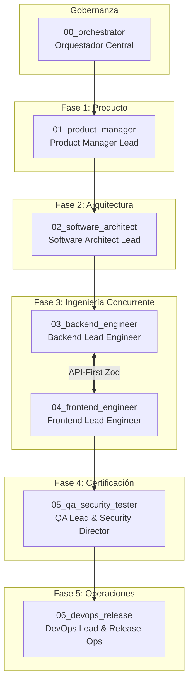

# 🤖 Multi-Agent SDLC Starter Kit

[](LICENSE)
[](tooling/)
[](.workflow/)
[](AGENTS.md)

> **Plantilla rectora universal para desarrollo de software de misión crítica guiado por Inteligencias Artificiales concurrentes y especializadas, artefactos inmutables en disco y compuertas de calidad HITL (Human In The Loop).**

---

## 🌟 ¿Qué es y por qué cambia las reglas del juego?

El desarrollo de software asistido por IAs suele fracasar cuando se utiliza un único modelo en modo "generalista" que intenta escribir código a partir de instrucciones dispersas en el chat:
1. **Pérdida de Contexto:** La memoria conversacional es volátil y se degrada rápidamente.
2. **Desacoples Silenciosos:** El frontend inventa campos que el backend no retorna; el backend usa tipos arbitrarios.
3. **Deuda Técnica y `any` descontrolado:** Los modelos colocan `any` para silenciar errores del compilador.
4. **Alucinaciones Funcionales:** Agentes que inventan requisitos o alteran reglas de negocio.

**Este Starter Kit erradica esos problemas** convirtiendo tu repositorio en una **fábrica de software concurrente**, donde cada rol líder y sus subroles operan bajo **Compuertas de Calidad ("Stage-Gates")**, validación estricta por AST (Cero `any`) y contratos Zod API-First compartidos.

```mermaid
flowchart LR
    G0["🚦 Gate 0<br/>Gobernanza"] --> G1["📋 Gate 1<br/>PRD & Requisitos"]
    G1 --> G2["🏛️ Gate 2<br/>DDL & Zod Contracts"]
    G2 --> G3A["⚙️ Gate 3A<br/>Backend API"]
    G3A --> G3B["🎨 Gate 3B<br/>Frontend SPA"]
    G3B --> G4["🧪 Gate 4<br/>QA Forense (4 Pilares)"]
    G4 --> G5["🚀 Gate 5<br/>Release & Despliegue"]

    style G0 fill:#0f172a,stroke:#94a3b8,color:#ffffff
    style G1 fill:#003366,stroke:#38bdf8,color:#ffffff
    style G2 fill:#003366,stroke:#34d399,color:#ffffff
    style G3A fill:#003366,stroke:#fbbf24,color:#ffffff
    style G3B fill:#003366,stroke:#f87171,color:#ffffff
    style G4 fill:#003366,stroke:#a78bfa,color:#ffffff
    style G5 fill:#003366,stroke:#34d399,color:#ffffff
```



---

## 🚀 Inicio Rápido en 3 Pasos

### Paso 1: Clonar o Usar como Plantilla
Haz clic en **"Use this template"** en GitHub o clona este repositorio:
```bash
git clone https://github.com/DanExl24/multiagent-sdlc-starter.git mi-proyecto
cd mi-proyecto
npm install
```

### Paso 2: Ejecutar el Asistente Interactivo de Inicialización
Personaliza automáticamente todos los documentos de gobernanza, nombres de proyecto y dominio:
```bash
npm run init:project
```
El asistente te preguntará:
- Nombre del proyecto (ej. `FintechPay`, `HealthOps`, `StoreFlow`)
- Dominio del negocio (ej. `Banca Digital`, `Salud y Clínicas`, `Logística`)
- Autor u Organización
- Stacks de Backend y Frontend

### Paso 3: Aterrizar tu Agente de IA
Abre el proyecto en tu entorno de IA favorito (**Antigravity IDE**, **Cursor**, **Claude**, **ChatGPT**, **Windsurf**, etc.) y copia el siguiente prompt de aterrizaje:

```text
🤖 He abierto este repositorio. Por favor lee AGENTS.md y .workflow/current_state.json para conocer la metodología y tu rol activo. Confírmame qué rol asumes y cuál es la siguiente tarea según el Stage-Gate activo.
```
*(También disponible en [`LANDING_PROMPT.md`](file:///LANDING_PROMPT.md))*

---

## 👥 Arquitectura de Roles y Subroles Especializados



| Rol | Directorio | Misión Principal | Subroles Incluidos |
| :--- | :--- | :--- | :--- |
| **00_orchestrator** | [`multiAgents/00_orchestrator/`](file:///multiAgents/00_orchestrator/) | Gobernanza del semáforo y control de compuertas | Máquina de estados, halts HITL obligatorios |
| **01_product_manager** | [`multiAgents/01_product_manager/`](file:///multiAgents/01_product_manager/) | Descubrimiento funcional y blindaje normativo | Discovery (/grill-me), Legal/Compliance, BDD Gherkin, UAT |
| **02_software_architect** | [`multiAgents/02_software_architect/`](file:///multiAgents/02_software_architect/) | Topología C4, modelo de datos y contratos Zod | C4 Modeler, DDL Modeler, Zod Protocol Designer, Security Multi-tenant |
| **03_backend_engineer** | [`multiAgents/03_backend_engineer/`](file:///multiAgents/03_backend_engineer/) | API REST, transacciones y lógica de dominio | API Gateway, Domain Rules, DB Optimizer, TDD Tester |
| **04_frontend_engineer** | [`multiAgents/04_frontend_engineer/`](file:///multiAgents/04_frontend_engineer/) | SPA Reactiva, Design System y DataViz | Design System Core, State Zustand, Views/UX, DataViz |
| **05_qa_security_tester** | [`multiAgents/05_qa_security_tester/`](file:///multiAgents/05_qa_security_tester/) | Auditoría forense con poder de veto (Stop-the-Line) | SDET Contratos, E2E & A11y axe-core, Performance k6 |
| **06_devops_release** | [`multiAgents/06_devops_release/`](file:///multiAgents/06_devops_release/) | Contenedores, seeders idempotentes y CI/CD | Docker Ops, Seeders Lifecycle, CI/CD Automator, Observability |

---

## 🛡️ Las 11 Reglas de Oro Innegociables

1. **Regla de Oro #1 — Cero Código Sin Contrato Previo:** Ningún endpoint o pantalla se construye sin un contrato Zod aprobado en `docs/contracts/*.contract.ts`.
2. **Regla de Oro #2 — Alto Obligatorio HITL:** El agente no puede auto-aprobarse compuertas; debe detenerse mecánicamente (**Yield/Halt**) y solicitar la venia del Director Humano.
3. **Regla de Oro #3 — Respeto Estricto de Reglas de Negocio:** Las entidades en estados cerrados o inmutables devuelven rechazos HTTP semánticos (409 Conflict / 403 Forbidden).
4. **Regla de Oro #4 — Mandato Zero ANY Innegociable:** Prohibido el uso de `any` en TypeScript. Se audita mecánicamente con AST parsers (`npm run check:no-any`).
5. **Regla de Oro #5 — Prohibición Absoluta de Mocks Ficticios:** Todo dato en pantalla proviene de endpoints reales con contratos tipados.
6. **Regla de Oro #6 — Poder de Veto de QA (Stop-the-Line):** Si una prueba de integración, E2E o auditoría de tipos falla, el pase a producción queda revocado.
7. **Regla de Oro #7 — Envelope Canónico de Respuestas:** Todas las respuestas de la API siguen la estructura unificada `{ success: true, data: T }` o `{ success: false, error: ... }`.
8. **Regla de Oro #8 — Aislamiento Multi-Tenant Anti-IDOR:** El identificador del tenant se extrae exclusivamente del JWT autenticado, jamás de parámetros de entrada no confiables.
9. **Regla de Oro #9 — Sistema de Diseño Consistente:** Prohibidos colores hexadecimales hardcodeados; uso estricto de tokens semánticos accesibles (WCAG 2.1 AA).
10. **Regla de Oro #10 — Convención Semántica de Commits:** Commits formateados bajo el estándar `tipo(scope): descripcion` (sin prefijo de versión). `feat` exige citar una HU satisfecha end-to-end.
11. **Regla de Oro #11 — Inmutabilidad de Artefactos de Memoria:** El estado del proyecto reside en `current_state.json` y los manuales en disco, no en la ventana de chat efímera.

---

## 🗂️ Estructura del Repositorio

```text
/ (Raíz del Proyecto)
├── AGENTS.md                            # 📍 Manual Rector Multiagente (Lectura obligatoria)
├── LANDING_PROMPT.md                    # 🚀 Prompt canónico para alimentar a la IA
├── README.md                            # 📖 Este documento de bienvenida y guía rápida
├── CHANGELOG.md                         # 📝 Historial bajo Keep a Changelog y SemVer
├── package.json                         # ⚙️ Scripts de gobernanza (init:project, check:no-any)
│
├── .workflow/                           # 🚦 Máquina de Estados y Gobernanza HITL
│   ├── STAGE_GATES.md                   # Protocolo formal de compuertas 0 a 5
│   └── current_state.json               # Estado activo en tiempo real
│
├── tooling/                             # 🛠️ Herramientas de Auditoría y Automatización
│   ├── init-project.mjs                 # Asistente interactivo de personalización
│   ├── check-no-any-backend.ts          # Comprobador AST para Backend TypeScript
│   ├── check-no-any-frontend.mjs        # Comprobador AST para Frontend TypeScript & Vue
│   ├── audit-security-runtime.mjs       # Escáner DAST en runtime (Headers, Cookies, CORS, 500s)
│   ├── run-load-test.mjs                # Orquestador k6 con reportes HTML visuales y JSON
│   ├── audit-a11y.mjs                   # Auditor automatizado de accesibilidad WCAG 2.1 AA
│   └── validate-contracts.mjs           # Validador canónico de contratos DTO Zod
│
├── multiAgents/                         # 🧠 Roles Líderes y Protocolos de Trabajo
│   ├── 00_orchestrator/                 # PROJECT_STATUS.md y semáforo global
│   ├── 01_product_manager/              # ROLE.md y subroles de Producto
│   ├── 02_software_architect/           # ROLE.md y subroles de Arquitectura
│   ├── 03_backend_engineer/             # ROLE.md y subroles de Backend
│   ├── 04_frontend_engineer/            # ROLE.md y subroles de Frontend
│   ├── 05_qa_security_tester/           # ROLE.md y arsenal de los 4 pilares
│   ├── 06_devops_release/               # ROLE.md y subroles de Operaciones
│   └── protocols/                       # Handshakes, Tech Trio, Git Commit y Templates
│
├── docs/                                # 📚 Artefactos de Ingeniería (Fuente de la Verdad)
│   ├── 01_prd.md                        # Documento Rector de Requerimientos
│   ├── 02_architecture.md               # Topología técnica y Modelo C4
│   ├── 03_qa_report.md                  # Certificación ejecutiva de calidad
│   ├── 04_ui_design_system.md           # Tokens semánticos y componentes UI
│   ├── VERSION_MATRIX.md                # Trazabilidad de versiones y módulos
│   ├── contracts/                       # Contratos API-First Zod (.contract.ts)
│   ├── adrs/                            # Architectural Decision Records
│   ├── modules/                         # Especificaciones por módulo (01_ a XX_)
│   └── qa/                              # Reportes forenses, DAST, k6 HTML/JSON y A11y
│
└── walkthroughs/                        # 🚶 Guías de Verificación Reproducibles
    └── 00_starter/v1.0.0/               # WALKTHROUGH.md inicial
```

---

## 🛠️ Suite Automatizada de Calidad y Testing (Comandos npm)

El starter incluye herramientas ejecutables de calidad que tanto los agentes de IA como los ingenieros humanos deben disparar para certificar entregables:

```bash
# 1. Auditoría AST de Tipos (Zero ANY):
npm run check:no-any

# 2. Validación de Contratos DTO Zod (Request, Response Envelopes):
npm run test:contracts

# 3. Auditoría de Seguridad Dinámica (DAST en Runtime):
npm run audit:dast -- http://localhost:3000
# Genera: docs/qa/dast-audit-summary.json

# 4. Pruebas de Carga y Concurrencia (k6 con Reporte Visual y JSON):
npm run test:load -- http://localhost:3000
# Genera: docs/qa/load-report.html y docs/qa/load-summary.json

# 5. Escáner Automatizado de Accesibilidad (WCAG 2.1 AA):
npm run audit:a11y
# Genera: docs/qa/a11y-audit-summary.json

# 6. Compuerta Rápida Combinada (Pre-Commit / CI Gate):
npm test
```

---

## 📄 Licencia

Distribuido bajo la licencia [MIT](LICENSE). Libre para uso personal, comercial o institucional.
