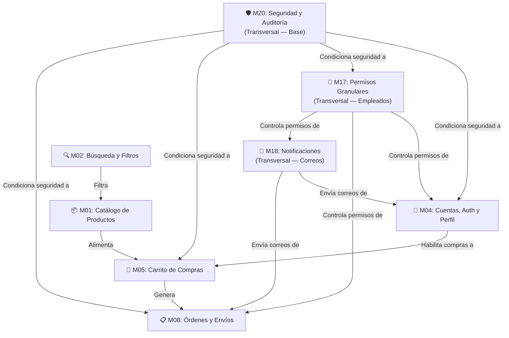

# 📋 Documento Rector de Requerimientos de Producto (PRD)

> **Proyecto:** Pintu Clic
> **Dominio:** pintuclic.com
> **Versión:** 1.0.0
> **Autor Líder:** Product Manager Lead (Fase 1)
> **Estado:** FUENTES DE VERDAD EXISTENTES — Formalización ATDD/BDD pendiente por módulo
> **Fecha de Emisión:** 2026-10-20

---

> ⚠️ **INSTRUCCIÓN PARA EL AGENTE PRODUCT MANAGER:**
> Este proyecto ya posee especificaciones funcionales completas en `../docs/02_MODULOS_FUNCIONALES/`
> y políticas de negocio en `../docs/01_TRANSVERSALES/`.
>
> Tu tarea en Gate 1 NO es redactar specs desde cero.
> Tu tarea es **formalizar** cada spec existente en el formato INVEST + BDD Gherkin del SDLC,
> generando los artefactos `01_SPEC_FUNCIONAL.md`, `02_HISTORIAS_USUARIO.md` y `03_FLUJO_Y_ESTADOS.md`
> en `docs/modules/[MXX]/` a partir de las fuentes de verdad listadas abajo.

---

## 1. Visión y Resumen Ejecutivo

- **Problema de Negocio:**
  El mercado de pinturas y revestimientos carece de una plataforma digital especializada que sirva simultáneamente a consumidores particulares (B2C) y empresas (B2B) con condiciones comerciales diferenciadas, control de inventario en tiempo real y gestión interna de empleados con permisos granulares.

- **Solución Propuesta:**
  Pintu Clic es una plataforma de e-commerce especializada que ofrece catálogo de productos con atributos técnicos de pintura (base, rendimiento, acabado), carrito y checkout, gestión de órdenes, panel de administración con permisos atómicos por empleado, y procesos B2B de aprobación de clientes empresariales.

- **Objetivos SMART del Sistema:**
  1. Reducir la fricción en la compra de pinturas ofreciendo entonado digital y filtros técnicos especializados.
  2. Garantizar 100% de trazabilidad forense en operaciones administrativas críticas (M20).
  3. Asegurar latencia p95 menor a 200ms en endpoints transaccionales de catálogo y carrito.
  4. Cero exposición cruzada de datos entre clientes B2C y B2B (Anti-IDOR estricto).

---

## 2. Marco Regulatorio y Reglas Inmutables de Dominio

| Regla | Descripción | Fuente de Verdad |
| :--- | :--- | :--- |
| **Control de Acceso por Servidor** | Ningún endpoint asume permisos. Auth y authz se verifican en backend ante cada petición. | [`../docs/01_TRANSVERSALES/POLITICAS/politica_HU-ADM-03_control_acceso_servidor.md`](../docs/01_TRANSVERSALES/POLITICAS/politica_HU-ADM-03_control_acceso_servidor.md) |
| **Unicidad de Cuentas** | Una persona o empresa no puede tener múltiples cuentas activas con el mismo identificador. | [`../docs/01_TRANSVERSALES/POLITICAS/politica_HU-CUE-08_unicidad_cuentas.md`](../docs/01_TRANSVERSALES/POLITICAS/politica_HU-CUE-08_unicidad_cuentas.md) |
| **No exposición de datos sensibles** | Contraseñas, tokens y datos PII nunca se retornan en respuestas API. | [`../docs/01_TRANSVERSALES/POLITICAS/politica_HU-SEG-06_no_exposicion_datos_sensibles.md`](../docs/01_TRANSVERSALES/POLITICAS/politica_HU-SEG-06_no_exposicion_datos_sensibles.md) |
| **Permisos Granulares (no roles rígidos)** | Empleados tienen permisos atómicos individuales, no roles preestablecidos. | [`../docs/01_TRANSVERSALES/M17_PERMISOS_Y_ROLES.md`](../docs/01_TRANSVERSALES/M17_PERMISOS_Y_ROLES.md) |
| **Notificaciones desacopladas** | Ningún módulo envía emails directamente; emiten eventos que M18 procesa asincrónicamente. | [`../docs/01_TRANSVERSALES/M18_NOTIFICACIONES.md`](../docs/01_TRANSVERSALES/M18_NOTIFICACIONES.md) |
| **Trazabilidad e inmutabilidad** | Toda acción administrativa se registra en bitácora con fecha, actor, IP y valor modificado. | [`../docs/01_TRANSVERSALES/M20_SEGURIDAD_Y_AUDITORIA.md`](../docs/01_TRANSVERSALES/M20_SEGURIDAD_Y_AUDITORIA.md) |

---

## 3. Matriz de Actores y Perfiles de Acceso (RBAC de Pintu Clic)

| Actor | Alcance de Permisos | Propósito Operativo |
| :--- | :--- | :--- |
| **Visitante (Anónimo)** | Solo lectura de catálogo público | Exploración, inicio de registro/login |
| **Cliente B2C** | Compras, carrito, órdenes, perfil personal | Comercio electrónico para particulares |
| **Cliente B2B** | Precios mayoristas, condiciones comerciales especiales | Comercio para empresas (requiere aprobación de NIT/RUT) |
| **Empleado** | Permisos atómicos individuales asignados por Administrador | Operación interna según permisos específicos |
| **Administrador** | Acceso global al sistema | Configuración y gobernanza total |
| **Sistema (Automático)** | Triggers de auditoría y envío de correos | Procesos en background no interactivos |

---

## 4. Desglose de Módulos del Sistema (Pintu Clic)

> Especificaciones funcionales completas de cada módulo en:
> `../docs/02_MODULOS_FUNCIONALES/` y `../docs/01_TRANSVERSALES/`
> Ver mapa completo en [`PINTUCLIC_CONTEXT.md`](../PINTUCLIC_CONTEXT.md) §3.1

---

## 5. Fuentes de Verdad por Módulo (Insumos para Gate 1)

| Módulo | Spec Funcional (Fuente de Verdad) | Diagramas |
| :--- | :--- | :--- |
| **M01 Catálogo** | [`../docs/02_MODULOS_FUNCIONALES/M01_ESPECIFICACION_CATALOGO.md`](../docs/02_MODULOS_FUNCIONALES/M01_ESPECIFICACION_CATALOGO.md) | `../docs/assets/diagrams/M01/` |
| **M02 Búsqueda** | [`../docs/02_MODULOS_FUNCIONALES/M02_ESPECIFICACION_BUSQUEDA.md`](../docs/02_MODULOS_FUNCIONALES/M02_ESPECIFICACION_BUSQUEDA.md) | `../docs/assets/diagrams/M02/` |
| **M04 Cuentas** | [`../docs/02_MODULOS_FUNCIONALES/M04_CUENTAS_AUTH_PERFIL.md`](../docs/02_MODULOS_FUNCIONALES/M04_CUENTAS_AUTH_PERFIL.md) | `../docs/assets/diagrams/M04/` |
| **M05 Carrito** | [`../docs/02_MODULOS_FUNCIONALES/M05_ESPECIFICACION_CARRITO.md`](../docs/02_MODULOS_FUNCIONALES/M05_ESPECIFICACION_CARRITO.md) | `../docs/assets/diagrams/M05-M08/` |
| **M08 Órdenes** | [`../docs/02_MODULOS_FUNCIONALES/M08_ESPECIFICACION_ORDEN.md`](../docs/02_MODULOS_FUNCIONALES/M08_ESPECIFICACION_ORDEN.md) | `../docs/assets/diagrams/M08/` |
| **M17 Permisos** | [`../docs/01_TRANSVERSALES/M17_PERMISOS_Y_ROLES.md`](../docs/01_TRANSVERSALES/M17_PERMISOS_Y_ROLES.md) | `../docs/assets/diagrams/M17/` |
| **M18 Notificaciones** | [`../docs/01_TRANSVERSALES/M18_NOTIFICACIONES.md`](../docs/01_TRANSVERSALES/M18_NOTIFICACIONES.md) | `../docs/assets/diagrams/M18/` |
| **M20 Seguridad** | [`../docs/01_TRANSVERSALES/M20_SEGURIDAD_Y_AUDITORIA.md`](../docs/01_TRANSVERSALES/M20_SEGURIDAD_Y_AUDITORIA.md) | `../docs/assets/diagrams/M20/` |

---

## 6. Requisitos No Funcionales (NFRs)

1. **Calidad de Tipado Estricto (Mandato Zero ANY):** Cero uso de `any` en TypeScript backend y frontend verificado mecánicamente por AST Parser (`npm run check:no-any`).
2. **Arquitectura API-First:** Todos los endpoints deben tener un contrato Zod validado en `docs/contracts/` antes de escribir código.
3. **Resiliencia y Rendimiento:** Transacciones ACID vía Prisma y paginación en consultas masivas de catálogo.
4. **Diseño Visual Institucional:** Sistema de diseño en `../frontend/src/core/theme/`, modo claro accesible (WCAG 2.1 AA).
5. **Seguridad Multi-Capa:** JWT para sesiones, permisos atómicos granulares, auditoría inmutable (M20).
