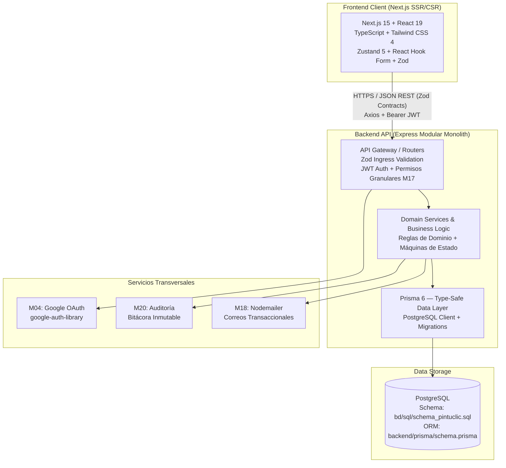

# 🏛️ Documento Rector de Arquitectura Técnica y Modelo C4

> **Proyecto:** Pintu Clic
> **Dominio:** pintuclic.com
> **Versión:** 1.0.0
> **Autor Líder:** Software Architect Lead (Fase 2)
> **Estado:** FUENTES DE VERDAD EXISTENTES — Contratos Zod API-First pendientes por módulo
> **Fecha:** 2026-10-20

---

> ⚠️ **INSTRUCCIÓN PARA EL AGENTE SOFTWARE ARCHITECT:**
> La arquitectura general y el schema de BD ya existen. Tu tarea en Gate 2 es:
> 1. Leer los documentos de arquitectura existentes (fuentes de verdad abajo).
> 2. Generar los **contratos Zod API-First** en `docs/contracts/[MXX].contract.ts` para cada módulo.
> 3. Documentar las ADRs de decisiones técnicas en `docs/adrs/`.
> **NO rediseñar la arquitectura.** Si detectas mejoras necesarias, abre un RFC formal.

---

## 1. Fuentes de Verdad de Arquitectura (pintuclic.com)

| Artefacto | Ubicación | Descripción |
| :--- | :--- | :--- |
| **Arquitectura General** | [`../docs/00_SISTEMA/01_ARQUITECTURA/ARQUITECTURA_GENERAL.md`](../docs/00_SISTEMA/01_ARQUITECTURA/ARQUITECTURA_GENERAL.md) | Visión del sistema, dominios, actores, principios clave |
| **Arquitectura Backend** | [`../docs/00_SISTEMA/01_ARQUITECTURA/ARQUITECTURA_BACKEND.md`](../docs/00_SISTEMA/01_ARQUITECTURA/ARQUITECTURA_BACKEND.md) | Estructura modular del backend, patrones, capas |
| **Matriz de Trazabilidad** | [`../docs/00_SISTEMA/01_ARQUITECTURA/MATRIZ_TRAZABILIDAD.md`](../docs/00_SISTEMA/01_ARQUITECTURA/MATRIZ_TRAZABILIDAD.md) | Trazabilidad entre módulos, specs y código |
| **Schema DDL** | [`../bd/sql/schema_pintuclic.sql`](../bd/sql/schema_pintuclic.sql) | DDL completo de la base de datos PostgreSQL |
| **Documentación BD** | [`../bd/docs/DOCUMENTACION_BASE_DATOS.md`](../bd/docs/DOCUMENTACION_BASE_DATOS.md) | Documentación detallada de tablas y relaciones |
| **Diagrama ER** | [`../bd/assets/ER Pintuclic-Final 1.2.drawio.png`](../bd/assets/ER Pintuclic-Final 1.2.drawio.png) | Diagrama entidad-relación final |
| **Prisma Schema** | [`../backend/prisma/schema.prisma`](../backend/prisma/schema.prisma) | Schema ORM (fuente de verdad para el Data Layer) |
| **Guía de BD** | [`../bd/docs/GUIA_REFACTORIZACION_BD.md`](../bd/docs/GUIA_REFACTORIZACION_BD.md) | Guía para refactorizar la BD |

---

## 2. Topología del Sistema (Stack Confirmado)

El sistema se estructura como un **Monolito Modular Moderno con desacople API-First** y tipado estricto bidireccional mediante contratos Zod.



---

## 3. Stack Técnico Definitivo (NO negociable)

| Capa | Tecnología | Versión |
| :--- | :--- | :--- |
| **Backend Framework** | Express | `^5.2.1` |
| **Backend Language** | TypeScript | `^5.9.3` |
| **ORM** | Prisma | `^6.0.0` |
| **Validación** | Zod | `^4.5.4` |
| **Auth** | jsonwebtoken + google-auth-library | — |
| **Email** | nodemailer | — |
| **Tests Backend** | Vitest | `^3.2.4` |
| **Frontend Framework** | Next.js | `^15.4.2` |
| **UI Library** | React | `^19.1.0` |
| **Estilos** | Tailwind CSS | `^4.1.11` |
| **Estado Global** | Zustand | `^5.0.6` |
| **Formularios** | React Hook Form + @hookform/resolvers | `^7.x` |
| **HTTP Client** | Axios | `^1.10.0` |
| **Tests Frontend** | Vitest + @vitejs/plugin-react | `^3.2.4` |
| **Base de Datos** | PostgreSQL | — |

---

## 4. Estructura Modular del Backend (Patrón Establecido)

Cada módulo en `../backend/src/modules/[mXX-nombre]/` sigue el patrón:

```
mXX-nombre/
├── __tests__/          # Vitest: tests de integración del módulo
├── controllers/        # Controladores HTTP (enrutamiento + validación Zod)
├── dtos/               # Data Transfer Objects tipados
├── interfaces/         # Interfaces y tipos del dominio
├── repositories/       # Capa de datos (Prisma queries — cero SQL crudo)
└── services/           # Lógica de negocio y reglas del dominio
```

> Guía de incorporación de nuevos módulos:
> [`../docs/00_SISTEMA/02_GUIAS_Y_ESTANDARES/ESTANDAR_Y_GUIA_INCORPORACION.md`](../docs/00_SISTEMA/02_GUIAS_Y_ESTANDARES/ESTANDAR_Y_GUIA_INCORPORACION.md)

---

## 5. Principios Arquitecturales Clave

1. **Regla de Oro #1 — Cero Código Sin Contrato Previo:** Ningún endpoint se implementa sin un contrato formal en `docs/contracts/[MXX].contract.ts`.
2. **Regla de Oro — Zero ANY:** Prohibido taxativamente el uso de `any` en cualquier `.ts` o `.tsx`.
3. **Envelope Canónico de Respuesta:**
   ```typescript
   // Respuesta Exitosa
   { success: true, data: T, message?: string }
   // Respuesta de Error
   { success: false, error: { code: string, message: string, details?: unknown } }
   ```
4. **Permisos Atómicos (no roles rígidos):** Validar `hasPermission('PERMISO_ESPECIFICO')`, nunca `user.role == 'admin'`.
5. **Cero SQL Crudo:** Toda consulta usa Prisma Client. Prohibidas las cadenas SQL concatenadas.
6. **Notificaciones Desacopladas:** Los módulos emiten eventos; M18 gestiona el SMTP vía nodemailer.
7. **Auditoría Inmutable:** M20 registra toda acción sensible con actor, IP, timestamp y delta de valores.

---

## 6. Estrategia de Contratos Zod API-First (Pendiente — Gate 2)

Los contratos Zod deben generarse en `docs/contracts/` con el formato `[MXX]_[nombre].contract.ts`:

```typescript
// Ejemplo: docs/contracts/M04_cuentas.contract.ts
import { z } from 'zod/v4';

export const RegisterRequestSchema = z.object({
  email: z.email(),
  password: z.string().min(8),
  nombre: z.string().min(2),
  tipo: z.enum(['B2C', 'B2B']),
});

export const LoginResponseSchema = z.object({
  success: z.literal(true),
  data: z.object({
    token: z.string(),
    usuario: z.object({ id: z.string().uuid(), email: z.string(), nombre: z.string() }),
  }),
});

export type RegisterRequest = z.infer<typeof RegisterRequestSchema>;
export type LoginResponse = z.infer<typeof LoginResponseSchema>;
```

> El Backend usa estos schemas para validar en runtime (Zod middleware).
> El Frontend los importa para tipar en compile-time (DTOs).
> **Un solo contrato. Dos consumidores. Cero desacople.**

---

## 7. Módulos a Contractualizar (Prioridad para Gate 2)

| Módulo | Contrato a generar | Insumo principal |
| :--- | :--- | :--- |
| M04 | `docs/contracts/M04_cuentas.contract.ts` | `../docs/02_MODULOS_FUNCIONALES/M04_CUENTAS_AUTH_PERFIL.md` |
| M01 | `docs/contracts/M01_catalogo.contract.ts` | `../docs/02_MODULOS_FUNCIONALES/M01_ESPECIFICACION_CATALOGO.md` |
| M02 | `docs/contracts/M02_busqueda.contract.ts` | `../docs/02_MODULOS_FUNCIONALES/M02_ESPECIFICACION_BUSQUEDA.md` |
| M05 | `docs/contracts/M05_carrito.contract.ts` | `../docs/02_MODULOS_FUNCIONALES/M05_ESPECIFICACION_CARRITO.md` |
| M08 | `docs/contracts/M08_ordenes.contract.ts` | `../docs/02_MODULOS_FUNCIONALES/M08_ESPECIFICACION_ORDEN.md` |
| M17 | `docs/contracts/M17_permisos.contract.ts` | `../docs/01_TRANSVERSALES/M17_PERMISOS_Y_ROLES.md` |
| M18 | `docs/contracts/M18_notificaciones.contract.ts` | `../docs/01_TRANSVERSALES/M18_NOTIFICACIONES.md` |
| M20 | `docs/contracts/M20_seguridad.contract.ts` | `../docs/01_TRANSVERSALES/M20_SEGURIDAD_Y_AUDITORIA.md` |
