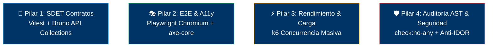

# 📊 Panel Maestro Consolidado de Calidad y Certificación (QA Report)

> **Proyecto:** Pintu Clic (`pintuclic.com`)  
> **Versión Activa:** `v0.1.8`  
> **Responsable:** QA Lead & Security Compliance Director (Fase 4)  
> **Estado de Certificación:** SIN CERTIFICAR — ningún módulo ha alcanzado Gate 4  
> **Última Auditoría:** (ninguna)  

---

## 1. Resumen Ejecutivo de Salud y Calidad

> ⚠️ **Ninguna dimensión está certificada todavía.** El proyecto está en Gate 0 y no existe
> implementación que auditar: `backend/src/` no existe y `frontend/src/` solo contiene el
> esqueleto de `core/`. Las filas se completan cuando el primer módulo alcance **Gate 4**, y
> solo el QA Lead puede firmarlas, con evidencia reproducible adjunta (Regla de Oro #8 —
> Transparencia Radical: prohibido maquillar u ocultar defectos).

| Dimensión de Calidad | Métrica / Estado | Criterio de Aceptación | Dictamen |
| :--- | :---: | :---: | :---: |
| **Auditoría AST (Zero ANY)** | Sin código que auditar | Cero `any` tolerado en Backend y Frontend | ⚪ NO EJECUTADO |
| **Suites de Integración (Backend)** | Sin suites | 0 fallos en endpoints transaccionales | ⚪ NO EJECUTADO |
| **Suites E2E en Navegador Real** | Sin suites | Flujos críticos validados en Chromium | ⚪ NO EJECUTADO |
| **Accesibilidad Web (a11y)** | Sin vistas | Cumplimiento WCAG 2.1 Nivel AA | ⚪ NO EJECUTADO |
| **Validación Perimetral Zod** | Sin endpoints | Rechazo estricto de payloads no autorizados | ⚪ NO EJECUTADO |
| **Aislamiento Multi-Tenant (Anti-IDOR)** | Sin endpoints | Imposibilidad de cruce de tenants | ⚪ NO EJECUTADO |

---

## 2. El Arsenal de los 4 Pilares de QA

---

## 3. Matriz de Reportes Modulares Forenses
Cada módulo auditado genera su reporte forense independiente en:
`docs/qa/[XX_modulo]/[vX.Y.Z]/QA_REPORT.md`

| Módulo | Versión | Tests Ejecutados | Violaciones A11y | Cero ANY | Dictamen Final |
| :--- | :---: | :---: | :---: | :---: | :---: |
| *(ninguno auditado todavía)* | — | — | — | — | ⚪ PENDIENTE |
