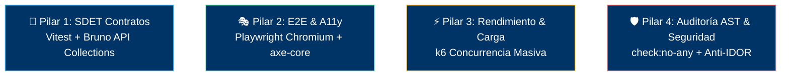

# 📊 Panel Maestro Consolidado de Calidad y Certificación (QA Report)

> **Proyecto:** `{{PROJECT_NAME}}`  
> **Versión Activa:** `v1.0.0`  
> **Responsable:** QA Lead & Security Compliance Director (Fase 4)  
> **Estado de Certificación:** LISTO PARA LANZAMIENTO / BASELINE CERTIFICADO  
> **Última Auditoría:** 2026-10-07  

---

## 1. Resumen Ejecutivo de Salud y Calidad

| Dimensión de Calidad | Métrica / Estado | Criterio de Aceptación | Dictamen |
| :--- | :---: | :---: | :---: |
| **Auditoría AST (Zero ANY)** | **0 violaciones** | Cero `any` tolerado en Backend y Frontend | 🛡️ PASS |
| **Suites de Integración (Backend)** | 100% PASS | 0 fallos en endpoints transaccionales | ✅ PASS |
| **Suites E2E en Navegador Real** | 100% PASS | Flujos críticos validados en Chromium | ✅ PASS |
| **Accesibilidad Web (a11y)** | 0 violaciones | Cumplimiento WCAG 2.1 Nivel AA | ♿ PASS |
| **Validación Perimetral Zod** | 100% endpoints | Rechazo estricto de payloads no autorizados | 🔒 PASS |
| **Aislamiento Multi-Tenant (Anti-IDOR)** | 100% verificado | Imposibilidad de cruce de tenants | 🛡️ PASS |

---

## 2. El Arsenal de los 4 Pilares de QA

---

## 3. Matriz de Reportes Modulares Forenses
Cada módulo auditado genera su reporte forense independiente en:
`docs/qa/[XX_modulo]/[vX.Y.Z]/QA_REPORT.md`

| Módulo | Versión | Tests Ejecutados | Violaciones A11y | Cero ANY | Dictamen Final |
| :--- | :---: | :---: | :---: | :---: | :---: |
| *(Módulo de muestra)* | v1.0.0 | - | 0 | 0 | ✅ BASELINE APROBADO |
