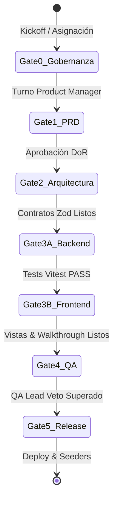

# 🗺️ Matriz Bidireccional de Versiones y Trazabilidad del Ciclo de Vida

> **Proyecto:** Pintu Clic (`pintuclic.com`)  
> **Estándar Semántico:** SemVer 2.0.0 (`MAJOR.MINOR.PATCH`)  
> **Convención Git:** `tipo(scope): descripcion` (commit, sin versión) · `tipo(scope) [X.Y.Z.W]: mensaje` (título de PR)  
> **Última Actualización:** 2026-10-07  

---

## 1. Estado Consolidado de Módulos y Versiones

| Módulo ID | Nombre del Módulo | Versión Activa | Stage-Gate Actual | Estado de QA | Walkthrough Asociado |
| :---: | :--- | :---: | :---: | :---: | :--- |
| `01_auth` | Autenticación y Sesiones | `v0.1.0` | **Gate 0 (Gobernanza)** | ⏳ PENDIENTE | `walkthroughs/01_auth/v0.1.0/` |

---

## 2. Definición del Ciclo de Vida por Módulo

---

## 3. Registro Histórico de Entregas por Versión
- **v1.0.0** (2026-10-07): Lanzamiento inicial de la plantilla rectora universal de desarrollo multiagente.
