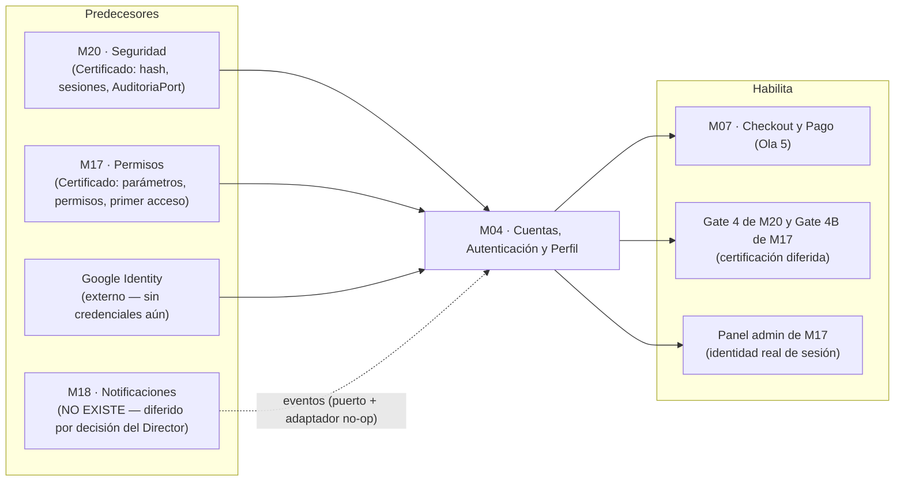

# 📄 01_SPEC_FUNCIONAL — M04. Cuentas, Autenticación y Perfil

> **Módulo:** `M04` · **Scope:** `m04-cuentas` · **Ola:** 3 (Clientes, Búsqueda y Notificaciones)
> **Dominio:** Identidad del cliente (particular y empresa) / Acceso / Perfil / Direcciones / Aprobación B2B
> **Responsable:** Product Manager Lead (Fase 1)
> **Estado:** ✅ **GATE 1 FIRMADO por el Director Humano el 2026-10-21**, con la mesa ATDD pendiente de los dictámenes del Arquitecto y del QA
> **Fuente de verdad funcional:** [`M04_CUENTAS_AUTH_PERFIL.md`](../../../../docs/02_MODULOS_FUNCIONALES/M04_CUENTAS_AUTH_PERFIL.md) y [`politica_HU-CUE-08_unicidad_cuentas.md`](../../../../docs/01_TRANSVERSALES/POLITICAS/politica_HU-CUE-08_unicidad_cuentas.md)
> **Diagramas contractuales:** [`docs/assets/diagrams/M04/`](../../../../docs/assets/diagrams/M04/) (5 diagramas inspeccionados)
> **Perfil de Compuerta Declarado:** **Perfil A (Vertical)** según `STAGE_GATES.md` §1.3.

---

## 0. Autorización de salto de ola (trazabilidad)

La Ruta del Proyecto ubica a M04 en la **Ola 3** y lo hace depender de **M18**, que no existe; la Ola 2
(M13, M01, M16) tampoco está construida. El **Director Humano autorizó explícitamente el 2026-10-21**
construir M04 antes que M18 y antes de cerrar la Ola 2, e incorporar M18 **después** de M04.

- **Efecto sobre este módulo:** el envío de correos (códigos de verificación, enlaces de recuperación,
  avisos de decisión) se especifica contra un **puerto de notificación** con adaptador de desarrollo.
  Se sigue el precedente de M20 con `AuditoriaPort`: cuando aterrice M18 solo se sustituye el adaptador.
- **Lo que NO cambia:** la dependencia sigue en el grafo. La autorización la registra como salto
  consciente, no la borra. Queda en `current_state.json → bloqueos[]` como `SALTO_DE_OLA_AUTORIZADO`.
- **Lo que no puede certificarse sin M18:** el despacho real de correo (ver `01_ATDD_SPEC.md` §4).

---

## 1. Visión y Propósito del Módulo

- **¿Qué es este módulo?**
  M04 constituye la **identidad del cliente** en Pintu Clic: permite que una persona o una empresa cree una
  cuenta, acceda a ella de forma segura y administre sus datos, diferenciando al cliente **particular** del
  cliente **empresa**, que queda sujeto a aprobación de un administrador antes de recibir condiciones
  comerciales de empresa.

- **¿Qué vacío del sistema llena?**
  M20 entregó las primitivas de sesión y de credenciales y M17 el panel administrativo, **pero ninguno puede
  ejercitarse de punta a punta porque no existe el login**. Sin M04:
  1. No hay forma de abrir una sesión real: el Gate 4 de M20 y el Gate 4B de M17 siguen diferidos.
  2. El panel administrativo de M17 muestra una identidad simulada ("Hola, Carlos").
  3. No existe cliente alguno que pueda comprar: M07 (Checkout) depende de M04.

- **Objetivos de Negocio:**
  1. **Identidad inequívoca:** un correo, una cuenta, sin importar si es de cliente, empleado o administrador.
  2. **Acceso seguro sin enumeración:** ni el login ni la recuperación revelan si un correo está registrado.
  3. **Autogestión del titular:** solo el titular rectifica sus datos personales (coherente con `RN-ADM-13` de M17
     y con Habeas Data); el personal interno nunca los edita.
  4. **B2B con control:** las cuentas empresa solo reciben condiciones comerciales tras una decisión trazable
     (quién, cuándo, motivo) de personal autorizado.
  5. **Desbloquear la cadena:** entregar la sesión real que habilita la certificación diferida de M20 y M17.

- **Medida de Éxito:**
  100 % de los 94 escenarios BDD ejecutables en verde, **cero** respuestas que distingan la existencia de una cuenta
  ante un tercero sin credencial, y una sesión real utilizable por el panel de M17.

---

## 2. Mapa Topológico de Dependencias

- **Dependencias Entrantes:**
  - **`M20` (Certificado):** `CredencialesService` (derivar y verificar BCrypt), `SesionService` (`crear`,
    `cerrarManualmente`, `invalidarTodas`), `authMiddleware`, envelope sin datos sensibles y `AuditoriaPort`.
  - **`M17` (Certificado):** catálogo de parámetros de autenticación (`HU-ADM-07`), control de permisos en
    servidor, y la marca de **primer acceso con cambio de clave** de los empleados (`CA-ADM-01-03`).
  - **`M18` (No existe):** despacho de correos transaccionales (`HU-NOT-01`). Ver §0.
  - **Google Identity (Externo):** requiere un cliente OAuth que hoy no existe; ver `01_ATDD_SPEC.md` §4.
- **Dependencias Salientes:**
  - **`M07`** (por la Ruta): identidad del comprador y tipo de cuenta.
  - **Certificación diferida:** el login real de M04 es la condición con la que `current_state.json` difirió el
    Gate 4 de M20 y el Gate 4B de M17.

---

## 3. Matriz de Actores

| Actor | Alcance en M04 | Mecanismo de Control |
| :--- | :--- | :--- |
| **Visitante** | Registrarse (formulario o Google), recuperar contraseña. | Rutas públicas; sin sesión. |
| **Cliente particular** | Perfil, direcciones, contraseña, correo, solicitud de ascenso a empresa. | Sesión de cliente; titularidad en servidor (`RN-CUE-10`). |
| **Cliente empresa (pendiente)** | Iniciar sesión, consultar el estado de su solicitud. **Sin** condiciones de empresa. | `RN-CUE-15`. |
| **Cliente empresa (aprobada)** | Perfil, direcciones, solicitud de renovación de NIT. **No** edita su NIT. | `RN-CUE-13`, `RN-CUE-19`. |
| **Empleado con permiso `empresas.validar`** | Listar y decidir solicitudes, consultar el RUT. | Permiso atómico comprobado en servidor (`RN-CUE-18`). |
| **Administrador** | Todo lo anterior sobre solicitudes. | Facultades implícitas de M17. |
| **Sistema (M18)** | Receptor de eventos de notificación. | Puerto desacoplado (`RN-CUE-24`). |

---

## 4. Reglas de Negocio Inmutables de M04 (`RN-CUE-01` … `RN-CUE-26`)

> Notación de parámetros `P1`…`P6`: ver §9. Códigos de error en el envelope canónico de M20 (`success:false`).

| ID | Enunciado invariante | Fundamento | Capa de control | Violación (HTTP · código) |
| :--- | :--- | :--- | :--- | :--- |
| **RN-CUE-01** *(Unicidad universal de correo)* | Un correo identifica **una sola cuenta en todo el sistema**; no puede pertenecer a la vez a un cliente y a un empleado o administrador. La comparación ignora mayúsculas y espacios en los extremos. | `RF-CUE-08-01/02`, política HU-CUE-08, `CA-CUE-01-04` | BD (unicidad) + Backend (consulta a los 3 tipos antes de aceptar) | 409 · `REGISTRO_CONFLICTO`, **mismo cuerpo** para cualquier tipo de cuenta en conflicto |
| **RN-CUE-02** *(Cuenta no verificada)* | Toda cuenta de cliente nace **no verificada** (`estado = pendiente`) y no abre sesión hasta confirmar su código. Una cuenta jamás verificada **no reserva el correo**: un nuevo registro con él reinicia el trámite (reemplaza datos y contraseña e invalida códigos previos). | `RF-CUE-01-03`, `RF-CUE-04-03`, `DP-07` | Backend | 403 · `CUENTA_NO_VERIFICADA` (solo con credencial correcta, `RN-CUE-08`) |
| **RN-CUE-03** *(Código de un solo uso)* | El código es de **un solo uso**, vence a los `P1` min, admite `P2` intentos fallidos y, agotados, exige uno nuevo. Pedir un reenvío invalida el anterior. Se guarda derivado, jamás en claro. | `RF-CUE-01-02/04`, `CA-CUE-01-03/05`, HU-SEG-01/06 | Backend + BD | 422 · `CODIGO_INVALIDO` / `CODIGO_EXPIRADO` / `CODIGO_INTENTOS_AGOTADOS` |
| **RN-CUE-04** *(Política de contraseña)* | Longitud mínima `P3` (por defecto 12, **piso de M20**) y máxima 128. Se almacena con BCrypt coste ≥ 12 y **nunca** se devuelve ni se registra. | `RF-CUE-01-05`, `RNF-CUE-01-01`, M20 `RN-SEG-01/03` | Backend (Zod + `CredencialesService`) | 422 · `CONTRASENA_NO_CUMPLE_POLITICA` |
| **RN-CUE-05** *(Identidad Google)* | La cuenta Google **no existe hasta tener contraseña propia**; si el flujo se cancela o falla no queda cuenta ni sesión. El correo de Google debe venir **verificado**. Un correo coincidente con una cuenta existente se vincula **solo si el titular lo confirma**, nunca automáticamente. Solo las cuentas de cliente particular admiten acceso por Google. | `RF-CUE-02-01…05`, `RNF-CUE-02-01`, M20 `RN-SEG-02`, `DP-12/13` | Backend | 401 · `IDENTIDAD_EXTERNA_INVALIDA` |
| **RN-CUE-06** *(Respuesta uniforme)* | Todo punto de acceso que reciba un correo responde **igual exista o no la cuenta**: mismo código, cuerpo y comportamiento (login con credencial incorrecta; recuperación de contraseña). | `RF-CUE-05-04`, `CA-CUE-04-02`, `CA-CUE-05-02`, M20 `RN-SEG-09/10` | Backend | 401 · `CREDENCIALES_INVALIDAS`; recuperación: 202 · `SOLICITUD_RECIBIDA` |
| **RN-CUE-07** *(Restricción por intentos)* | Tras `P5` intentos fallidos consecutivos sobre un correo —**exista o no**— el acceso con ese correo queda restringido `P6` min. Un acceso exitoso reinicia el contador. | `RF-CUE-04-05`, `CA-CUE-04-05` | Backend + BD | 429 · `ACCESO_TEMPORALMENTE_RESTRINGIDO` |
| **RN-CUE-08** *(Orden de verificación)* | El estado de la cuenta (no verificada, desactivada) **solo se revela después de validar la credencial**. Una credencial incorrecta nunca expone el estado. | `RF-CUE-04-03/04`, `RN-CUE-06` | Backend | 403 · `CUENTA_NO_VERIFICADA` / `CUENTA_DESACTIVADA` (solo con credencial correcta) |
| **RN-CUE-09** *(Invalidación en masa)* | Cambiar la contraseña —por recuperación o desde el perfil— invalida **todas** las sesiones activas de la cuenta, **incluida la actual**, con motivo `cambio_contrasena`. | `RF-CUE-05-05`, `CA-CUE-06-04`, M20 `RN-SEG-04` | Backend (`invalidarTodas` de M20) | Efecto: la sesión previa responde 401 |
| **RN-CUE-10** *(Titularidad)* | Un usuario solo consulta o modifica **su propio** perfil y **sus propias** direcciones; se verifica en servidor en cada petición. Un recurso ajeno responde igual que uno inexistente. | HU-SEG-03, M20 `RN-SEG-07/08` | Backend | 404 · `RECURSO_NO_ENCONTRADO` |
| **RN-CUE-11** *(Cambio de correo)* | El correo cambia solo tras verificar un código enviado al correo **nuevo**; el vigente no varía mientras tanto. Al aplicarse se **notifica al correo anterior**. El nuevo debe cumplir `RN-CUE-01`. | `RF-CUE-06-03`, `CA-CUE-06-02` | Backend | 409 · `REGISTRO_CONFLICTO`; 422 · códigos de `RN-CUE-03` |
| **RN-CUE-12** *(Contraseña actual)* | Cambiar la contraseña desde el perfil exige la contraseña actual correcta. | `RF-CUE-06-04`, `CA-CUE-06-03` | Backend | 422 · `CONTRASENA_ACTUAL_INCORRECTA` |
| **RN-CUE-13** *(NIT inmutable en el perfil)* | El NIT de una cuenta empresa **no se modifica desde el perfil**; solo cambia por una renovación aprobada (`RN-CUE-19`). El servidor lo rechaza aunque el cliente lo envíe. | `RF-CUE-06-06`, `CA-CUE-06-05` | Backend (esquema estricto) + Frontend (campo de solo lectura) | 422 · `CAMPO_NO_EDITABLE` |
| **RN-CUE-14** *(Unicidad del NIT)* | Un NIT no puede estar en dos solicitudes pendientes ni en dos cuentas empresa. El NIT de una solicitud **rechazada** puede volver a presentarse. | `CA-CUE-03-03`, `DP-10` | BD + Backend | 409 · `NIT_YA_REGISTRADO` |
| **RN-CUE-15** *(Condición pendiente)* | Una solicitud de empresa o de ascenso nace `pendiente`; mientras lo esté, la cuenta **no recibe condiciones comerciales de empresa**. Al aprobarse se habilitan de inmediato. El tipo de cuenta solo cambia por una decisión de aprobación. | `RF-CUE-03-02`, `RF-CUE-09-04`, `CA-CUE-03-02` | Backend | No aplica a M04: los consumidores (M06/M07) leen el tipo de cuenta |
| **RN-CUE-16** *(Decisión terminal)* | Una solicitud decidida es **terminal e inmutable**: no se decide de nuevo. La decisión registra quién y cuándo. Ante decisiones concurrentes sobre la misma solicitud **prospera solo una**. | `RF-CUE-09-03`, `CA-CUE-09-04`, Regla de Oro PM #3 | Backend (actualización condicionada atómica) + BD | 409 · `SOLICITUD_YA_DECIDIDA` |
| **RN-CUE-17** *(Motivo de rechazo)* | Rechazar un **registro** de empresa exige motivo; en el rechazo de un **ascenso** o de una **renovación de NIT** el motivo es opcional. El motivo viaja al cliente en la notificación. | `RF-CUE-09-05/07/08`, `DP-11` | Backend | 422 · `MOTIVO_REQUERIDO` |
| **RN-CUE-18** *(Facultad de decidir)* | Solo el administrador y el empleado con el permiso `empresas.validar` listan, consultan y deciden solicitudes y ven el RUT; se comprueba en servidor en cada petición. | HU-ADM-03, política de control de acceso | Backend (middleware de M17) | 403 · `ACCESO_DENEGADO` (opaco, sin nombrar el permiso) |
| **RN-CUE-19** *(Renovación de NIT)* | Solo el **titular** de una cuenta empresa aprobada solicita la renovación, **solo adjuntando el RUT**. Mientras esté pendiente el NIT vigente no cambia y no puede haber otra renovación pendiente de esa cuenta. El NIT nuevo difiere del vigente. | `RF-CUE-10-01…03` | Backend + BD | 422 · `DOCUMENTO_RUT_REQUERIDO`; 409 · `SOLICITUD_PENDIENTE_EXISTENTE`; 409 · `NIT_YA_REGISTRADO`; 403 · `ACCESO_DENEGADO` |
| **RN-CUE-20** *(Custodia del RUT)* | El RUT es dato sensible: PDF, JPG o PNG de **hasta 5 MB**; nunca aparece en listados ni en respuestas a quien no cumpla `RN-CUE-18`. | HU-SEG-06, `DP-18` | Backend | 422 · `DOCUMENTO_RUT_INVALIDO`; 403 · `ACCESO_DENEGADO` |
| **RN-CUE-21** *(Libreta de direcciones)* | Una dirección exige: dirección, barrio, nombre y apellido y teléfono (apartamento/casa opcional). No se admiten duplicadas por cuenta, hay **como máximo una predeterminada** (la primera lo es) y **hasta 10** por cuenta. | `RF-CUE-07-01…03`, `DP-05/06`, diagrama de direcciones | Backend + BD | 422 · `DIRECCION_INVALIDA`; 409 · `DIRECCION_DUPLICADA`; 422 · `LIMITE_DIRECCIONES` |
| **RN-CUE-22** *(Ubicación del dispositivo)* | La ubicación solo se lee con permiso del titular; las coordenadas se guardan **únicamente si el titular confirma** la dirección y pueden editarse antes de guardar. | `RF-CUE-07-06`, `CA-CUE-07-04`, M20 `RN-SEG-12` | Frontend (consentimiento) + Backend | No aplica (la negativa del usuario no es un error) |
| **RN-CUE-23** *(Auditoría de decisiones)* | Toda decisión sobre solicitudes de empresa, ascenso y renovación de NIT se registra en auditoría con **quién, cuándo y motivo** mediante `AuditoriaPort`. | `CA-CUE-09-09`, M20 `RN-SEG-15` | Backend | No aplica (verificable observando el puerto) |
| **RN-CUE-24** *(Notificación desacoplada)* | M04 **no envía correos**: emite eventos a M18. Un fallo de entrega no revierte la operación de cuenta. | `RF-NOT-01-01/03`, Ruta §5 | Backend | No aplica |
| **RN-CUE-25** *(Mínima exposición)* | Ninguna respuesta incluye contraseña ni su derivado, códigos, tokens ni identificadores internos innecesarios; el perfil devuelve solo lo que el titular necesita. | HU-SEG-06, M20 `RN-SEG-03/09` | Backend (DTO de salida explícito) | No aplica |
| **RN-CUE-26** *(Tipo de sesión)* | El tipo de sesión (cliente o administración) lo decide el **backend** a partir de la cuenta autenticada, nunca el cliente. | Diagrama de login, M20 `RN-SEG-05` | Backend | No aplica |

---

## 5. Matriz de Alcance: In-Scope vs Out-of-Scope

| Componente / Historia | En Alcance (In-Scope) | Fuera de Alcance (Out-of-Scope) |
| :--- | :--- | :--- |
| **`HU-CUE-01` Registro con verificación** | Alta de particular, código de un solo uso, reenvío, expiración, intentos, reinicio de trámite no verificado. | Captura de dirección en el registro (`DP-03`). Verificación de teléfono por SMS. |
| **`HU-CUE-02` Google** | Alta y acceso con Google, contraseña propia obligatoria, vinculación confirmada. | Otros proveedores sociales. Registro de **empresa** por Google (`DP-13`). |
| **`HU-CUE-03` Registro de empresa** | Registro con NIT, solicitud pendiente, consulta de estado. | Decisión de aprobación (`HU-CUE-09`). Verificar la veracidad del NIT (se hace fuera del sistema). |
| **`HU-CUE-04` Login/Logout** | Login por correo, restricción por intentos, cierre de sesión, cambio de clave forzoso de empleados. | Vigencia y renovación de sesión (ya definidas en M20 `HU-SEG-02`). Autenticación multifactor. |
| **`HU-CUE-05` Recuperación** | Solicitud uniforme, enlace de un solo uso, invalidación de sesiones. | Recuperación de cuentas de empleado/administrador (la gobierna M17; `DP-14`). |
| **`HU-CUE-06` Perfil** | Consulta, edición de nombre y teléfono, cambio de correo y de contraseña, solicitud de ascenso. | Teléfono secundario (`DP-04`). Edición de datos empresariales de una cuenta aprobada (`C-15`, abierta). Campo "Documento de identidad" (hallazgo `F-04`). |
| **`HU-CUE-07` Direcciones** | Alta manual y por ubicación, edición, eliminación, predeterminada, límite, duplicados. | Validación de cobertura y uso en checkout (`M10`/`M07`). |
| **`HU-CUE-08` Unicidad** | Unicidad universal, normalización, ascenso sobre la misma cuenta. | Fusión de cuentas duplicadas preexistentes. |
| **`HU-CUE-09` Aprobación** | Tres vistas de decisión (registro, ascenso, renovación), motivo, auditoría, notificación. | Reapertura de una solicitud rechazada (`DP-10`). |
| **`HU-CUE-10` Renovación de NIT** | Solicitud con RUT, estado visible, notificación de recepción. | Antivirus sobre el archivo adjunto (recomendación a DevOps). |

---

## 6. Decisiones de Producto Propuestas (requieren la firma de Gate 1)

> Cada una resuelve una pregunta que la fuente dejó abierta o ambigua. **No son hechos consumados:** el
> Director Humano las firma, ajusta o rechaza junto con Gate 1. El origen "M18 §6" remite a las preguntas
> pendientes de [`M18_NOTIFICACIONES.md`](../../../../docs/01_TRANSVERSALES/M18_NOTIFICACIONES.md), donde la
> fuente las dejó registradas.

| ID | Pregunta de origen | Decisión propuesta | Alternativa descartada |
| :--- | :--- | :--- | :--- |
| **DP-01** | Valores de los parámetros de autenticación (`RF-CUE-01-05`, `RF-CUE-04-05`) | Adoptar los **valores por defecto ya definidos en el catálogo de M17** (§9). No se inventan valores nuevos. | Fijar valores propios de M04, que divergirían del panel de M17. |
| **DP-02** | ¿Nombre y teléfono obligatorios en el registro? (M18 §6) | Sí: `RF-CUE-01-01` los lista como **Definido**. Empresa: nombre de empresa, representante, correo, teléfono, NIT y contraseña. | Hacerlos opcionales. |
| **DP-03** | ¿La dirección se pide en el registro? (M18 §6) | **No.** El alcance de `HU-CUE-01` lo excluye; se gestiona en `HU-CUE-07`. | Pedirla en el alta. |
| **DP-04** | Teléfono secundario (`RF-CUE-06-05`, Pendiente) | **Fuera de alcance** de esta entrega: un solo teléfono. | Admitir varios. |
| **DP-05** | Límite y datos mínimos de dirección (`RF-CUE-07-04`, M18 §6) | Mínimos: dirección, barrio, nombre y apellido, teléfono; apartamento/casa opcional. **Máximo 10 por cuenta.** Sin validación de cobertura (`RF-CUE-07-05` depende de M10). | Sin límite. |
| **DP-06** | Comportamiento de la predeterminada | La **primera dirección es predeterminada**; al eliminar la predeterminada, la **más reciente** de las restantes pasa a serlo. | Dejar a la cuenta sin predeterminada. |
| **DP-07** | Cuenta registrada pero jamás verificada | **No reserva el correo:** un nuevo registro reinicia el trámite. Evita dejar fuera de la plataforma al dueño legítimo de un correo. | Rechazar siempre con conflicto (bloqueo permanente). |
| **DP-08** | ¿Qué puede hacer una empresa pendiente? (M18 §6) | Iniciar sesión, navegar y **consultar su estado**; sin condiciones de empresa (puede comprar como cliente particular). | Impedirle todo acceso. |
| **DP-09** | ¿Quién decide la aprobación? (M18 §6) | **Administrador y empleados con el permiso nuevo `empresas.validar`.** El catálogo actual de M17 no tiene ninguno que sirva (§7, `F-15`). | Exclusivo del administrador. |
| **DP-10** | ¿El rechazo admite corrección y reenvío? (`RF-CUE-09-06`, Pendiente) | **No se reabre:** la solicitud rechazada queda inmutable y el cliente presenta una **nueva**. El NIT rechazado se libera. | Reabrir la misma solicitud. |
| **DP-11** | Motivo de rechazo: obligatorio u opcional | **Obligatorio solo en el rechazo de un registro de empresa**; opcional en ascenso y renovación de NIT (resuelve la contradicción entre `RF-CUE-09-05` y `RF-CUE-09-07/08`). | Obligatorio en todos. |
| **DP-12** | Cuenta empresa sin acceso Google (`RF-CUE-08-03`) | Al **aprobar el ascenso** de una cuenta con Google vinculado, ese acceso se **desactiva**; se advierte al solicitar. | Conservar el acceso Google en la cuenta empresa. |
| **DP-13** | ¿Puede una empresa registrarse con Google? | **No:** el registro de empresa es solo por formulario. | Permitirlo. |
| **DP-14** | Recuperación de contraseña de empleados/administrador | Respuesta **idéntica**, **sin envío**: su ruta de recuperación es la de M17 (`HU-ADM-06`). | Recuperarlas por este flujo. |
| **DP-15** | ¿Un mismo correo puede ser cliente y empleado? (`C-21`, M18 §6) | **No** (`RF-CUE-08-02`). No existe selección de cuenta en el login. | Permitirlo con selector. |
| **DP-16** | ¿El cambio de contraseña del perfil cierra la sesión actual? | **Sí, todas incluida la actual** (lectura literal de `CA-CUE-06-04`). | Conservar la sesión actual. |
| **DP-17** | Vigencia e intentos del código de cambio de correo | Reutilizan `P1` y `P2`; el catálogo de M17 no define parámetros propios. | Crear parámetros nuevos (ampliaría el catálogo de M17). |
| **DP-18** | Documento RUT | **PDF, JPG o PNG, ≤ 5 MB;** una renovación pendiente a la vez. Son constantes de producto, no parámetros. | Parametrizarlos (ampliaría el catálogo de M17). |
| **DP-19** | ¿Cuándo ve el administrador una solicitud de empresa? | Solo **tras verificar el correo**; antes no existe para él. | Mostrarla desde el envío del formulario. |

---

## 7. Hallazgos sobre la Fuente (contradicciones y defectos)

> **Resolución del Director Humano (2026-10-21):** ante conflicto entre un diagrama y la especificación o la
> política de seguridad, **prevalece la especificación**. Los diagramas afectados los corrige el Product Owner.

### 7.1. Diagramas que contradicen la especificación

| ID | Diagrama | Qué dice el diagrama | Qué exige la fuente | Se implementa |
| :--- | :--- | :--- | :--- | :--- |
| **F-01** | `login_sistema` | Recuperación: si el correo no existe → *"Este correo no existe"*. | `RF-CUE-05-04`, `CA-CUE-05-02`, `RN-SEG-10`: respuesta idéntica. | **Spec** (`RN-CUE-06`) |
| **F-02** | `informacion_personal` | Cambio de correo: el código va al correo **actual**; el nuevo solo se valida en formato. | `RF-CUE-06-03`: verificar el **nuevo** y notificar al anterior. | **Spec** (`RN-CUE-11`) |
| **F-03** | `registro_sistema` | Google: sin paso de contraseña; cuenta existente → redirige a login. | `RF-CUE-02-03/04`: sugerir vinculación y exigir contraseña propia. | **Spec** (`RN-CUE-05`) |
| **F-04** | `informacion_personal` | El perfil de la persona natural muestra *"Documento de Identidad"*. | Ningún RF ni columna del modelo lo contempla. | **Fuera de alcance** hasta que el PO lo defina |
| **F-05** | `gestion_direcciones` | Rama *"¿Ya existe esta dirección?"*. | Ningún RF la define. | **Diagrama** (`RN-CUE-21`): los diagramas son contrato |
| **F-06** | `registro_sistema` | La rama de empresa termina en *"Registro exitoso como persona natural"*. | Debe terminar en solicitud en aprobación (`RF-CUE-03-02`). | Se interpreta como errata |

### 7.2. Defectos de la especificación y del entorno

| ID | Hallazgo | Tratamiento |
| :--- | :--- | :--- |
| **F-07** | `CA-CUE-08-01` aparece **duplicado** con dos enunciados distintos. | Se referencian como `CA-CUE-08-01a` (cliente duplicado) y `CA-CUE-08-01b` (correo de empleado). |
| **F-08** | `RF-CUE-08-03` figura **Pendiente** en la política de unicidad, pero ya tiene decisión en la spec. | La política está desactualizada: el PO la corrige. |
| **F-09** | La Matriz de Trazabilidad cita `registro_sistema.png`, `informacion_perfil.png` y `solicitudes_empresa.png`; los archivos reales son `*.drawio.png`, `informacion_personal.drawio.png` y `solicitudes_empresas.png`. | Se usan los nombres reales; el PO corrige la Matriz. |
| **F-10** | Seis RF sin categoría ni prioridad (`RF-CUE-02-05`, `06-06`, `06-07`, `07-06`, `09-07`, `09-08`): incorporaciones tardías. | Se tratan con la prioridad de su HU. |
| **F-11** | El encabezado de la fuente anuncia "15 preguntas abiertas" y un análisis de M18. | Están en `M18_NOTIFICACIONES.md` §6 (el documento original se partió en dos). Aquí se resuelven las que afectan a M04 (§6). |
| **F-12** | `RF-CUE-08-03` habla de un particular de Google que *"aún no cuenta con contraseña propia"*, caso imposible por `RF-CUE-02-04` y `RN-SEG-02`. | Rige `RN-CUE-05`: toda cuenta tiene contraseña desde su creación. |
| **F-13** | M17 admitía un mínimo de contraseña de **8** (rango 8–32); M20 lo fija en **12**. | ✅ **Resuelto el 2026-10-21:** el catálogo de M17 y el seed pasan a 12–32, con una prueba que ata el piso al de M20. **Observación nueva:** M20 no lee este parámetro (su `.min(12)` es fijo); M04 sí lo usará en `RN-CUE-04`. |
| **F-14** | M17 guarda su catálogo de parámetros en un `Map` **en memoria** (`AlmacenConfiguracionMemoria`). **No es un defecto:** es la decisión documentada `ADR-007`, tomada porque el DDL de `bd/` no tenía tabla de parámetros y estaba bloqueado sin RFC. Los valores vuelven a sus defectos al reiniciar el servidor. | **Resuelto en la BD:** la tabla `parametro_sistema` existe desde la v2.9 (`RFC-M17-001`). **Pendiente en el código:** M17 debe sustituir el adaptador. M04 los consume por un puerto, así que no cambia. |
| **F-15** | El catálogo de permisos del seed **no tiene** un permiso para validar empresas. | `DP-09`: se crea `empresas.validar` (Gate 2). |
| **F-16** | `solicitud_empresa.motivo_rechazo` está documentado como *"obligatoria"*, contra `RF-CUE-09-07/08`. | `DP-11`. |
| **F-17** | El primer acceso con cambio de clave de empleados (`primerAccesoPendiente`) **no se persiste** en M17: solo se devuelve al crear la cuenta. | El login de M04 debe hacerlo efectivo; requiere dónde guardar la marca (`RFC-M04-001`, C-8). |

---

## 8. Perfil de Compuerta Declarado: **Perfil A (Vertical)**

M04 entrega funcionalidad que una persona ejercita de punta a punta (registrarse, entrar, editar su perfil):
**las cinco compuertas se aplican sin variación.** Tres consecuencias que se declaran desde ahora:

1. **Gate 3B exige revisión visual real** de login, registro, recuperación, perfil, direcciones y las vistas de
   decisión. Las fuentes visuales son las de la Directiva #13; antes de maquetar hay que comprobar qué vistas de
   M04 contiene `VISTAS.pdf`, porque el mockup administrativo oficial cubre solo M01 y M02.
2. **Gate 4 de M04 ejercita una sesión real** y es la condición bajo la cual se certifican el Gate 4 de M20 y el
   Gate 4B de M17, hoy diferidos por acuerdo.
3. **Dos límites de certificación declarados de antemano:** despacho real de correo (falta M18) y flujo real de
   Google (faltan credenciales OAuth). Ver `01_ATDD_SPEC.md` §4. Si QA considera que equivalen a diferir parte de
   Gate 4, deberá abrir RFC conforme a `STAGE_GATES.md` §1.2.

---

## 9. Parámetros Configurables Consumidos

Valores **ya definidos** en el catálogo de M17 (`configuracion.repository.ts`); M04 los consume, no los define.

| Ref | Clave | Por defecto | Rango | Uso en M04 |
| :---: | :--- | :---: | :---: | :--- |
| **P1** | `auth.vigencia_codigo_registro_minutos` | 15 | 5–60 | Vigencia del código de registro y de cambio de correo |
| **P2** | `auth.intentos_codigo_registro` | 3 | 1–10 | Intentos del código |
| **P3** | `auth.complejidad_minima_contrasena` | 12 | 12–32 | Longitud mínima. El piso de 12 de M20 ya está **alineado** en el catálogo (`F-13` resuelto) |
| **P4** | `auth.vigencia_enlace_recuperacion_minutos` | 30 | 10–120 | Vigencia del enlace de recuperación |
| **P5** | `auth.intentos_fallidos_bloqueo` | 5 | 3–10 | Fallos antes de restringir |
| **P6** | `auth.duracion_bloqueo_minutos` | 15 | 5–1440 | Duración de la restricción |

`comms.reintentos_envio_transaccional` (3) lo consume M18. Las constantes de producto **no parametrizables** de
M04 (10 direcciones, RUT de 5 MB) quedan fuera del catálogo; hacerlas configurables ampliaría `HU-ADM-07` de M17
y exigiría la aprobación de la Directiva #3.

---

## 10. Trazabilidad con Políticas Transversales

| HU | M20 | M17 | M18 |
| :--- | :--- | :--- | :--- |
| `HU-CUE-01` | HU-SEG-01 (hash), HU-SEG-06 (no enumeración) | `P1`, `P2`, `P3` | HU-NOT-01 (código) |
| `HU-CUE-02` | HU-SEG-01, HU-SEG-02, HU-SEG-06 | — | — |
| `HU-CUE-03` | HU-SEG-06 | — | HU-NOT-01 (en revisión) |
| `HU-CUE-04` | HU-SEG-01, HU-SEG-02 | `P5`, `P6`, primer acceso | — |
| `HU-CUE-05` | HU-SEG-01, HU-SEG-06 | `P4` | HU-NOT-01 (enlace) |
| `HU-CUE-06` | HU-SEG-03, HU-SEG-05 | HU-ADM-04 (el personal no edita datos del cliente) | HU-NOT-01 (aviso al correo anterior) |
| `HU-CUE-07` | HU-SEG-03, HU-SEG-05 (ubicación = dato personal) | — | — |
| `HU-CUE-08` | HU-SEG-06, política HU-CUE-08 | — | — |
| `HU-CUE-09` | HU-SEG-04 (auditoría, aplazada), HU-SEG-06 | HU-ADM-02/03 (permiso `empresas.validar`) | HU-NOT-01 (decisión) |
| `HU-CUE-10` | HU-SEG-03, HU-SEG-04, HU-SEG-06 | — | HU-NOT-01 (recepción) |

Las tres políticas de cierre (`CHECKLIST_CIERRE_MODULOS.md`) aplican: **unicidad** (`RN-CUE-01`), **control de
acceso en servidor** (`RN-CUE-10`, `RN-CUE-18`) y **no exposición de datos sensibles** (`RN-CUE-25`).

---

## 11. Indicadores de Éxito (Subrol 04)

> Las metas son **propuestas a validar con el negocio**; no hay línea base porque el módulo no existe.

| Indicador | Definición | Meta propuesta |
| :--- | :--- | :--- |
| **Tasa de activación** | Cuentas verificadas ÷ registros iniciados | ≥ 85 % |
| **Tiempo de decisión B2B** | Mediana entre solicitud y decisión | ≤ 2 días hábiles |
| **Restricciones por intentos** | Correos restringidos por periodo | Monitoreo; alerta ante picos |
| **Recuperaciones completadas** | Enlaces emitidos que terminan en cambio | ≥ 60 % |
| **Fugas de existencia de cuenta** | Respuestas que distinguen cuenta existente / inexistente | **0** (verificable por prueba) |

---

## 12. Definition of Ready (Gate 1 → Gate 2)

- [x] Especificación funcional completa con **26 reglas inmutables** (`RN-CUE-01`…`RN-CUE-26`).
- [x] **10 HU** bajo INVEST con **94 escenarios BDD** trazados a los **48 criterios de aceptación** de la fuente.
- [x] Los 5 diagramas contractuales inspeccionados y transcritos (`03_FLUJO_Y_ESTADOS.md`); 6 desviaciones registradas.
- [x] Perfil de compuerta declarado (**A**).
- [x] Bitácora actualizada en `multiAgents/01_product_manager/WORKLOG.md`.
- [ ] **Ficha ATDD firmada por los Three Amigos** → el PM firmó su parte; **Arquitecto y QA siguen pendientes** (`01_ATDD_SPEC.md` §5).
- [x] **Matriz In/Out-of-Scope y decisiones `DP-01`…`DP-19` validadas** → validadas con la firma de Gate 1 (2026-10-21).
- [x] **Firma del Director Humano en Gate 1 (2026-10-21).**
- [~] *(Insumo de Gate 2, no bloquea Gate 1)* Decisión sobre [`RFC-M04-001`](RFC-M04-001_cambios_ddl.md): **parcial.** Aprobados y aplicados **C-1** y **C-3 (opción A)**; **C-2 y C-4…C-9 siguen pendientes.**
