# 🔀 03_FLUJO_Y_ESTADOS — M04. Cuentas, Autenticación y Perfil

> **Módulo:** `M04` · **Scope:** `m04-cuentas`
> **Responsable:** Product Manager Lead (Fase 1)
> **Propósito:** transcribir a Mermaid los **5 diagramas contractuales** de
> [`docs/assets/diagrams/M04/`](../../../../docs/assets/diagrams/M04/) y declarar las máquinas de estados que las
> reglas de [`01_SPEC_FUNCIONAL.md`](01_SPEC_FUNCIONAL.md) custodian.
> **Convención:** donde el diagrama original contradice la especificación, **se transcribe la versión corregida** y
> se señala la desviación (`F-xx`, ver §7.1 de la especificación). Por resolución del Director Humano
> (2026-10-21) prevalece la especificación.

---

## 0. Mapa de Diagramas Contractuales

| Diagrama original | Secciones de este documento | HU cubiertas | Desviaciones |
| :--- | :--- | :--- | :--- |
| `registro_sistema.drawio.png` | §2, §3 | `HU-CUE-01`, `02`, `03`, `08` | `F-03`, `F-06` |
| `login_sistema.drawio.png` | §4, §6 | `HU-CUE-02`, `04`, `05` | `F-01` |
| `informacion_personal.drawio.png` | §7 | `HU-CUE-06`, `08` | `F-02`, `F-04` |
| `gestion_direcciones.drawio.png` | §8 | `HU-CUE-07` | `F-05` |
| `solicitudes_empresas.png` | §9 | `HU-CUE-03`, `09`, `10` | — |

---

## 1. Máquina de Estados de la Cuenta de Cliente

`usuario.estado` es el estado existente del modelo (`pendiente`, `activo`, `inactivo`, `bloqueado`). M04 solo
usa **`pendiente`** (correo sin verificar) y **`activo`**; **`inactivo`** lo fija M17 (`HU-ADM-04`). El estado
`bloqueado` **no lo usa M04**: la restricción por intentos es temporal y vive aparte (§5).

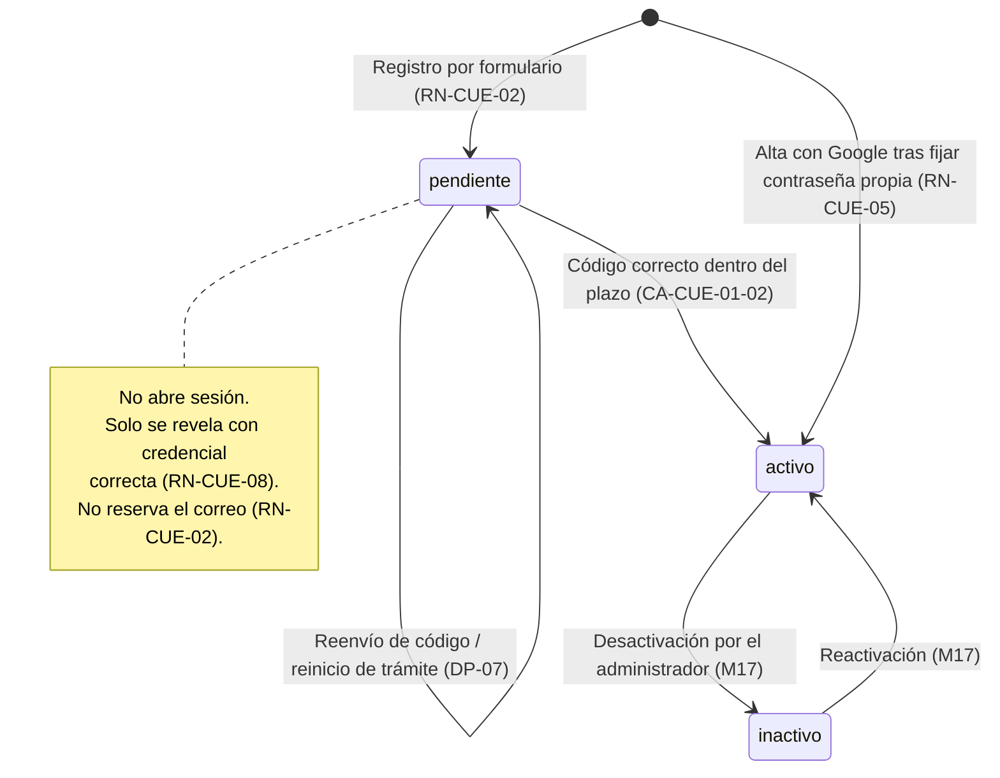

El **tipo** de cuenta (`normal` / `empresa`) es ortogonal al estado y solo cambia por una **decisión de aprobación**
(`RN-CUE-15`):

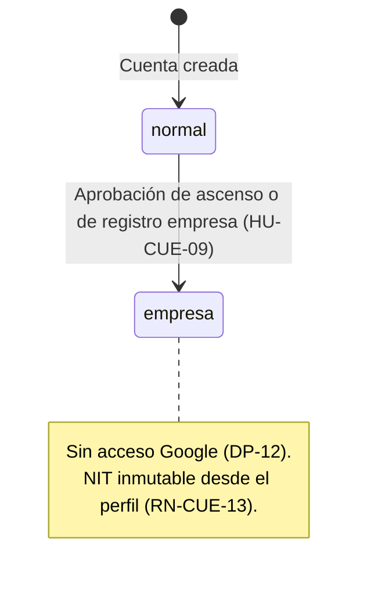

---

## 2. Registro por Formulario (`registro_sistema.drawio.png`)

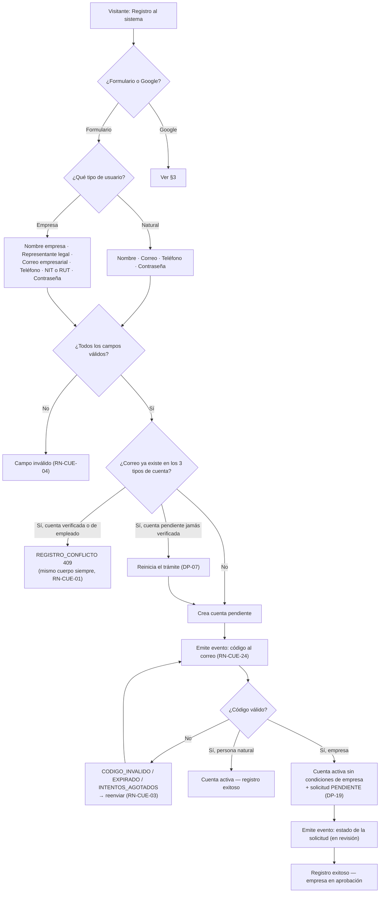

> **`F-06`:** el diagrama original rotula el final de la rama de empresa como *"Registro exitoso como persona
> natural"*. Se transcribe como **empresa en aprobación**.

---

## 3. Registro y Acceso con Google (`registro_sistema` + `login_sistema`)

> **`F-03`:** el diagrama original no incluye el paso de contraseña propia ni la sugerencia de vinculación.
> Se transcribe la versión conforme a `RF-CUE-02-03/04` y `RN-CUE-05`.

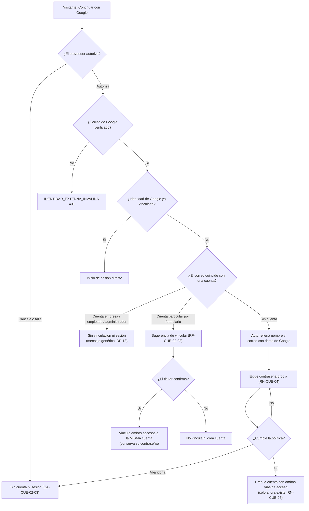

---

## 4. Inicio de Sesión (`login_sistema.drawio.png`)

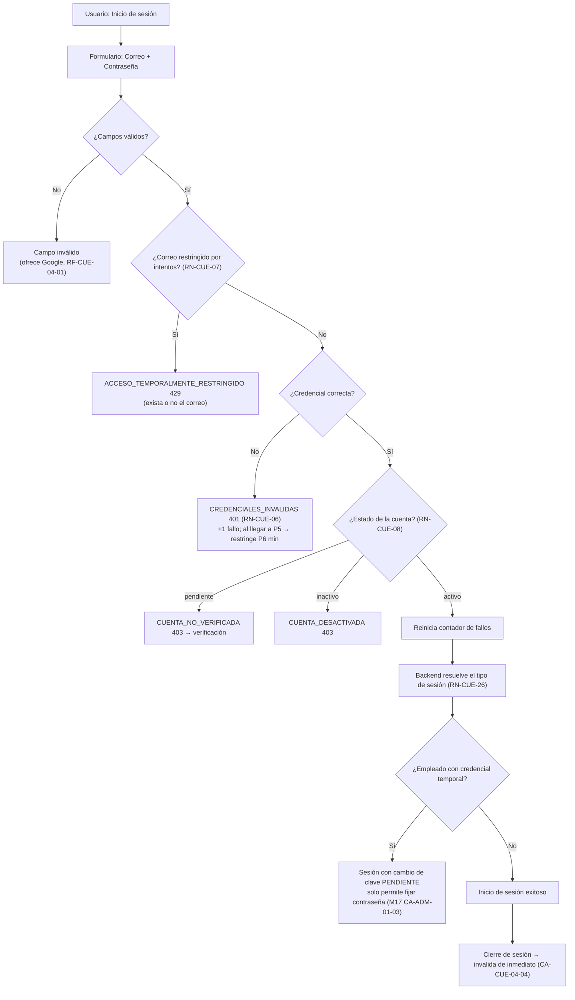

---

## 5. Control de Intentos de Acceso

La restricción se lleva **por correo**, exista o no la cuenta (`RN-CUE-07`), para que su comportamiento sea idéntico
y no filtre la existencia de la cuenta.

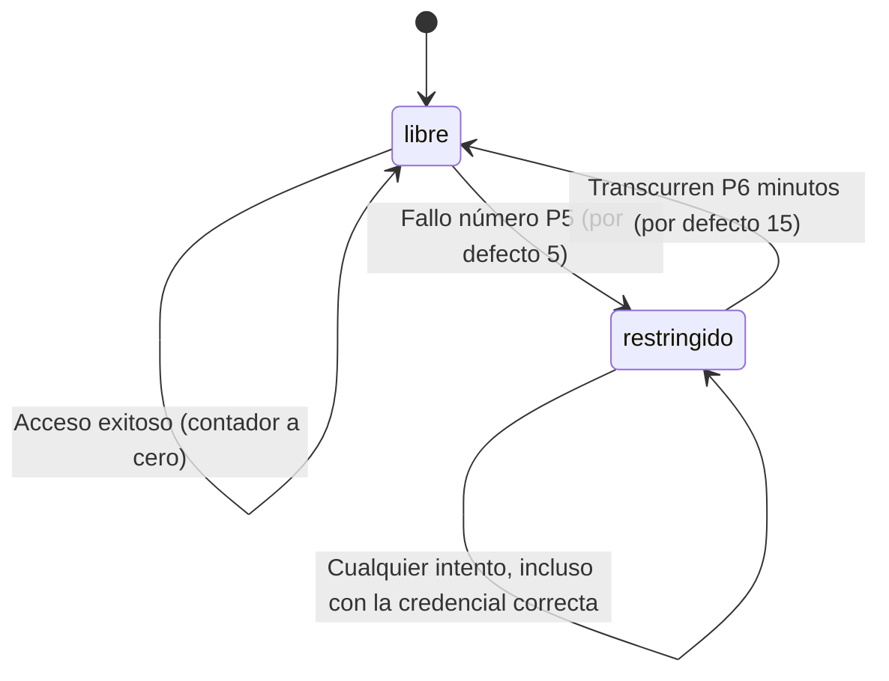

---

## 6. Recuperación de Contraseña (`login_sistema.drawio.png`, rama derecha)

> **`F-01`:** el diagrama original tiene la rama *"Este correo no existe"*. Se transcribe la versión conforme a
> `RF-CUE-05-04` y `RN-CUE-06`: **una sola respuesta para todos los casos**.

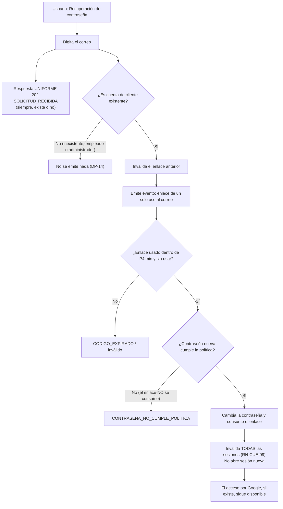

---

## 7. Información Personal y Perfil (`informacion_personal.drawio.png`)

> **`F-04`:** el campo *"Documento de Identidad"* del diagrama queda **fuera de alcance**.
> **`F-02`:** el diagrama manda el código al correo **actual**; se transcribe la versión conforme a `RN-CUE-11`.

### 7.1. Cambio de correo

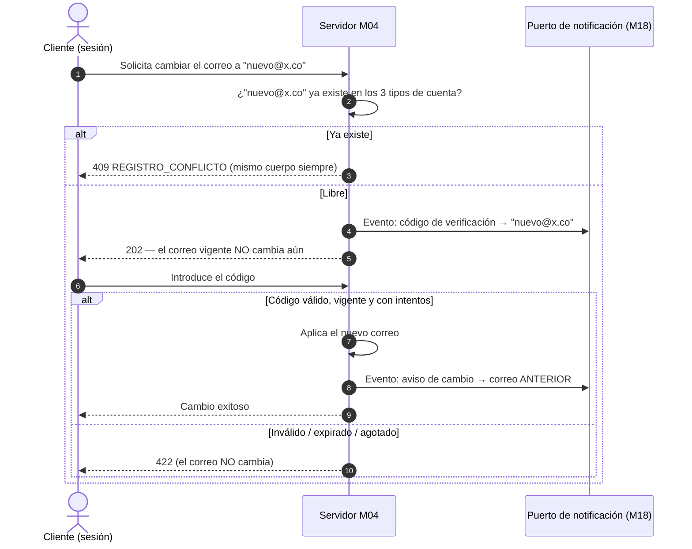

### 7.2. Cambio de contraseña y ascenso a empresa

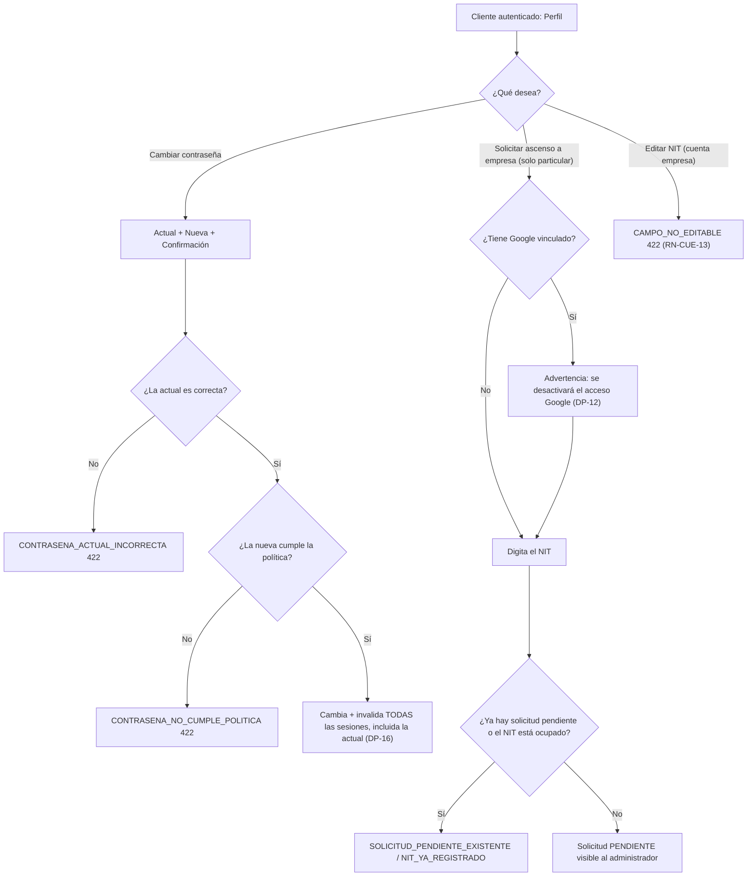

---

## 8. Gestión de Direcciones (`gestion_direcciones.drawio.png`)

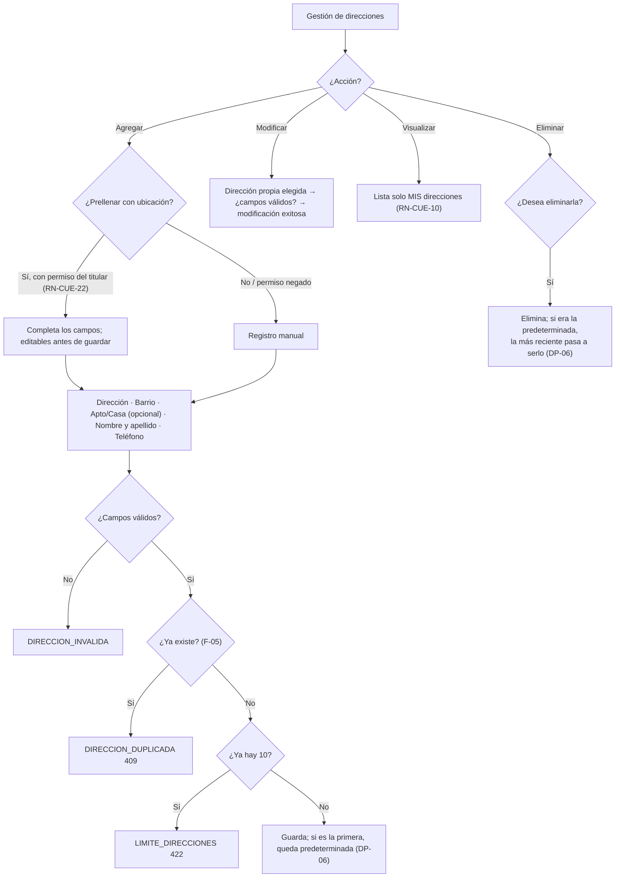

La **predeterminada es única**. Cambiar de predeterminada ocurre en una sola transacción: primero se retira la
condición a la anterior y después se concede a la nueva.

---

## 9. Solicitudes de Empresa (`solicitudes_empresas.png`)

### 9.1. Máquina de estados de una solicitud

Aplica por igual a la **solicitud de empresa** (registro y ascenso) y a la **solicitud de renovación de NIT**.
`aprobada` y `rechazada` son **estados terminales** (`RN-CUE-16`).

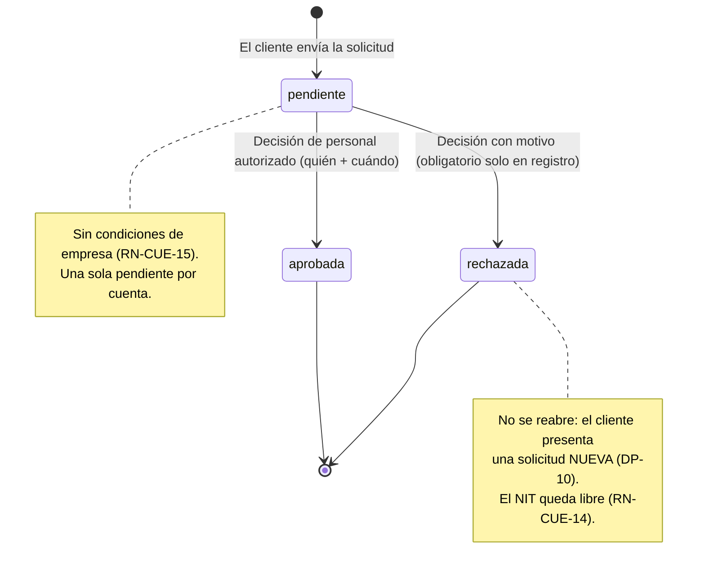

### 9.2. Panel de decisión (dos vistas independientes, `RF-CUE-09-08`)

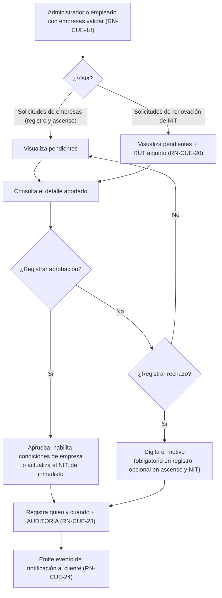

### 9.3. Secuencia de una decisión (con concurrencia)

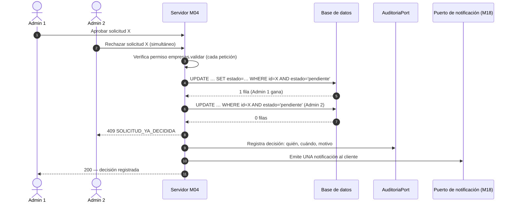

---

## 10. Eventos que M04 Emite hacia M18

Catálogo de eventos que M04 publica por el puerto de notificación (`RN-CUE-24`). El contenido editorial de cada
plantilla corresponde a `HU-NOT-03` de M18.

| Evento | Disparador | Destinatario |
| :--- | :--- | :--- |
| `codigo_registro` | Registro por formulario o reenvío | Correo indicado |
| `solicitud_empresa_en_revision` | Verificación de correo de una empresa | Correo de la empresa |
| `enlace_recuperacion` | Solicitud de recuperación de una cuenta de cliente existente | Correo de la cuenta |
| `codigo_cambio_correo` | Solicitud de cambio de correo | Correo **nuevo** |
| `aviso_cambio_correo` | Cambio de correo aplicado | Correo **anterior** |
| `decision_empresa` | Aprobación o rechazo de registro de empresa | Correo de la empresa |
| `decision_ascenso` | Aprobación o rechazo de ascenso | Correo del cliente |
| `renovacion_nit_recibida` | Envío de solicitud de renovación | Correo de la empresa |
| `decision_renovacion_nit` | Aprobación o rechazo de renovación | Correo de la empresa |
