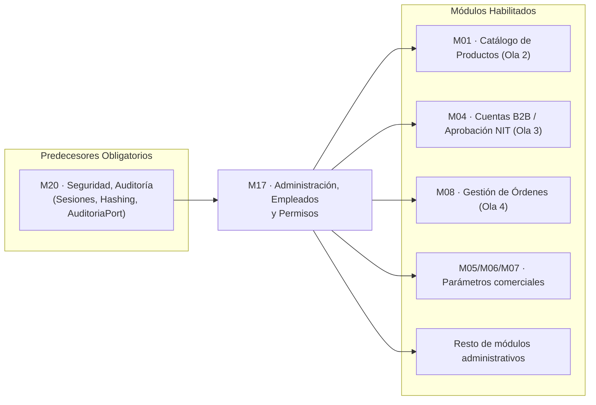

# 📄 01_SPEC_FUNCIONAL — M17. Administración, Empleados y Permisos

> **Módulo:** `M17` · **Scope:** `m17-permisos` · **Ola:** 1 (Núcleo Base)
> **Dominio:** Administración interna / Control de acceso granular / Gestión de empleados y parámetros
> **Responsable:** Product Manager Lead (Fase 1)
> **Estado:** REVISIÓN — esperando firma del Director Humano en Gate 1
> **Fuente de verdad funcional:** [`../../../../docs/01_TRANSVERSALES/M17_PERMISOS_Y_ROLES.md`](../../../../docs/01_TRANSVERSALES/M17_PERMISOS_Y_ROLES.md) y [`../../../../docs/01_TRANSVERSALES/POLITICAS/politica_HU-ADM-03_control_acceso_servidor.md`](../../../../docs/01_TRANSVERSALES/POLITICAS/politica_HU-ADM-03_control_acceso_servidor.md)
> **Diagramas contractuales:** [`../../../../docs/assets/diagrams/M17/`](../../../../docs/assets/diagrams/M17/) (5 diagramas inspeccionados)
> **Perfil de Compuerta Declarado:** **Perfil B (Módulo Transversal / Habilitador de Plataforma)** según `STAGE_GATES.md` §1.3.

---

## 1. Visión y Propósito del Módulo

- **¿Qué es este módulo?**  
  M17 es el motor de gobernanza interna y autorización granular de Pintu Clic. Define y administra quién puede ejecutar cada acción en el sistema mediante un modelo de **permisos individuales por empleado, sin roles predefinidos fijos** (`RF-ADM-02-01`). Además, gobierna la cuenta de administrador única, centraliza la consulta y restricción de clientes desde la operación, y custodia el catálogo maestro de parámetros del sistema.

- **¿Qué vacío del sistema llena?**  
  M20 implementó la infraestructura de sesiones y verificación criptográfica, pero carece del **catálogo de permisos atómicos** y del **mecanismo de asignación/resolución dinámica de facultades** por usuario. Sin M17:
  1. No se pueden crear colaboradores con privilegios delimitados.
  2. No se pueden proteger los módulos operativos subsiguientes (`M01`, `M04`, `M08`, `M09`, etc.) sin recurrir a roles hardcodeados prohibidos (`if user.role === 'admin'`).
  3. No existe un almacén dinámico para los parámetros operativos del sistema (`HU-ADM-05` / `HU-ADM-07`), del que dependen las ventanas de expiración de sesión y tokens de M20 (`RF-SEG-02-07`).

- **Objetivos de Negocio:**
  1. **Principio de Mínimo Privilegio:** Cada empleado accede estrictamente a lo que su labor demanda; toda cuenta nueva nace con cero permisos asignados (*default deny*).
  2. **Gobernanza Indestructible:** Garantizar la continuidad operativa mediante una cuenta de administrador única que nunca puede ser eliminada, bloqueada ni despojada de facultades.
  3. **Protección de Datos del Cliente:** Facilitar la atención al cliente sin permitir que el personal interno altere datos personales, acceda a contraseñas ni visualice instrumentos de pago completos.
  4. **Adaptabilidad sin Redespliegues:** Permitir al administrador calibrar parámetros operativos y comerciales en tiempo real.

- **Medida de Éxito:**  
  100 % de las operaciones administrativas del sistema protegidas en servidor mediante resolución dinámica de permisos atómicos, con tiempo de respuesta sin degradación perceptible (`RNF-ADM-03-02`).

---

## 2. Mapa Topológico de Dependencias

- **Dependencias Entrantes (Predecesores):**
  - **`M20` (Certificado):** Consume el hashing BCrypt (costo 12) para credenciales de empleados (`HU-SEG-01`), el repositorio/servicio de sesiones para revocación inmediata (`HU-SEG-02`), el envelope de respuesta sin datos sensibles (`HU-SEG-06`) y el puerto de auditoría (`AuditoriaPort`).
- **Dependencias Salientes (Habilitadas):**
  - **`M01` Catálogo:** Consume permisos `catalogo.ver`, `catalogo.crear`, `catalogo.editar`, `catalogo.eliminar`.
  - **`M04` Cuentas:** Consume permisos de atención al cliente `personal.ver` y validación de empresas B2B.
  - **`M08` Órdenes:** Consume permisos `ventas.ver`, `ventas.gestionar`, `ventas.exportar`.
  - **Parámetros Generales:** Alimenta a los módulos de cobro e impuestos (`M06`, `M12`) con valores vigentes de IVA y tolerancias.

---

## 3. Matriz de Actores y Modelo de Permisos Granulares

> ⚠️ **Regla de Oro Inviolable (Directiva #10 de AGENTS.md):**  
> El sistema **NO utiliza roles predefinidos fijos para empleados**. La tabla `usuario_rol` asigna la categoría de cuenta (`administrador`, `cliente`), mientras que los privilegios de los empleados residen en la asignación atómica N:M en `asignacion_permiso`.

### 3.1. Matriz de Actores del Ecosistema M17

| Actor | Alcance en M17 | Mecanismo de Control |
| :--- | :--- | :--- |
| **Administrador Único** | Facultades implícitas, totales e inmutables sobre empleados, permisos, parámetros y clientes. | Identidad única raíz; no requiere asignación de permisos individuales (`RF-ADM-02-10`, `RF-ADM-06-07`). |
| **Empleado con Permisos** | Acceso limitado exclusivamente a las áreas funcionales concedidas explícitamente. | Comprobación atómica en servidor por cada operación (`RF-ADM-03-01`). |
| **Empleado sin Permisos** | Acceso restringido a su propio perfil de usuario; ninguna operación de negocio expuesta. | Comprobación de omisión (*default deny* — `RF-ADM-02-08`). |
| **Cliente (B2C / B2B)** | No tiene acceso al panel administrativo; sujeto a consulta y desactivación por personal autorizado. | Rechazo en middleware de autenticación administrativa (403). |

---

## 4. Reglas de Negocio Inmutables de M17 (`RN-ADM-01` … `RN-ADM-18`)

### 4.1. Cuentas de Empleado y Credenciales (`HU-ADM-01`)
* **`RN-ADM-01` (Unicidad Universal de Correo):** El correo electrónico de un empleado debe ser único en la tabla `usuario`; no puede coincidir con otro empleado ni con ningún cliente particular o empresa (`RF-ADM-01-02`, `CA-ADM-01-08`).
* **`RN-ADM-02` (Credencial Inicial de Un Solo Uso):** Al crear una cuenta de empleado, se genera una contraseña temporal de alta entropía con caducidad; en el primer inicio de sesión, el sistema fuerza su sustitución antes de autorizar cualquier otra acción (`RF-ADM-01-03`, `CA-ADM-01-03`).
* **`RN-ADM-03` (Alta en Denegación por Defecto):** Toda cuenta de empleado se crea con cero permisos asignados. El acceso efectivo requiere un acto explícito posterior del administrador (`RF-ADM-01-04`).
* **`RN-ADM-04` (Inmutabilidad Histórica y Baja Lógica):** Prohibida la eliminación física de cuentas de empleado (`DELETE FROM usuario`). La baja es siempre lógica (`estado = inactivo`). Las acciones pasadas en auditoría conservan su autoría (`RF-ADM-01-10`, `RF-ADM-01-11`).
* **`RN-ADM-05` (Cierre Inmediato de Sesiones en Baja):** Al desactivar un empleado, todas sus sesiones activas en `sesion` se revocan inmediatamente con motivo `cuenta_desactivada` (`RF-ADM-01-07`, `CA-ADM-01-04`).
* **`RN-ADM-06` (Reactivación con Restauración de Permisos):** Al reactivar una cuenta desactivada, se restablecen los permisos que poseía en el momento de la baja para revisión del administrador (`RF-ADM-01-09`).

### 4.2. Asignación Individual de Permisos (`HU-ADM-02`)
* **`RN-ADM-07` (Concesión Implicada Consulta-Operación):** Conceder un permiso de operación sobre un área otorga automáticamente el permiso de consulta correspondiente (`catalogo.editar` → `catalogo.ver`) (`RF-ADM-02-04`, `CA-ADM-02-02`).
* **`RN-ADM-08` (Retiro en Cascada):** Retirar un permiso de consulta implica revocar automáticamente todos los permisos de operación que dependen de él, previa advertencia al administrador (`RF-ADM-02-05`, `CA-ADM-02-03`).
* **`RN-ADM-09` (Efecto en Caliente / Sin Caché de Token):** La revocación de un permiso tiene efecto inmediato en la siguiente petición del empleado, sin esperar a que expire su JWT ni forzar re-inicio de sesión (`RF-ADM-02-06`, `CA-ADM-02-04`).
* **`RN-ADM-10` (Prohibición de Auto-Modificación):** Ningún empleado puede asignarse, modificarse o revocar sus propios permisos ni los de otros empleados. La gestión de permisos es potestad exclusiva del administrador (`RF-ADM-02-09`).

### 4.3. Verificación Centralizada en Servidor (`HU-ADM-03`)
* **`RN-ADM-11` (Fail-Safe por Defecto):** Toda ruta o endpoint administrativo exige comprobación explícita de permiso en backend. Ocultar botones en la UI es solo ergonomía visual (`RF-ADM-03-01`, `RF-ADM-03-04`).
* **`RN-ADM-12` (Opacidad en Respuestas 403):** La respuesta ante una operación no autorizada debe ser genérica (`403 Forbidden` con mensaje estándar), sin revelar si el recurso existe ni el nombre del permiso requerido (`RF-ADM-03-06`, `CA-ADM-03-03`).

### 4.4. Gestión de Clientes desde Administración (`HU-ADM-04`)
* **`RN-ADM-13` (Privacidad e Inviolabilidad de Datos del Cliente):** El personal administrativo **NO puede** modificar datos personales del cliente (`RF-ADM-04-06`), ni ver contraseñas (`RF-ADM-04-08`), ni visualizar datos completos de medios de pago (`RF-ADM-04-07`). Solo el titular edita sus datos personales.
* **`RN-ADM-14` (Desactivación de Clientes con Motivo Obligatorio):** Solo el administrador puede desactivar cuentas de cliente, debiendo registrar obligatoriamente el motivo (`RF-ADM-04-09`, `RF-ADM-04-12`). Las órdenes en curso no se cancelan y completan su ciclo (`RF-ADM-04-10`).

### 4.5. Configuración General y Gobernanza (`HU-ADM-05`, `HU-ADM-06`, `HU-ADM-07`)
* **`RN-ADM-15` (Parámetros Dinámicos sin Reinicio):** Las modificaciones a los parámetros generales aplican de forma inmediata en runtime (`RF-ADM-05-03`). Deben respetar rangos válidos y nunca quedar nulos (`RF-ADM-05-05`, `RF-ADM-05-06`).
* **`RN-ADM-16` (Irretroactividad Comercial):** Los cambios en parámetros comerciales (ej. IVA) no afectan operaciones ya cerradas (`RF-ADM-05-10`, `CA-ADM-05-05`).
* **`RN-ADM-17` (Unicidad e Inmortalidad de la Cuenta Administrador):** El sistema admite únicamente una cuenta de administrador (`RF-ADM-06-02`). No existe botón para crear otra ni para desactivarla/eliminarla (`RF-ADM-06-03`, `RF-ADM-06-06`).
* **`RN-ADM-18` (Sustitución de Administrador por Doble Enlace):** La persona responsable del negocio se sustituye cambiando el correo verificado de la cuenta admin, requiriendo validación en el nuevo buzón antes de activarse, notificando al buzón antiguo e invalidando sesiones activas (`RF-ADM-06-08`, `RF-ADM-06-09`, `RF-ADM-06-11`).

---

## 5. Matriz de Alcance: In-Scope vs Out-of-Scope

| Componente / Historia | En Alcance (In-Scope) | Fuera de Alcance (Out-of-Scope) |
| :--- | :--- | :--- |
| **`HU-ADM-01` Cuentas Empleado** | CRUD lógico, generación de credencial efímera, listado filtrable por estado, desactivación/reactivación. | Eliminación física de registros en BD. Asignación automática de trabajo pendiente (se mantiene retenido para reasignación manual). |
| **`HU-ADM-02` Permisos Individuales** | Matriz de permisos, acoplamiento consulta-operación, revocación en caliente, auditoría de cambios. | Roles predefinidos o agrupadores jerárquicos de permisos. Delegación de administración en empleados. |
| **`HU-ADM-03` Verificación Servidor** | Middleware centralizado de autorización en Express, respuestas opacas 403, registro de accesos denegados. | Reglas de autorización frontend como barrera de seguridad (solo UI). |
| **`HU-ADM-04` Gestión Clientes** | Búsqueda por documento/correo/teléfono, consulta de ficha, historial de órdenes y cotizaciones, desactivación con motivo. | Modificación de datos del cliente por teléfono (debe hacerlo el titular en M04). Ver tarjetas completas. |
| **`HU-ADM-05` Configuración General** | Almacén de parámetros clave-valor tipados, validación de rangos, valores por defecto, aplicación en caliente. | Contenido institucional (misión, visión, logo), que corresponde a `M16`. |
| **`HU-ADM-06` Gobernanza Administrador** | Sustitución de correo con verificación, reseteo de contraseña admin, bloqueo de autodestrucción. | Creación de múltiples administradores. |
| **`HU-ADM-07` Catálogo Parámetros** | Definición tipada de parámetros de Autenticación, Comunicaciones y Comercial básico (IVA, fletes). | Parámetros complejos de promociones y descuentos dinámicos (corresponden a `M06`). |

---

## 6. Resolución de Preguntas Pendientes de la Especificación

1. **Reasignación de trabajo en baja de empleado (`HU-ADM-01` §6.1):**
   * *Decisión de Producto:* El trabajo pendiente (órdenes en preparación o cotizaciones) **queda retenido** para que el administrador lo reasigne manualmente. No se automatiza a la bandeja general para evitar errores operativos en pedidos sensibles.
2. **Delegación de facultades del administrador (`HU-ADM-02` §6.1):**
   * *Decisión de Producto:* **No se permite delegación.** La gestión de empleados, permisos y configuración general queda reservada estrictamente a la cuenta de administrador.
3. **Corrección de datos de clientes por teléfono (`HU-ADM-04` §6.1):**
   * *Decisión de Producto:* **Prohibido.** Ningún empleado puede alterar nombres, documentos o teléfonos de clientes. El cliente debe rectificarlos de manera autónoma desde su perfil en `M04` para garantizar trazabilidad legal (Habeas Data).
4. **Catálogo comercial de `HU-ADM-07` (§6.1):**
   * *Decisión de Producto:* Se modelan formalmente `comercial.iva_porcentaje` (default 19, rango 0–100), `comercial.costo_envio_base` y `comercial.umbral_envio_gratis`.
