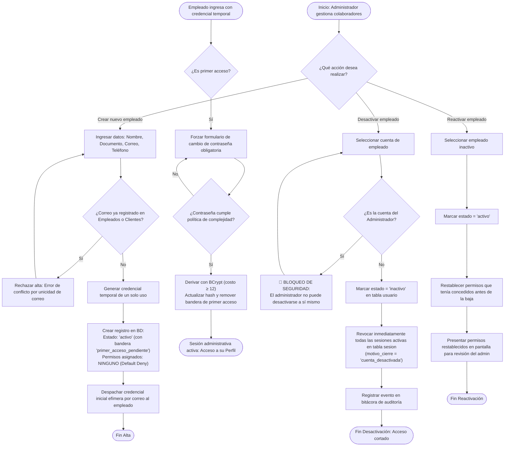
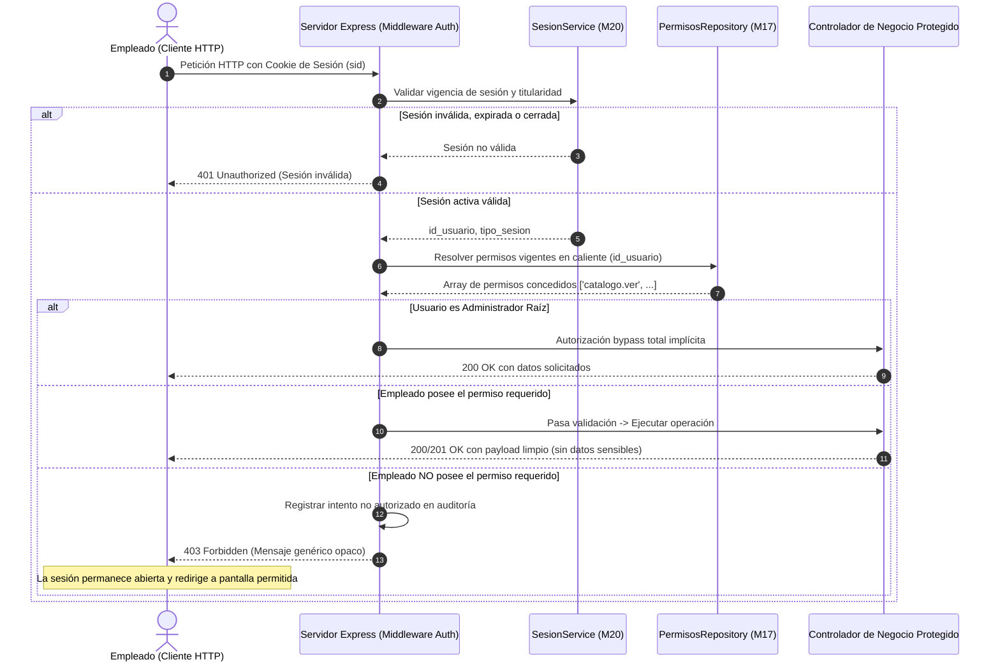
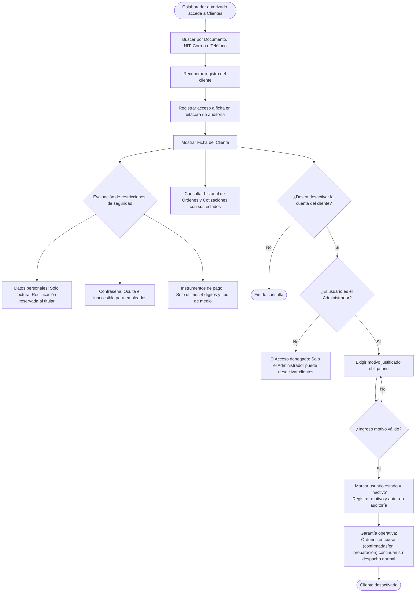
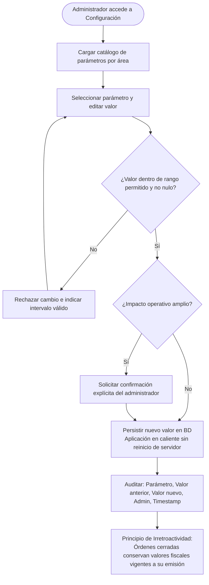
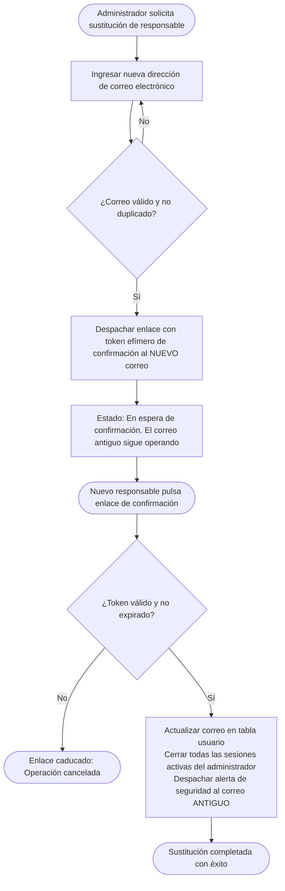
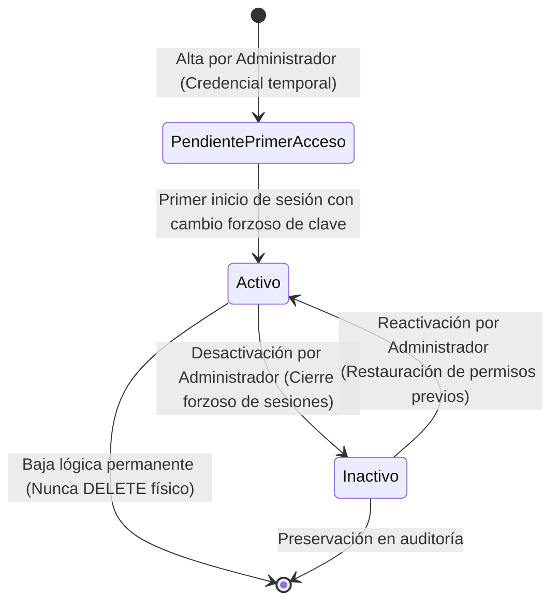
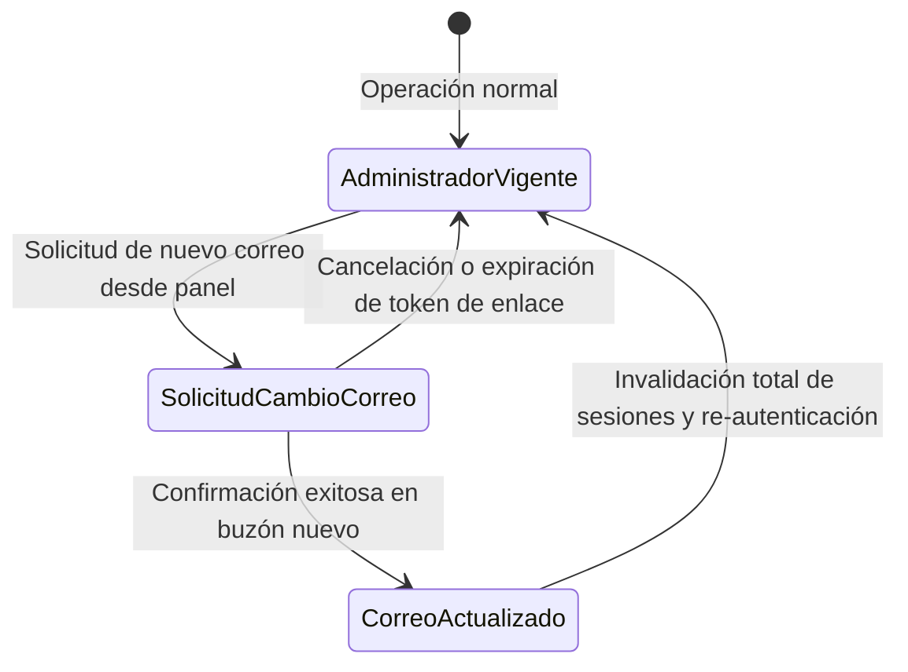

# 🔄 03_FLUJO_Y_ESTADOS — M17. Administración, Empleados y Permisos

> **Módulo:** `M17` · **Scope:** `m17-permisos`
> **Responsable:** Product Manager Lead (traducción formal) · Software Architect (ratificación en Gate 2)
> 
> ⚠️ **Los diagramas son contratos de flujo obligatorios** (Directiva #5 de `AGENTS.md`).  
> Este documento contiene la transcripción canónica a sintaxis Mermaid de los **5 diagramas `.drawio.png`**
> ubicados en [`docs/assets/diagrams/M17/`](../../../../docs/assets/diagrams/M17/), junto con las máquinas
> de estados que rigen la persistencia del módulo.

---

## 1. HU-ADM-01 — Gestión de cuentas de empleado

Transcripción contractual del flujo de creación, primer acceso, desactivación y reactivación de colaboradores:



---

## 2. HU-ADM-02 — Asignación individual de permisos

Transcripción contractual del flujo de otorgamiento, dependencias implícitas y revocación en caliente:

```mermaid
flowchart TD
    INICIO([Administrador abre ficha de permisos de un empleado]) --> LOAD_CAT[Cargar catálogo completo de permisos agrupado por área funcional]
    LOAD_CAT --> VIEW_PERMS[Mostrar estado de cada permiso: Concedido / No concedido]
    VIEW_PERMS --> OPERACION{¿Qué modificación realiza?}

    %% CONCESIÓN DE PERMISO
    OPERACION -->|Conceder permiso| CHECK_TIPO{¿Es permiso de operación/edición?}
    CHECK_TIPO -->|Sí| AUTO_VIEW["Conceder automáticamente permiso de consulta del área<br/>(ej. catalogo.editar concede también catalogo.ver)"]
    AUTO_VIEW --> SAVE_ADD[Persistir asignaciones en tabla asignacion_permiso]
    CHECK_TIPO -->|No (solo consulta)| SAVE_ADD
    SAVE_ADD --> AUD_ADD[Registrar en auditoría: Empleado, Permisos otorgados, Admin, Timestamp]
    AUD_ADD --> FIN_MOD([Permisos actualizados en caliente])

    %% REVOCACIÓN DE PERMISO
    OPERACION -->|Retirar permiso| CHECK_DEP{¿Es un permiso de consulta del que dependen otros?}
    CHECK_DEP -->|Sí (tiene operaciones asociadas)| WARN_CASCADE[Mostrar advertencia:<br/>'Retirar este permiso revocará también los permisos de operación del área']
    WARN_CASCADE --> CONFIRM_CASC{¿Administrador confirma?}
    CONFIRM_CASC -->|No| VIEW_PERMS
    CONFIRM_CASC -->|Sí| DEL_CASC[Eliminar permiso de consulta y permisos dependientes asociados]
    DEL_CASC --> SAVE_DEL
    CHECK_DEP -->|No| DEL_SINGLE[Eliminar permiso atómico específico]
    DEL_SINGLE --> SAVE_DEL[Persistir revocaciones en tabla asignacion_permiso]
    SAVE_DEL --> AUD_DEL[Registrar en auditoría: Empleado, Permisos retirados, Admin, Timestamp]
    AUD_DEL --> LIVE_CHECK["Efecto en caliente:<br/>La siguiente petición del empleado es evaluada contra BD<br/>y rechazada de inmediato si requiere el permiso revocado"]
    LIVE_CHECK --> FIN_MOD
```

---

## 3. HU-ADM-03 — Verificación de permisos en servidor (Contrato de Intercepción)



---

## 4. HU-ADM-04 — Gestión de clientes desde administración

Transcripción contractual de la consulta restringida y desactivación de cuentas cliente:



---

## 5. HU-ADM-05 y HU-ADM-06 — Configuración general y Gobernanza del Administrador

### 5.1. Configuración General (`HU-ADM-05`)


### 5.2. Sustitución de la Cuenta de Administrador (`HU-ADM-06`)


---

## 6. Máquinas de Estados Formales de M17

### 6.1. Ciclo de Vida de la Cuenta de Empleado


### 6.2. Ciclo de Vida de la Sustitución del Administrador

