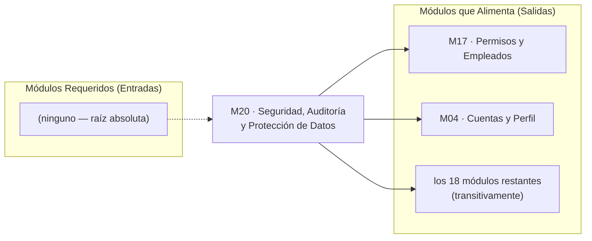

# 📄 01_SPEC_FUNCIONAL — M20. Seguridad, Auditoría y Protección de Datos

> **Módulo:** `M20` · **Scope:** `m20-seguridad` · **Ola:** 1 (Núcleo Base)
> **Dominio:** Seguridad transversal / Autenticación / Protección de datos personales
> **Responsable:** Product Manager Lead (Fase 1)
> **Estado:** REVISIÓN — esperando firma del Director Humano en Gate 1
> **Fuente de verdad funcional:** [`../../../../docs/01_TRANSVERSALES/M20_SEGURIDAD_Y_AUDITORIA.md`](../../../../docs/01_TRANSVERSALES/M20_SEGURIDAD_Y_AUDITORIA.md)
> **Diagramas contractuales:** [`../../../../docs/assets/diagrams/M20/`](../../../../docs/assets/diagrams/M20/) (6 diagramas, inspeccionados)

---

## 1. Visión y Propósito del Módulo

- **¿Qué es este módulo?**
  M20 es la capa de seguridad transversal de Pintu Clic. Protege la información de los usuarios y de
  la operación, y deja rastro de las acciones relevantes. No es un módulo de pantallas: alrededor del
  **70 % de su entrega son primitivas que el resto del sistema consume sin exponer HTTP propio**
  (derivación y verificación de credenciales, ciclo de vida de sesión, validador central de
  autorización, saneador de datos sensibles, manejador global de errores), y el 30 % restante son los
  servicios de privacidad de `HU-SEG-05`.

- **¿Qué vacío del sistema llena?**
  Sin M20, cada módulo posterior improvisa su propio control de acceso y su propio manejo de
  credenciales. La especificación lo dice sin rodeos: *"Construirlos después obliga a reabrir cada
  operación ya escrita para insertarle la comprobación de permiso y el registro de auditoría."*
  M20 existe para que **una operación nueva quede protegida por omisión y no por acuerdo del
  programador que la escriba** (`RNF-SEG-03-01`).

- **Objetivos de negocio:**
  1. Que un incidente en la empresa no comprometa las otras cuentas del cliente (credenciales no
     recuperables en claro).
  2. Que ningún usuario pueda ver ni operar sobre datos de otro, aunque manipule la petición.
  3. Que el tratamiento de datos personales cumpla la normativa colombiana aplicable y quede
     consentido con conocimiento de causa.
  4. Desbloquear la construcción de los 20 módulos restantes, que dependen de M20 transitivamente.

- **Medida de éxito:** no se mide en pantallas entregadas, sino en **cuántos módulos quedan
  correctamente protegidos por omisión** al consumir sus primitivas.

---

## 2. Mapa Topológico de Dependencias

- **Dependencias entrantes:** **ninguna.** `RUTA_DEL_PROYECTO.md` marca M20 como `raiz_absoluta`.
  La verificación de predecesores certificados se satisface de forma vacua.

- **Dependencias salientes:**
  - *M17 (Permisos):* recibe el mecanismo `requirePermission()` / `requireOwnership()` y los modelos
    de permiso atómico. M17 aporta el **catálogo y la asignación**; M20 aporta **la comprobación**.
  - *M04 (Cuentas):* recibe derivación y verificación de contraseña, ciclo de sesión, y los servicios
    de aviso de privacidad y consentimiento que su flujo de registro debe invocar.
  - *M18 (Notificaciones):* M20 no envía correo; emite eventos (principio de desacoplamiento).
  - *Todos los demás:* el validador central y el envelope de respuesta sin datos sensibles.

- **Qué necesita M20 de terceros para operar al 100 % en producción:**
  PostgreSQL con el esquema aplicado, `JWT_SECRET` y los tiempos de sesión en variables de entorno,
  canal TLS (`RNF-SEG-06-01`), y el catálogo de permisos que entregará M17.

---

## 3. Matriz de Actores y Permisos (RBAC)

> ⚠️ **Regla crítica heredada de `PINTUCLIC_CONTEXT.md` §5:** está PROHIBIDO codificar condicionales
> sobre roles rígidos (`if user.role == 'admin'`). Se comprueba el **permiso atómico**
> (`tienePermiso('seguridad.auditoria.ver')`). Esta matriz describe el resultado esperado de esa
> comprobación, no una implementación por roles.

| Actor | Sus propias sesiones | Aviso de privacidad vigente | Su consentimiento | Su solicitud de supresión | Registro de auditoría |
| :--- | :---: | :---: | :---: | :---: | :---: |
| **Visitante (anónimo)** | — | Ver | — | — | No |
| **Cliente B2C** | Ver · Cerrar | Ver | Otorgar · Consultar | Crear · Consultar la propia | No |
| **Cliente B2B** | Ver · Cerrar | Ver | Otorgar · Consultar | Crear · Consultar la propia | No |
| **Empleado** | Ver · Cerrar | Ver | Otorgar · Consultar | Crear · Consultar la propia | Solo con permiso atómico |
| **Administrador** | Ver · Cerrar | Ver | Otorgar · Consultar | Crear · Consultar la propia | Sí (cuando HU-SEG-04 se active) |
| **Sistema** | Invalidar en masa | — | — | — | Escribir (nunca modificar ni borrar) |

**Invariante de titularidad:** ningún actor accede a la sesión, el consentimiento o la solicitud de
supresión de **otro** titular. La comprobación es de titularidad, no de rol (`RF-SEG-03-02`).

---

## 4. Reglas de Negocio Inmutables (RN)

- **RN-SEG-01 — Irreversibilidad de la credencial.** Toda contraseña se almacena derivada con sal
  única por usuario y se verifica **derivando y comparando**, nunca descifrando ni reconstruyendo.
  El coste de derivación debe poder subirse sin migrar las contraseñas ya almacenadas.
  *(`RF-SEG-01-01/02`, `RNF-SEG-01-02`)*

- **RN-SEG-02 — Toda cuenta tiene contraseña propia.** Incluidas las creadas mediante Google. El
  sistema la exige al completar el registro, de modo que la cuenta nazca con ambas vías de acceso.
  Vincular Google a una cuenta que ya tenía contraseña **no se la retira**.
  *(`RF-SEG-01-05` corregido, `RF-CUE-02-04`, `RF-CUE-02-05`)*
  > 📌 Esta regla **invierte** la postura original del documento, por refactorización de historias de
  > M04. La redacción anterior —"no debe almacenar contraseña alguna para las cuentas creadas
  > mediante Google"— quedó derogada.

- **RN-SEG-03 — La credencial no sale ni se registra.** Ninguna contraseña, en claro ni derivada,
  aparece en respuesta al navegador, ni en registro de aplicación, de auditoría o de error.
  *(`RF-SEG-01-03/04`, `RF-SEG-04-07`)*

- **RN-SEG-04 — Invalidación en masa por cambio de estado de confianza.** Todas las sesiones activas
  de un usuario se invalidan cuando cambia su contraseña, se desactiva su cuenta o se le retiran
  permisos. La causa queda registrada en la propia sesión. *(`RF-SEG-01-06`, `RF-SEG-02-06`)*

- **RN-SEG-05 — Vigencia por inactividad, con renovación.** La sesión caduca por inactividad —30
  minutos en panel administrativo, 30 días en cliente— y **cada operación del usuario renueva la
  vigencia**. Es una ventana deslizante, no una expiración fija. *(`RF-SEG-02-01/02/03`)*

- **RN-SEG-06 — Sesiones simultáneas legítimas.** Un mismo cliente puede tener sesión abierta en
  varios dispositivos a la vez sin que una cierre a la otra. *(`RF-SEG-02-05`)*

- **RN-SEG-07 — Autorización central y en tiempo real.** La comprobación de permiso o titularidad se
  realiza **en el servidor, de forma centralizada, ante cada operación**, resolviendo los permisos en
  el momento de la petición y no a partir de un valor fijado al iniciar la sesión. Ocultar una opción
  en la interfaz es ayuda de usabilidad y **nunca** control de acceso.
  *(`RF-SEG-03-01/03/04/06`, `RNF-SEG-03-01`, `RF-ADM-03-03`)*

- **RN-SEG-08 — Respuesta uniforme ante acceso denegado.** Un recurso inexistente y un recurso
  existente pero ajeno producen respuestas **indistinguibles**. El mensaje no revela si el recurso
  existe ni qué permiso concreto haría falta. *(`RF-SEG-03-05`, `RF-ADM-03-06`)*

- **RN-SEG-09 — Mínima exposición.** Cada respuesta entrega únicamente los datos necesarios para la
  operación solicitada; jamás información de otros clientes; jamás el precio empresarial a quien no
  sea cliente empresa aprobado; jamás rutas, consultas ni versiones de componentes en los mensajes de
  error. El detalle técnico se registra internamente.
  *(`RF-SEG-06-01/03/04/05/07`)*

- **RN-SEG-10 — No enumeración de correos.** El proceso de recuperación de contraseña responde de
  forma idéntica exista o no el correo. *(`RF-SEG-06-06`)*

- **RN-SEG-11 — Custodia de instrumentos de pago delegada.** El sistema no almacena en ningún momento
  datos de instrumentos de pago; su custodia corresponde a la pasarela. *(`RF-SEG-06-02`)*

- **RN-SEG-12 (Cumplimiento regulatorio) — Consentimiento informado y versionado.** El tratamiento de
  datos personales exige consentimiento expreso en el registro, previa información de qué datos se
  recogen y con qué finalidad. El sistema conserva **fecha y versión del aviso aceptado** por cada
  usuario, y mantiene el aviso vigente accesible en todo momento.
  Norma aplicable: régimen colombiano de protección de datos personales (Habeas Data).
  *(`RF-SEG-05-01/02/03/04`, `RNF-SEG-05-01`)*

- **RN-SEG-13 (Cumplimiento regulatorio) — Supresión con conservación legal.** El titular puede
  solicitar la supresión de sus datos y la solicitud queda registrada y confirmada. Si existen
  órdenes de venta asociadas, el sistema **conserva la información comercial que la ley obliga a
  conservar y la desvincula de la identidad del titular cuando sea posible**.
  *(`RF-SEG-05-06/07`)*

- **RN-SEG-14 — Canal cifrado y sesión no legible por la página.** El identificador de sesión viaja
  únicamente por canal cifrado y **no debe ser accesible desde el código de la página**.
  *(`RNF-SEG-02-01`, `RNF-SEG-06-01`)*
  > 📌 Esto obliga a cookie `HttpOnly` + `Secure` + `SameSite`. El esqueleto actual de
  > `frontend/src/core/api/apiClient.ts` guarda el token en `localStorage` e **incumple esta regla**;
  > su corrección entra en el alcance de M20.

---

## 5. Matriz de Alcance (In-Scope / Out-of-Scope)

### ✅ In-Scope

| # | Alcance | Historia |
| :---: | :--- | :--- |
| 1 | Derivación y verificación de credenciales con sal única y coste ajustable | HU-SEG-01 |
| 2 | Contraseña obligatoria también en cuentas creadas con Google | HU-SEG-01 |
| 3 | Ciclo de vida completo de la sesión: creación, ventana deslizante, cierre manual, invalidación en masa con motivo, sesiones simultáneas | HU-SEG-02 |
| 4 | Aviso de expiración y **retorno al destino que el usuario pretendía alcanzar** | HU-SEG-02 |
| 5 | Validador central de autorización: permiso atómico y titularidad, resuelto en cada petición | HU-SEG-03 |
| 6 | Respuesta uniforme e indistinguible ante acceso denegado y recurso inexistente | HU-SEG-03 |
| 7 | Aviso de privacidad versionado y vigente, consultable sin autenticarse | HU-SEG-05 |
| 8 | Consentimiento expreso con fecha y versión; bloqueo del registro si no se otorga | HU-SEG-05 |
| 9 | Solicitud de supresión con confirmación de recepción, conservación legal y desvinculación de identidad | HU-SEG-05 |
| 10 | Presentadores de respuesta sin credenciales ni datos de terceros; errores sin detalle interno y con log técnico | HU-SEG-06 |
| 11 | Respuesta idéntica en recuperación de contraseña exista o no el correo | HU-SEG-06 |
| 12 | Contrato de ocultación del precio empresarial, para que M01/M06 lo consuman | HU-SEG-06 |
| 13 | Migración del transporte de sesión a cookie `HttpOnly`+`Secure`+`SameSite` | RN-SEG-14 |

### ❌ Out-of-Scope (con motivo)

| # | Fuera de alcance | Motivo |
| :---: | :--- | :--- |
| 1 | **HU-SEG-04 completa** — registro de auditoría, consulta con filtros, historial por entidad y exportación | **Aplazada por el Product Owner:** la tabla de auditoría aún no se establece |
| 2 | `RF-SEG-03-07` / `CA-SEG-03-05` — persistir el acceso denegado | Depende de HU-SEG-04. Se cubre **por diseño**: ver RN de puerto abajo |
| 3 | `RF-SEG-02-07` — panel para configurar los tiempos de sesión | El almacén de parámetros es `HU-ADM-05`/`HU-ADM-07` de **M17**. M20 expone el puerto y el valor por defecto |
| 4 | `RF-SEG-05-08` — informar de transferencias a proveedores externos | Depende de decisiones legales y de historias bloqueadas de M03 (Asesoría) |
| 5 | `RF-SEG-05-09` — retención de imágenes del simulador y conversaciones de chatbot/WhatsApp | Marcado **PENDIENTE DE DEFINICIÓN** en la propia especificación |
| 6 | Catálogo y asignación de permisos atómicos | Es **M17**. M20 entrega la comprobación, no el contenido |
| 7 | Historial de contraseñas usadas (no reutilización) | Pregunta abierta `HU-SEG-01`; tiene coste e implicación de privacidad. Ver §6 |
| 8 | Cerrar una sesión concreta de **otro** dispositivo desde el perfil | Pregunta abierta `HU-SEG-02`; la propia spec la declara añadible después sin rehacer nada |
| 9 | Texto legal del aviso de privacidad | Lo redacta el área legal; M20 entrega el mecanismo y el versionado |

### 🔌 Decisión de diseño que evita deuda estructural

> **RN-SEG-15 — Puerto de auditoría.** Aunque HU-SEG-04 esté aplazada, M20 define desde ya el puerto
> `AuditoriaPort` e **invoca `registrarAccesoDenegado(...)` en todos los puntos de llamada correctos**.
> En esta entrega se enchufa un adaptador **no-op con log técnico interno**. Cuando el Product Owner
> desbloquee HU-SEG-04, solo se sustituye el adaptador, **sin tocar un solo punto de llamada**.
> El diagrama `HU-SEG-03_autorizacion_servidor.png` termina su rama de rechazo precisamente en el nodo
> *"Registro de acceso denegado (RF-SEG-03-07)"*: el nodo del contrato de flujo queda cableado.

---

## 6. Preguntas abiertas elevadas a Gate 1

La especificación de origen declara 9 preguntas abiertas y su §6.2 clasifica cada una indicando qué
hacer mientras tanto. Estas son las que afectan a M20, con la postura que el PM propone ratificar:

| # | Pregunta | Clasificación (spec §6.2) | Postura propuesta |
| :---: | :--- | :--- | :--- |
| 1 | ¿Debe impedirse reutilizar una contraseña anterior? | Detalle de seguridad | **No en v1.** Exige conservar historial de derivaciones, con coste e implicación de privacidad |
| 2 | ¿Debe el usuario ver y cerrar sus sesiones en otros dispositivos? | Confirmación de valores | **No en v1.** La spec la declara añadible después sin rehacer nada |
| 3 | ¿Se confirman 30 min admin / 30 días cliente? | Confirmación de valores | **Sí**, como valor por defecto configurable (`RF-SEG-02-02`) |
| 4 | ¿Periodo definitivo de conservación del registro de auditoría? | **Decisión legal** | Sin efecto en v1: HU-SEG-04 está aplazada |
| 5 | ¿En qué plazo se atiende una supresión y quién la resuelve? | Decisión legal + organizativa | **No afecta al desarrollo:** la funcionalidad se construye igual; solo cambia a quién se notifica |
| 6 | ¿Quién responde en la organización por el tratamiento de datos? | Decisión organizativa | Ídem |

> Ninguna de las seis impide construir. Las posturas 1 y 2 aplican el criterio que la propia
> especificación recomienda: **la interpretación más restrictiva, que es la reversible** — ampliar
> después es sencillo, restringir después ya no.

---

## 7. Definition of Ready — estado

- [x] Especificación funcional completa y trazada a la fuente de verdad.
- [x] 100 % de las HU en alcance redactadas en INVEST con escenarios BDD ejecutables → [`02_HISTORIAS_USUARIO.md`](02_HISTORIAS_USUARIO.md)
- [x] Flujos y máquina de estados en Mermaid → [`03_FLUJO_Y_ESTADOS.md`](03_FLUJO_Y_ESTADOS.md)
- [x] Reglas de negocio identificadas unívocamente (`RN-SEG-01` … `RN-SEG-15`).
- [x] Matriz In-Scope / Out-of-Scope redactada.
- [ ] **Matriz validada con el Director Humano** → se valida con la firma de Gate 1.
- [ ] **Ficha ATDD firmada por los Three Amigos** → [`01_ATDD_SPEC.md`](01_ATDD_SPEC.md): el PM firmó su parte; Arquitecto y QA firman en sus turnos.
- [x] Bitácora actualizada en `multiAgents/01_product_manager/WORKLOG.md`.
