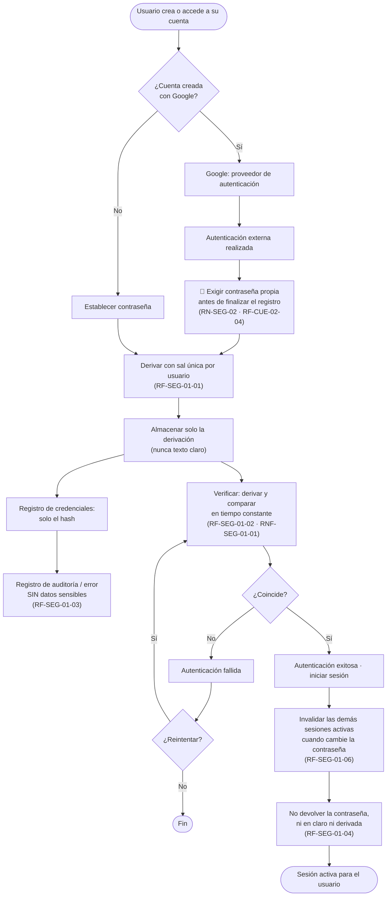
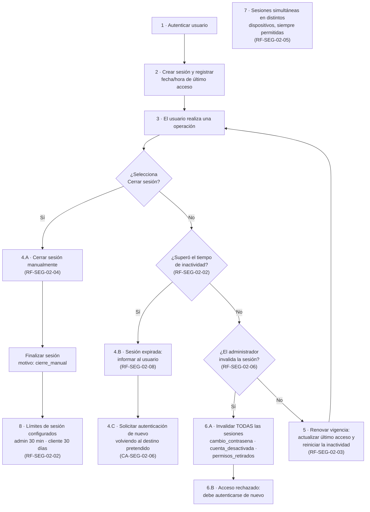
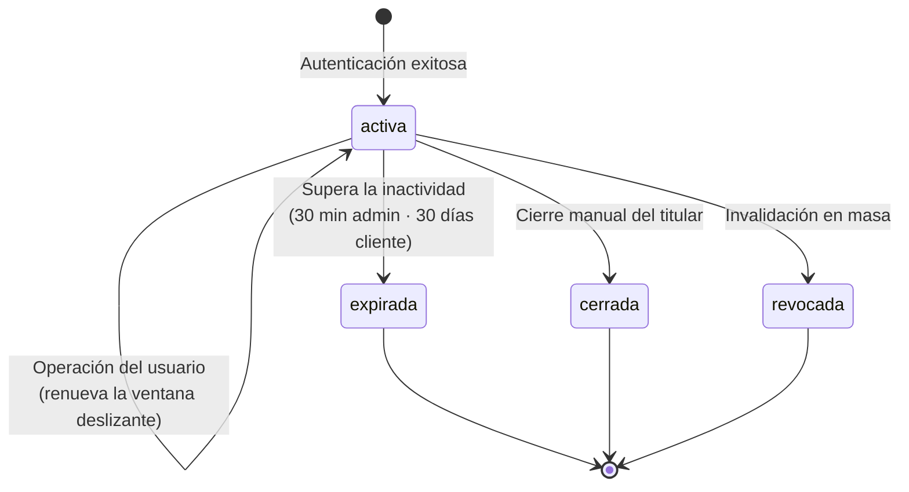
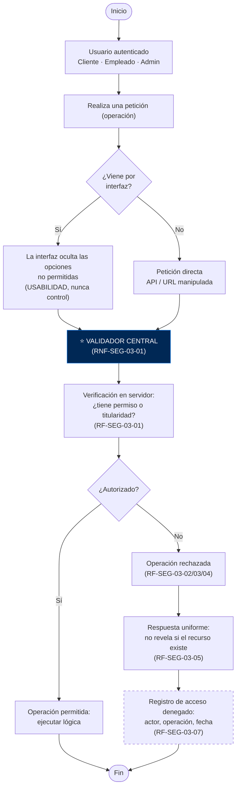
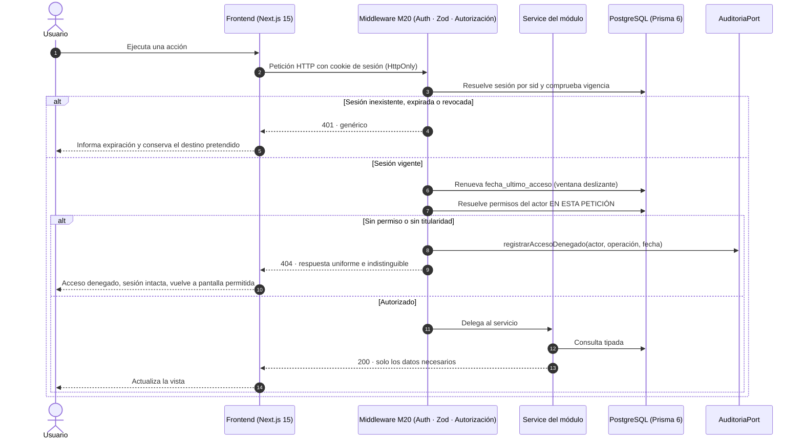
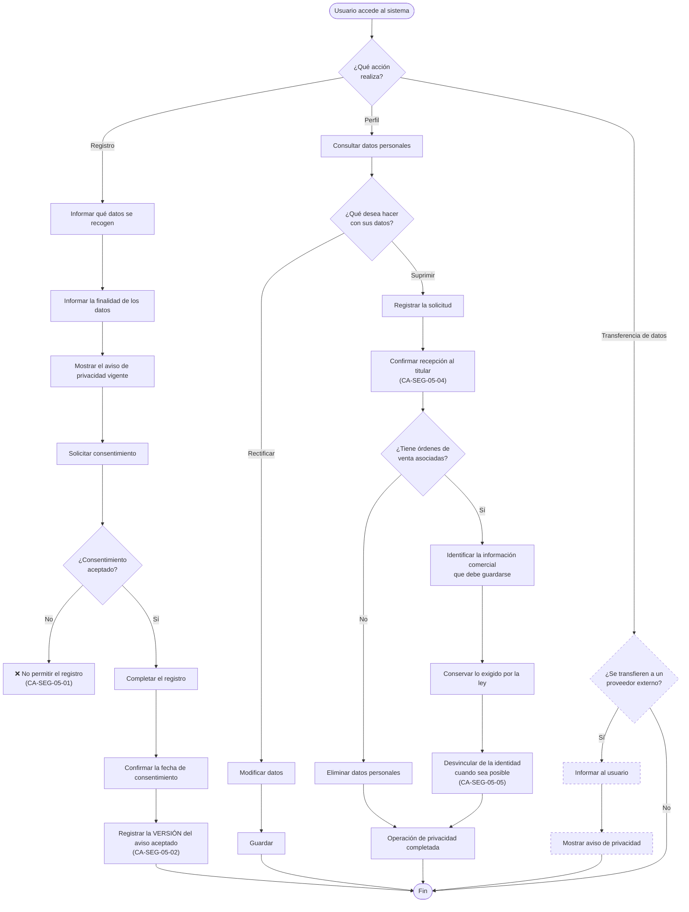
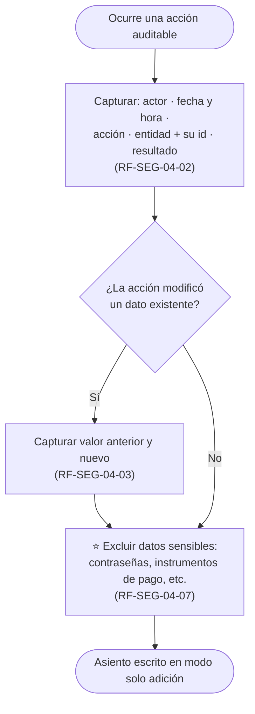
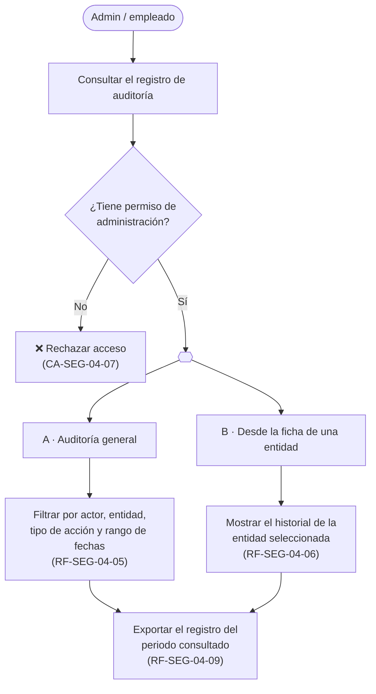
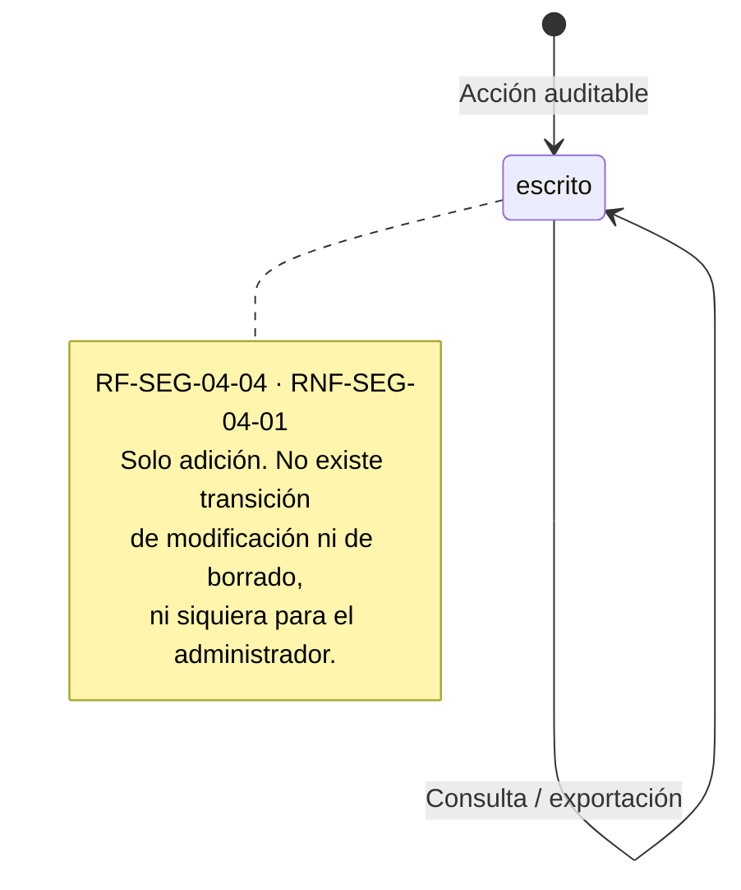

# 🔄 03_FLUJO_Y_ESTADOS — M20. Seguridad, Auditoría y Protección de Datos

> **Módulo:** `M20` · **Scope:** `m20-seguridad`
> **Responsable:** Product Manager Lead (traducción) · Software Architect (ratificación en Gate 2)
>
> ⚠️ **Los diagramas son contrato, no ilustración** (Directiva #5 de `AGENTS.md`). Lo que sigue es la
> transcripción fiel a Mermaid de los **6 diagramas `.png` de
> [`docs/assets/diagrams/M20/`](../../../../docs/assets/diagrams/M20/)**, que fueron inspeccionados
> visualmente uno a uno. Donde la transcripción se aparta del original se indica con 📌 y su motivo.

---

## 1. HU-SEG-01 — Almacenamiento seguro de credenciales

> 📌 **Única desviación respecto del `.png`:** la rama **Sí** del original termina en *"No se almacena
> contraseña en el sistema"*. Queda **derogada** por la refactorización de historias de M04: toda
> cuenta tiene contraseña propia obligatoria (RN-SEG-02, `RF-SEG-01-05` corregido). El diagrama
> `.png` sigue mostrando el flujo antiguo y **debe reeditarse**; ver §6.

---

## 2. HU-SEG-02 — Gestión de sesión (máquina de 8 estados del diagrama)

### 2.1 Máquina de estados de la Sesión

- **`activa`** — única que admite operaciones. Cada petición válida empuja `fecha_ultimo_acceso` y,
  con ella, `fecha_expiracion`.
- **`expirada`** — caducó por inactividad. `motivo_cierre = inactividad`.
- **`cerrada`** — el titular cerró sesión. `motivo_cierre = cierre_manual`.
- **`revocada`** — invalidada por el sistema. `motivo_cierre ∈ {cambio_contrasena,
  cuenta_desactivada, permisos_retirados}`.
- **Transiciones prohibidas:** los tres estados terminales **no vuelven** a `activa`. Reanudar exige
  una sesión nueva (RN-SEG-04, Regla de Oro #3 del SDLC: inmutabilidad de estados terminales).

---

## 3. HU-SEG-03 — Autorización verificada en el servidor

> 🔌 **El nodo `LOG` está cableado pero su adaptador es no-op en esta entrega** (RN-SEG-15, trazo
> discontinuo). Ambas ramas —interfaz y petición directa— **convergen obligatoriamente en el
> VALIDADOR CENTRAL**: ese es el contrato que hace que una operación nueva quede protegida por
> omisión.

### 3.1 Secuencia técnica de una petición protegida

---

## 4. HU-SEG-05 — Protección de datos personales

> 🔌 **La rama de transferencia (trazo discontinuo) queda fuera de alcance** (`RF-SEG-05-08`):
> depende de decisiones legales y de historias bloqueadas de M03. Se transcribe para que el contrato
> quede completo cuando se desbloquee.
>
> La **rama de Registro la ejecuta M04**; M20 entrega los servicios de aviso vigente y consentimiento
> versionado que ese flujo invoca.

---

## 5. HU-SEG-04 — Auditoría *(transcrito y en reserva)*

> 🛑 Historia **aplazada por el Product Owner**. Se deja el contrato transcrito para retomarlo sin
> volver a inspeccionar los `.png`.

### 5.1 Captura (`HU-SEG-04-captura_auditoria.drawio.png`)

> ⭐ **El saneador de datos sensibles está en AMBAS ramas**: se aplica siempre, no solo cuando hay
> valor anterior y nuevo.

### 5.2 Consulta (`HU-SEG-04_consulta_auditoria.drawio.png`)

### 5.3 Inmutabilidad

---

## 6. Deuda documental detectada

Los diagramas `.png` son contrato y **dos de ellos contradicen la especificación vigente** tras la
refactorización de historias de M04. No se pueden corregir desde aquí (son imágenes y requieren
reedición en drawio). Se elevan al Director Humano:

| Diagrama | Qué muestra hoy | Qué debería mostrar |
| :--- | :--- | :--- |
| `HU-SEG-01_almacenamiento_seguro_credenciales.png` | La rama Google termina en *"No se almacena contraseña en el sistema"* | Debe exigir contraseña propia antes de finalizar el registro (RN-SEG-02) |
| `M04/registro_sistema.drawio.png` y `M04/login_sistema.drawio.png` | Flujo de registro/login previo a la vinculación con Google | Vinculación sugerida y contraseña obligatoria (`RF-CUE-02-03/04/05`) |

---

## 7. Casos de Uso Extremo a Extremo

### CU-SEG-01 — Registro con Google y doble vía de acceso
1. **Precondición:** aviso de privacidad vigente publicado; Google Identity configurado.
2. El visitante autoriza el acceso con Google; el proveedor confirma.
3. El sistema informa qué datos recoge y su finalidad, muestra el aviso y pide consentimiento.
4. Sin consentimiento, el registro **no** se completa (CA-SEG-05-01).
5. Con consentimiento, el sistema **exige digitar y confirmar una contraseña propia** (CA-SEG-01-06).
6. Se almacena la derivación con sal única; se registran fecha y versión del aviso.
7. **Resultado:** cuenta con dos vías de acceso, consentimiento versionado y sesión activa.

### CU-SEG-02 — Permiso retirado en caliente
1. **Precondición:** empleado con sesión activa en el panel y un permiso concedido.
2. El administrador le retira el permiso.
3. El empleado, sin re-autenticarse, invoca la función.
4. El validador central resuelve los permisos **en esa petición** y no encuentra el permiso.
5. Se emite el evento al `AuditoriaPort` y se responde de forma uniforme.
6. **Resultado:** operación rechazada, **sesión intacta**, el empleado vuelve a una pantalla
   permitida (CA-SEG-03-04, RF-ADM-03-07).

### CU-SEG-03 — Supresión de datos con historial comercial
1. **Precondición:** cliente con órdenes de venta asociadas.
2. El titular solicita la supresión desde su perfil.
3. El sistema registra la solicitud en estado `pendiente` y confirma recepción.
4. Al resolverse, identifica la información comercial de conservación obligatoria.
5. La conserva y **la desvincula de la identidad** del titular.
6. **Resultado:** datos personales suprimidos, obligación legal satisfecha, trazabilidad comercial
   intacta pero anonimizada (CA-SEG-05-05).
