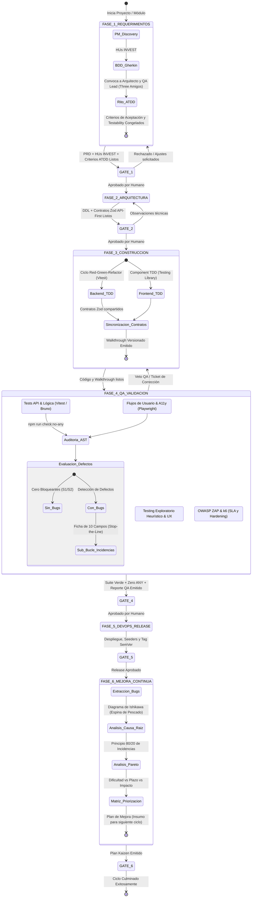

# 🧭 00_ORCHESTRATOR — Protocolo Maestro de Orquestación y Gobernanza Multiagente

> **Propósito:** Definir el ciclo de vida, la máquina de estados, los puntos de control ("Stage-Gates") y las reglas de interacción entre los agentes especializados del SDLC.  
> **Rol del Orquestador:** Garantizar el cumplimiento del proceso, evitar el *context drift*, validar los artefactos generados y coordinar la intervención del Director/Stakeholder Humano.

---

## 1. Principios Rectores del Sistema Multiagente

1. **Principio de Especialización Estricta:**  
   Ningún agente asume responsabilidades fuera de su dominio. Un *Frontend Engineer* no define contratos de base de datos; un *Product Manager* no escribe código de producción.

2. **Principio del Disco como Fuente Única de Verdad (Single Source of Truth):**  
   La memoria conversacional de un chat es efímera. La comunicación entre agentes se realiza **exclusivamente mediante artefactos versionados** en el repositorio (`docs/`, `src/`, `tests/`).

3. **Inmutabilidad de Fases Previas sin Aprobación:**  
   Un agente posterior no puede contradecir los artefactos de un agente anterior. Si durante el desarrollo se descubre un vacío en los requerimientos o en la arquitectura, se dispara un **Ciclo de Retroalimentación Formal (Feedback Loop)** hacia el agente responsable.

4. **Human-in-the-Loop en Stage-Gates:**  
   El Director Humano es la máxima autoridad. Ningún paso entre fases principales se ejecuta sin su aprobación explícita.

---

## 2. Máquina de Estados del SDLC Multiagente (6 Fases de Madurez)

---

## 3. Matriz de Agentes, Responsabilidades y Artefactos

| Fase | Agente Responsable | Carpeta del Agente | Artefacto de Entrada (Inputs) | Artefacto de Salida (Outputs) |
| :--- | :--- | :--- | :--- | :--- |
| **00** | **Orquestador Central** | `multiAgents/00_orchestrator/` | Petición del Humano | Estado del proyecto, asignación de tareas, gobierno HITL |
| **01** | **Product Manager (PM)** | `multiAgents/01_product_manager/` | Visión del Humano, Normativa | `docs/01_prd.md`, HUs INVEST, Criterios ATDD (`docs/modules/XX/01_ATDD_SPEC.md`) |
| **02** | **Software Architect** | `multiAgents/02_software_architect/` | `docs/01_prd.md`, Criterios ATDD | `docs/02_architecture.md`, DDL 3FN, Contratos Zod API-First (`docs/contracts/`) |
| **03A** | **Backend Engineer** | `multiAgents/03_backend_engineer/` | `docs/contracts/*.contract.ts` | `backend/src/` (Prisma 6, Zod), Tests TDD unitarios y de integración (`Vitest`) |
| **03B** | **Frontend Engineer** | `multiAgents/04_frontend_engineer/` | `docs/contracts/`, Design System | `frontend/src/` (SPA), Tests Component TDD (`@testing-library`), Walkthrough |
| **04** | **QA & Security Tester** | `multiAgents/05_qa_security_tester/` | Código en `src/`, Walkthroughs | `tests/`, Fichas de Bugs (10 campos), `docs/03_qa_report.md` (Cuadrantes Q1-Q4) |
| **05** | **DevOps & Release** | `multiAgents/06_devops_release/` | Código probado, Esquema DB | Seeders, Docker/Config, Changelog SemVer, `README.md` final |
| **06** | **Comité de Calidad (Kaizen)** | `multiAgents/06_devops_release/` & QA | Historial de bugs cerrados | `docs/quality/IMPROVEMENT_PLAN_vX.Y.Z.md` (Ishikawa, Pareto, Matriz Mejora) |

---

## 4. Definición de "Stage-Gates" (Puntos de Control Innegociables)

### 🛑 Gate 1: Validación de Requerimientos y Rito ATDD (PM -> Arquitecto)
- **Checklist del Orquestador:**
  - [ ] ¿Está cubierto el alcance acordado con historias bajo estándar INVEST?
  - [ ] ¿Se especificaron las reglas normativas y de negocio del dominio (`RN-DOM-XX`)?
  - [ ] ¿Se realizó la mesa de alineación ATDD (*Three Amigos*: PM + Arquitecto + QA Lead)?
  - [ ] ¿Cada Historia de Usuario tiene criterios de aceptación en formato BDD Gherkin (`Dado-Cuando-Entonces`) con casos límite (BVA) y firma de *Testability* por QA?
- **Acción:** Solicitar firma al Director Humano.

### 🛑 Gate 2: Validación de Arquitectura (Arquitecto -> Desarrolladores)
- **Checklist del Orquestador:**
  - [ ] ¿El modelo relacional DDL está completamente tipado y normalizado en 3FN?
  - [ ] ¿Se definieron los contratos de endpoints compartidos con validaciones Zod?
  - [ ] ¿Está definida la matriz de seguridad RBAC, aislamiento multi-tenant y manejo transaccional ACID?
- **Acción:** Solicitar firma al Director Humano.

### 🛑 Gate 3: Validación de Construcción TDD (Desarrolladores -> QA Lead)
- **Checklist del Orquestador:**
  - [ ] ¿Backend implementó el ciclo Red-Green-Refactor con suite Vitest pasando en verde?
  - [ ] ¿Frontend implementó pruebas unitarias de componentes base y stores con `@testing-library`?
  - [ ] ¿Se emitió el Walkthrough versionado y reproducible en `walkthroughs/[XX]/[vX.Y.Z]/WALKTHROUGH.md`?
- **Acción:** Transferencia automática a Fase 4 (Auditoría Forense de QA).

### 🛑 Gate 4: Validación de Calidad y Seguridad en 4 Cuadrantes (QA -> DevOps)
- **Checklist del Orquestador:**
  - [ ] ¿El 100% de las pruebas automatizadas pasan en verde (Vitest, Bruno, Playwright)?
  - [ ] ¿La auditoría AST `npm run check:no-any` arrojó 0 violaciones en Backend y Frontend?
  - [ ] ¿Se ejecutó escaneo dinámico DAST (OWASP ZAP) sin vulnerabilidades críticas ni IDOR?
  - [ ] ¿Se ejecutaron pruebas de testing exploratorio y accesibilidad WCAG 2.1 AA (axe-core)?
  - [ ] ¿Se resolvieron y verificaron todos los defectos S1 (Blocker) y S2 (Critical) en el sub-bucle de incidencias?
- **Acción:** Solicitar firma al Director Humano antes del release.

### 🛑 Gate 5: Validación de Despliegue y Release (DevOps -> Operaciones)
- **Checklist del Orquestador:**
  - [ ] ¿Los seeders y migraciones se ejecutan de forma limpia e idempotente?
  - [ ] ¿Los contenedores Docker levantan sin advertencias de configuración?
  - [ ] ¿Se generó el changelog formal bajo SemVer y el tag de Git correspondiente?
- **Acción:** Solicitar firma al Director Humano para paso a producción.

### 🛑 Gate 6: Aprobación del Plan de Mejora Continua Kaizen (Comité -> Siguiente Sprint)
- **Checklist del Orquestador:**
  - [ ] ¿Se extrajo la totalidad de incidentes y lecciones aprendidas del ciclo?
  - [ ] ¿Se estructuró el Diagrama de Causa-Efecto (Ishikawa) y el Diagrama de Pareto (80/20)?
  - [ ] ¿Se redactó la matriz de priorización clasificando acciones por Dificultad, Plazo e Impacto?
  - [ ] ¿El documento `docs/quality/IMPROVEMENT_PLAN_vX.Y.Z.md` asigna responsables claros y KPIs verificables para alimentar el backlog del siguiente módulo?
- **Acción:** Firma del Director Humano para incorporar las mejoras al nuevo Sprint.

