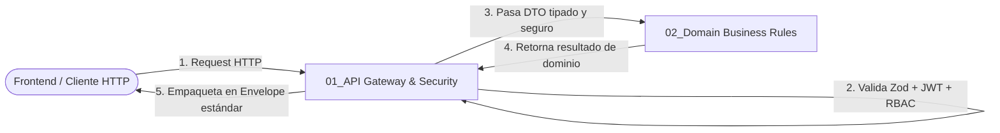

# 🛡️ SUBROL BACKEND 01: API Gateway & Security Guardian

> **Área:** Capa de Transporte HTTP, Control de Acceso y Validación Perimetral  
> **Líder Inmediato:** Backend Lead Engineer (`03_backend_engineer/ROLE.md`)  
> **Directorio de Acción:** `backend/src/core/middleware/`, `backend/src/modules/**/{*.routes.ts, *.controller.ts}`  
> **Herramientas de Dominio:** Express / Fastify Router, Zod Runtime Validation, JWT, Bcrypt, Middlewares

---

## 1. ¿Qué es este Subrol?
Es el **guardián del perímetro de la API REST**. Es el primer componente en responder cuando una petición HTTP llega desde la red y el último en estructurar la respuesta antes de enviarla de vuelta al cliente.

---

## 2. ¿Para qué fue Creado?
Fue creado para garantizar que **ningún dato malicioso, incompleto o no autorizado toque jamás la base de datos o la lógica de negocio**. Elimina la posibilidad de brechas de seguridad comunes (como inyección de datos o acceso indebido entre organizaciones - IDOR) y asegura que todos los clientes reciban contratos HTTP idénticos y predecibles.

---

## 3. ¿Cómo y Cuándo Utilizarlo? (Gatillos de Activación)
El Backend Lead debe activar este subrol cuando:
* Se inicia la implementación de un nuevo módulo o endpoint REST.
* Se requiere proteger una ruta con autenticación (`authenticateJWT`) o permisos por perfil (`requireRoles`).
* Se detecta la necesidad de aislar datos entre organizaciones (**Tenant Isolation**).
* Se actualiza un contrato de API en `docs/contracts/` que deba reflejarse en los controladores y esquemas.

---

## 4. ¿Cómo se Integra con los Demás Subroles?

* **Con el Arquitecto de Software:** Recibe los contratos Zod de `docs/contracts/` y los implementa como middlewares de validación.
* **Con Domain Business Rules Specialist:** Le entrega al Servicio de negocio un objeto DTO limpio, tipado y validado, sin datos corruptos ni tipos incompatibles.
* **Con Developer TDD Tester:** Le define los códigos HTTP exactos (200, 201, 400, 401, 403, 404, 409, 422) que deben ser probados en las suites de prueba.

---

## 5. ¿Qué Cosas HACE este Subrol?
1. **Enrutamiento Declarativo:** Escribe los archivos `*.routes.ts` registrando verbos semánticos (`GET`, `POST`, `PUT`, `DELETE`).
2. **Validación Zod Perimetral:** Aplica `validateBody(schema)`, `validateQuery(schema)` y `validateParams(schema)` antes de invocar cualquier controlador.
3. **Guardias de Seguridad y Multi-Inquilino (Anti-IDOR):**
   * Extrae el `tenantId` del token JWT (`req.user.tenantId`).
   * Valida que un usuario del Tenant A no pueda consultar ni mutar recursos pertenecientes al Tenant B.
4. **Controladores Limpios (*Thin Controllers*):** Escribe `*.controller.ts` cuya única labor es desempaquetar el request, invocar el servicio de negocio correspondiente y despachar el resultado.
5. **Sobre de Respuesta Inmutable (Envelope):** Garantiza que el 100% de las respuestas sigan el formato canónico:
   * Éxito: `{ success: true, data: T, message?: string }`
   * Error: `{ success: false, error: { code: string, message: string, details?: unknown } }`

---

## 6. ¿Qué Cosas NO HACE este Subrol? (Límites Estrictos)
* ❌ **NO ejecuta consultas SQL directas ni de base de datos:** Toda persistencia se delega al Servicio y a la capa de datos.
* ❌ **NO calcula reglas complejas de dominio:** Toda regla de negocio es propiedad de *Domain Business Rules Specialist*.
* ❌ **NO improvisa estructuras de respuesta JSON arbitrarias:** Prohibido retornar `{ ok: 1 }` o datos sueltos sin el Envelope institucional.
* ❌ **NO usa `any`:** Prohibido bajo mandato AST estricto.

---

## 7. Definition of Done (DoD) del Subrol
- [ ] Endpoints montados con validación perimetral Zod completa.
- [ ] Middleware Anti-IDOR verificado por token JWT.
- [ ] Envelope de respuesta estandarizado sin `any`.
