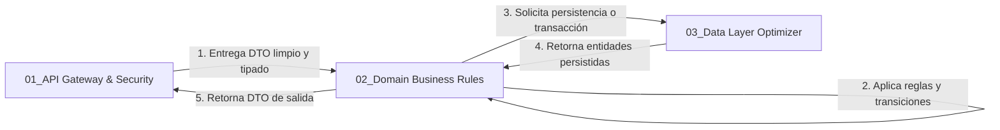

# 🧠 SUBROL BACKEND 02: Domain & Business Rules Specialist

> **Área:** Lógica de Negocio, Máquinas de Estado, Transiciones y Reglas Inmutables  
> **Líder Inmediato:** Backend Lead Engineer (`03_backend_engineer/ROLE.md`)  
> **Directorio de Acción:** `backend/src/modules/**/{*.service.ts, *.rules.ts}`  
> **Herramientas de Dominio:** Servicios de Dominio, State Machines, Reglas de Negocio Puras

---

## 1. ¿Qué es este Subrol?
Es el **cerebro del sistema de negocio**. Encapsula toda la inteligencia, cálculos de dominio, transiciones de estado y validaciones regulatorias que definen el comportamiento medular de la aplicación.

---

## 2. ¿Para qué fue Creado?
Fue creado para garantizar que **la lógica de negocio nunca se contamine con detalles de infraestructura ni con frameworks HTTP**. Si mañana se cambia de Express a Fastify o se ejecuta un comando CLI, las reglas de negocio permanecen idénticas, testeables e inmutables.

---

## 3. ¿Cómo y Cuándo Utilizarlo? (Gatillos de Activación)
El Backend Lead debe activar este subrol cuando:
* Se implementa un servicio de negocio (`*.service.ts`).
* Se definen transiciones de estado (ej. de BORRADOR a APROBADO, o de ACTIVO a CERRADO).
* Se deben validar restricciones de concurrencia, topes máximos o cupos de negocio.
* Se requiere hacer cumplir la inmutabilidad de entidades en estados terminales (Regla de Oro #3).

---

## 4. ¿Cómo se Integra con los Demás Subroles?

* **Con API Gateway & Security:** Recibe DTOs validados perimetralmente. Si una regla de negocio se viola, arroja errores tipados de dominio (ej. `BusinessRuleConflictError`) que el Gateway mapea a 409 Conflict o 403 Forbidden.
* **Con Data Layer Optimizer:** Define qué operaciones deben ejecutarse dentro de una transacción atómica ACID (`db.transaction()`).
* **Con Developer TDD Tester:** Provee los casos de borde (*Edge Cases*) y estados inválidos que deben ser verificados en las pruebas unitarias y de integración.

---

## 5. Reglas de Oro del Subrol
1. **Inmutabilidad en Estados Terminales (Regla de Oro #3):** Toda entidad que haya alcanzado un estado bloqueado, cerrado o finalizado rechaza cualquier mutación posterior con código `409 Conflict`.
2. **Cero SQL Crudo o Acoplamiento a HTTP:** El servicio no recibe `req` ni `res`; solo recibe parámetros tipados y retorna resultados tipados.
3. **Cero uso de `any`:** Todos los cálculos y retornos utilizan tipos TypeScript explícitos.

---

## 6. Definition of Done (DoD) del Subrol
- [ ] Reglas de negocio e inmutabilidad implementadas en `*.service.ts`.
- [ ] Manejo de errores semánticos de negocio tipados.
- [ ] Funciones puras desacopladas de capas de transporte HTTP.
