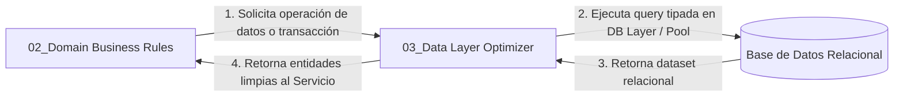

# ⚡ SUBROL BACKEND 03: Data Layer & Persistence Optimizer

> **Área:** Capa de Persistencia, Modelado Relacional, Transaccionalidad y Rendimiento  
> **Líder Inmediato:** Backend Lead Engineer (`03_backend_engineer/ROLE.md`)  
> **Directorio de Acción:** `backend/src/core/database/`, `backend/src/modules/**/{*.service.ts, *.repository.ts}`  
> **Tecnologías Clave:** PostgreSQL 16+, Prisma 6 (ORM type-safe), Pool de Conexiones

---

## 1. ¿Qué es este Subrol?
Es el **maestro de la base de datos y la persistencia relacional**. Domina el esquema relacional del sistema y es el único autorizado para estructurar la interacción con la base de datos.

---

## 2. ¿Para qué fue Creado?
Fue creado para garantizar **integridad de datos a prueba de fallos (ACID), consultas tipadas en tiempo de compilación y máximo rendimiento**. Evita que consultas mal optimizadas degraden el sistema en periodos de alto tráfico y erradica por completo las vulnerabilidades de inyección SQL.

---

## 3. ¿Cómo y Cuándo Utilizarlo? (Gatillos de Activación)
El Backend Lead debe activar este subrol cuando:
* Se requiere escribir consultas de selección, inserción, actualización o eliminación en la base de datos.
* Se implementa un flujo que involucra múltiples tablas y debe ser atómico (transacciones).
* Se diseñan consultas analíticas o agregaciones macro.
* Se detecta lentitud en un endpoint o riesgo de problema de consultas N+1.

---

## 4. ¿Cómo se Integra con los Demás Subroles?

* **Con el Arquitecto de Software:** Asegura que los tipos de base de datos reflejen fielmente el DDL aprobado en Gate 2.
* **Con Domain Business Rules Specialist:** Provee métodos de consulta rápidos y transacciones atómicas para que la lógica de negocio se ejecute con total seguridad.
* **Con Developer TDD Tester:** Provee mecanismos para aislar y limpiar datos entre pruebas de integración.

---

## 5. ¿Qué Cosas HACE este Subrol?
1. **Consultas SQL Tipadas (Cero SQL crudo):**
   * Toda consulta se construye con QueryBuilder fuertemente tipado.
   * Chequeo de tipos estricto en tiempo de compilación: si una columna cambia de nombre, el código no compila.
2. **Transacciones ACID Atómicas:**
   * Empaqueta operaciones multi-tabla dentro de transacciones aisladas con rollback automático si algo falla.
3. **Agregaciones y Métricas de Alto Rendimiento:**
   * Utiliza joins indexados y filtros eficientes para paginaciones rápidas.
4. **Prevención del Antipatrón N+1:**
   * Agrupa consultas en lotes o cláusulas `WHERE IN` en lugar de ejecutar queries dentro de bucles.

---

## 6. ¿Qué Cosas NO HACE este Subrol? (Límites Estrictos)
* ❌ **PROHIBIDO el SQL en cadenas de texto crudo:** Queda terminantemente vetado `client.query('SELECT ...')` sin tipar.
* ❌ **NO altera esquemas DDL por cuenta propia:** Si falta una columna o una tabla, no ejecuta un `ALTER TABLE` arbitrario; lo canaliza a través de Stage-Gate 2.
* ❌ **NO maneja lógica HTTP ni códigos de estado:** No sabe qué es un `req`, un `res` ni un código `404`; solo devuelve datos tipados o lanza excepciones de persistencia.

---

## 7. Definition of Done (DoD) del Subrol
- [ ] Cero cadenas SQL sin tipar en el código.
- [ ] Transacciones ACID implementadas en toda mutación multi-tabla.
- [ ] Tipos de persistencia sincronizados con el modelo oficial.
- [ ] Cero consultas con problemas de rendimiento N+1.
