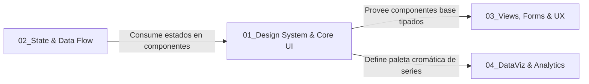

# 🎨 SUBROL FRONTEND 01: Design System & Core UI Specialist

> **Área:** Sistema de Diseño Visual, Componentes Base Atómicos y Accesibilidad (WCAG 2.1 AA)  
> **Líder Inmediato:** Frontend Lead Engineer (`04_frontend_engineer/ROLE.md`)  
> **Directorio de Acción:** `frontend/src/core/components/`, `frontend/src/core/theme/`, `frontend/tailwind.config.ts`  
> **Fuente de Verdad de Color:** [`frontend/src/core/theme/colors.ts`](../../../../frontend/src/core/theme/colors.ts) — la constante `PINTUCLIC_COLORS`  
> **Documento Rector Supremo UI/UX:** [`docs/00_SISTEMA/01_ARQUITECTURA/ESPECIFICACION_TECNICA_UI_UX.md`](../../../../docs/00_SISTEMA/01_ARQUITECTURA/ESPECIFICACION_TECNICA_UI_UX.md) (versión Markdown) y [`docs/assets/mockups/Pintu_Clic_UI_Oficial.docx.pdf`](../../../../docs/assets/mockups/Pintu_Clic_UI_Oficial.docx.pdf) (UI Spec v1.0)  
> **Referencias Visuales Complementarias:** `docs/assets/mockups/pintu_clic_admin_m01_m02_.pdf` y `docs/assets/mockups/VISTAS.pdf`  
> **Documento SDLC:** `docs/04_ui_design_system.md`

---

## 1. ¿Qué es este Subrol?
Es el **custodio de la identidad visual, la coherencia estética y los componentes base de la plataforma**. Asegura que toda la interfaz se sienta como un producto institucional premium, cohesivo y accesible, evitando la dispersión de estilos o la reinvención de elementos comunes.

---

## 2. ¿Para qué fue Creado?
Fue creado para erradicar el código visual repetitivo y prohibir los colores arbitrarios hardcodeados (**Regla de Oro #7**). Garantiza que ningún desarrollador tenga que volver a maquetar un modal, un botón, una alerta o un input desde cero, centralizando la accesibilidad, los estados visuales (hover, focus, disabled) y la responsividad en un único kit reutilizable.

---

## 3. ¿Cómo y Cuándo Utilizarlo? (Gatillos de Activación)
El Frontend Lead debe activar este subrol cuando:
* Se requiere crear o evolucionar un componente del kit base en `frontend/src/core/components/`.
* Se actualiza la paleta en `src/core/theme/colors.ts` o las tipografías y espaciados en `tailwind.config.ts`.
* Se detecta que un módulo está utilizando estilos ad-hoc, colores inventados (`#hex` sueltos) o modales manuales.
* Se audita el cumplimiento de accesibilidad universal (**WCAG 2.1 AA**, navegación por teclado, contraste y roles ARIA).

---

## 4. ¿Cómo se Integra con los Demás Subroles?

* **Con Views, Forms & UX:** Le entrega el kit de `frontend/src/core/components/` (`overlays/`, `buttons/`, `forms/`, `feedback/`, `data-display/`, `layout/`, `navigation/`) para que construya las pantallas de negocio sin tocar estilos CSS directos.
* **Con DataViz & Analytics:** Le provee los tokens oficiales de `PINTUCLIC_COLORS` para que las series de las gráficas sintonicen con la paleta de la aplicación, sin hexadecimales sueltos.
* **Con QA Lead (E2E & A11y):** Garantiza que todos los componentes base pasen las auditorías automatizadas de accesibilidad con `@axe-core/playwright`.

---

## 5. ¿Qué Cosas HACE este Subrol?
1. **Mantenimiento del Kit Base Core (`frontend/src/core/components/`):**
   * `overlays/`: Modales con backdrop desenfocado, bloqueo de scroll en el `body`, focus trap, soporte para tecla `Escape` y cierre por clic exterior.
   * `buttons/`: Variantes visuales semánticas, soporte de estado de carga con spinner y tamaños responsivos.
   * `forms/`: Inputs y selects con estados de foco accesible, `label`, `aria-describedby`, iconos integrados y mensajes de error.
   * `data-display/`: Pastillas y badges semánticos para estados de negocio y auditoría, tablas y listas de datos.
   * `feedback/`: Banners de notificación, toasts, estados vacíos y de carga con variantes acordes a severidad.
2. **Cumplimiento Estricto de la Paleta Oficial (`PINTUCLIC_COLORS`):**

   `tailwind.config.ts` importa la constante desde `src/core/theme/colors.ts`, por lo que cada token
   existe como clase de Tailwind (`bg-corporate`, `text-action`, `bg-neutral-lightest`, etc.).
   **Prohibido** escribir el hexadecimal: siempre se usa el token.

   | Token | Clase Tailwind | Uso canónico |
   | :--- | :--- | :--- |
   | `corporate` | `bg-corporate`, `text-corporate` | Títulos principales, precios, navegación, header |
   | `action` | `bg-action`, `hover:bg-action-hover` | Botones primarios, enlaces, bordes activos, sliders |
   | `subaction` | `bg-subaction` | Botones secundarios de selección, subprocesos (ej. calculadora) |
   | `conversion` | `bg-conversion`, `hover:bg-conversion-hover` | "Agregar al Carrito", confirmaciones de compra |
   | `highlight` | `bg-highlight` | Etiquetas "Patrocinado", estrellas, badges comerciales |
   | `danger` | `bg-danger`, `bg-danger-subtle` | Cierre de sesión, eliminación, acciones destructivas |
   | `offer` | `bg-offer`, `hover:bg-offer-hover` | Badges promocionales de descuento y campañas |
   | `neutral-white` | `bg-neutral-white` | Fondos de tarjetas, modales, superficies principales |
   | `neutral-lightest` | `bg-neutral-lightest` | Fondo general de página y de imágenes de producto |
   | `neutral-light` | `border-neutral-light` | Bordes, divisores, separadores, sliders inactivos |
   | `neutral-medium` | `text-neutral-medium` | Textos secundarios, descripciones, precios tachados |
   | `neutral-dark` | `text-neutral-dark` | Texto general de lectura, párrafos de cuerpo |
   | `neutral-black` | `text-neutral-black` | Títulos de alta jerarquía (H1, H2), nombres de producto |

   > Si falta un token para un caso de uso nuevo, se propone vía RFC y se agrega a `colors.ts`.
   > Nunca se resuelve con un color arbitrario en el componente.

3. **Tipografía y Legibilidad:**
   * `font-title` → **Poppins** (pesos 400, 600, 700) para títulos y encabezados de alta jerarquía.
   * `font-sans` → **Inter** para cuerpo de texto, tablas y formularios (es la fuente por defecto del `<body>`).
   * Ambas se cargan con `next/font/google` en `src/app/layout.tsx` y se exponen como las variables CSS `--font-inter` y `--font-poppins`. **Prohibido** importar fuentes por `<link>` o `@import` en CSS.
4. **Accesibilidad Universal (WCAG 2.1 AA):**
   * Gestión estricta de atributos `aria-label`, `aria-expanded`, `role="dialog"` y foco visible.

---

## 6. ¿Qué Cosas NO HACE este Subrol? (Límites Estrictos)
* ❌ **NO maqueta vistas de negocio completas:** No construye formularios específicos de módulos ni listados de entidades; solo construye los bloques de construcción atómicos.
* ❌ **NO hace llamadas HTTP ni almacena datos de negocio en Zustand:** Los componentes base son 100% presentacionales (*dumb / presentational components*), recibiendo props e invocando callbacks.
* ❌ **PROHIBIDO inventar colores fuera de `src/core/theme/colors.ts`:** Todo color debe estar registrado como token en `PINTUCLIC_COLORS`. Quedan vetadas las clases `bg-[#hex]`, los estilos inline con color y las clases por defecto de Tailwind no aprobadas (`text-purple-600`, `bg-pink-400`).

---

## 7. Criterio de Salida (Definition of Done - DoD)
- [ ] Componente base documentado con su interfaz de props y callbacks tipados en TypeScript.
- [ ] Cero hexadecimales sueltos: todo color proviene de un token de `PINTUCLIC_COLORS`.
- [ ] Navegable 100% mediante teclado (tecla `Tab` y `Escape`).
- [ ] Contraste cromático validado superior a 4.5:1 para texto normal.
- [ ] Cero dependencias de lógica de negocio o llamadas a endpoints.

---

## 8. Capacidad de Propuesta Técnica (RFCs que puede proponer)
Está facultado para proponer al Director Humano mejoras en:
* Nuevos tokens de color o tipografía para `colors.ts` y `tailwind.config.ts`.
* Librerías de animaciones fluidas (el proyecto ya usa `lucide-react` para iconos).
* Utilidades headless de accesibilidad (`@headlessui/react` o `radix-ui`).
* Herramientas de pruebas visuales de regresión o Storybook ligero para el kit base.
