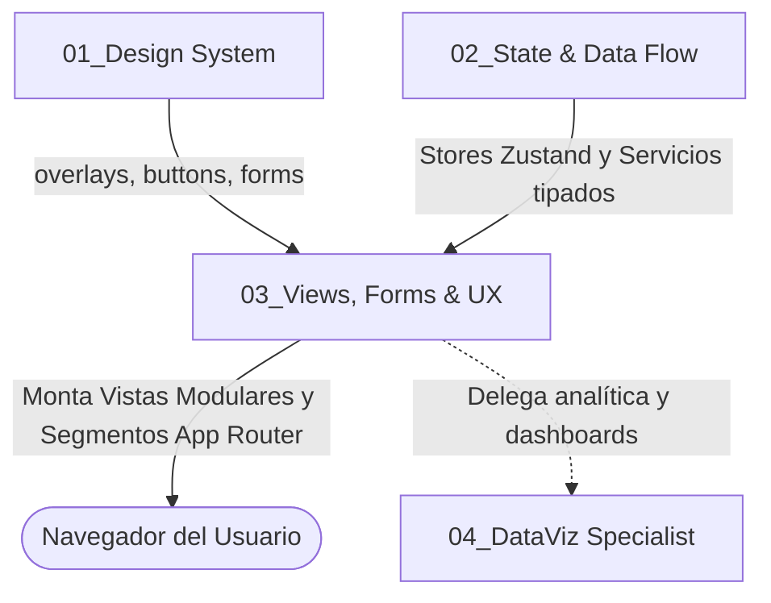

# 📋 SUBROL FRONTEND 03: Views, Forms & UX Specialist

> **Área:** Pantallas de Negocio, Formularios de Alta Densidad, Validación en Cliente y Enrutamiento RBAC  
> **Directorio de Acción:** `frontend/src/modules/m[xx]-[nombre]/components/`, `frontend/src/app/{(admin),(auth),(public)}/`  
> **Tecnologías Clave:** Next.js 15 App Router, React 19, React Hook Form + `zodResolver`, Core Base Kit (`frontend/src/core/components/`)  
> **Documento Rector Supremo UI/UX:** [`docs/00_SISTEMA/01_ARQUITECTURA/ESPECIFICACION_TECNICA_UI_UX.md`](../../../../docs/00_SISTEMA/01_ARQUITECTURA/ESPECIFICACION_TECNICA_UI_UX.md) (UI Spec v1.0)

---

## 1. ¿Qué es este Subrol?
Es el **constructor de la experiencia de usuario de los módulos del sistema**. Traduce las Historias de Usuario (HUs) del Product Manager en pantallas intuitivas, fluidas y profesionales con las que interactúan a diario los usuarios en sus diferentes roles.

---

## 2. ¿Para qué fue Creado?
Fue creado para garantizar que la interacción con el sistema sea **amigable, rápida y libre de frustración**. Evita que los usuarios sufran con formularios rotos, pérdidas accidentales de datos o pantallas bloqueadas, orquestando validaciones en caliente, retroalimentación visual clara y protección estricta de rutas según el rol de cada usuario.

---

## 3. ¿Cómo y Cuándo Utilizarlo? (Gatillos de Activación)
El Frontend Lead debe activar este subrol cuando:
* Se implementa la interfaz de un nuevo módulo del sistema.
* Se construyen modales de negocio para creación o edición de entidades (`*Modal.tsx`).
* Se diseñan formularios complejos de alta densidad.
* Se configuran nuevos segmentos de ruta en el App Router con verificación de permisos atómicos.

---

## 4. ¿Cómo se Integra con los Demás Subroles?

* **Con Design System & Core UI:** Consume religiosamente los componentes base de `core/components/` (`overlays/`, `buttons/`, `forms/`, `feedback/`, `data-display/`), garantizando que ninguna vista maquete estilos arbitrarios.
* **Con State & Data Flow:** Consume las stores y los servicios de módulo tipados, manejando el estado de carga (`isLoading`) y los mensajes de error devueltos por la API.
* **Con DataViz & Analytics:** Se coordina para integrar widgets o derivar al usuario hacia los dashboards de su respectivo rol.

---

## 5. ¿Qué Cosas HACE este Subrol?
1. **Vistas Modulares de Alta Densidad (`*ListView.tsx`, `*View.tsx`):**
   * Encabezados con breadcrumbs, botones de acción primaria y barras de filtrado reactivo.
   * Tablas de datos paginadas con badges de estado estandarizados.
2. **Modales de Negocio Estandarizados (`*Modal.tsx`):**
   * Consumen el componente de `core/components/overlays/` para heredar automáticamente accesibilidad, focus trap, bloqueo de scroll y atajo `Escape`.
   * Formularios con `useForm` + `zodResolver` y el schema Zod del contrato correspondiente.
3. **Manejo Riguroso de los 4 Estados de la Interfaz:**
   * **Loading:** Spinners o skeletons mientras se resuelve la petición asíncrona.
   * **Empty State:** Ilustración o mensaje amigable cuando no hay registros coincidentes.
   * **Error State:** Banner con `BaseAlert` y botón de reintento si el servidor falla.
   * **Success:** Renderizado ordenado del dataset.
4. **Validación Reactiva en Tiempo Real:**
   * Alertas antes de enviar: campos requeridos, límites de caracteres, validación semántica.
   * Bloqueo del botón de envío (`disabled={isSubmitting}`) para evitar envíos duplicados por doble clic.
5. **Rutas Protegidas con Permisos Atómicos (M17):**
   * Protección mediante verificación de permiso atómico: `hasPermission('CLIENTE_APROBAR')`. **Prohibido** condicionar por roles hardcodeados (`user.role === 'admin'`).
   * Redirección automática al login si no hay sesión, o a una pantalla de acceso denegado si falta el permiso.
   * La validación en cliente es solo de experiencia de usuario: el backend revalida identidad y permisos en cada petición (`HU-SEG-03`).

---

## 6. ¿Qué Cosas NO HACE este Subrol? (Límites Estrictos)
* ❌ **PROHIBIDO maquetar modales o botones HTML nativos desde cero:** Todo modal DEBE usar el componente de `core/components/overlays/` y todo botón el de `core/components/buttons/`.
* ❌ **PROHIBIDO hacer llamadas HTTP con URLs quemadas:** Todo request debe pasar por los servicios de módulo o stores tipadas.
* ❌ **PROHIBIDO usar colores fuera de la paleta oficial:** No se admiten colores sin estar justificados en `docs/04_ui_design_system.md`.
* ❌ **PROHIBIDO usar `any`:** Vetado por el comprobador AST.

---

## 7. Criterio de Salida (Definition of Done - DoD)
- [ ] Vista modular construida con TypeScript estricto.
- [ ] Modales construidos con componentes del kit base.
- [ ] 4 estados de la UI implementados (Loading, Empty, Error, Success).
- [ ] Compilación limpia sin errores (`npm run build` = `next build`).
- [ ] Segmento de ruta registrado en el App Router con verificación de permiso atómico.
