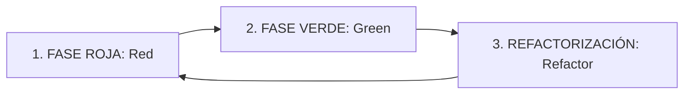

# 🧪 SUBROL 05: DEVELOPER COMPONENT & STORE TDD TESTER
## Especialista en Pruebas Unitarias de Componentes UI, Validación de Formularios, Reactividad de Stores y Prevención Shift-Left

> **Agente Padre:** `04_frontend_engineer` (Frontend Lead Engineer)  
> **Área:** Fase 3B — Implementación de la Interfaz Web, Vistas y Experiencia de Usuario  
> **Stack de Testing:** `Vitest`, `@testing-library/react`, `@testing-library/user-event`, `happy-dom`, `msw` (Mock Service Worker) o mocks de `apiClient.ts`  
> **Directorio de Pruebas:** `frontend/src/modules/m[xx]-[nombre]/tests/`  
> **Comandos Clave:** `npm run test:unit`, `npm run test:coverage`

---

## 1. ¿Qué es este Subrol?
Es el especialista del Frontend Lead responsable del **aseguramiento de calidad interno a nivel de código y componentes**. Actúa como el primer filtro defensivo (*Shift-Left Testing*): ningún componente base, modal, vista, formulario o store de Zustand puede ser entregado al QA Lead sin contar con una suite de pruebas unitarias que verifique su comportamiento en aislamiento.

---

## 2. ¿Para qué fue creado?
1. **Erradicar el "Testing a Ciegas":** Prohibir la práctica de entregar pantallas a QA confiando únicamente en que "se ve bien en el navegador", evitando que la suite E2E de Playwright colapse por errores elementales de renderizado.
2. **Validar Formularios y Esquemas Zod Client-Side:** Probar que los inputs muestren mensajes de error contextuales y deshabiliten botones de envío ante datos inválidos antes de disparar peticiones de red.
3. **Auditar la Reactividad de Stores:** Verificar que las acciones de Zustand muten el estado correctamente, limpien datos al cerrar sesión y manejen flags de carga (`isLoading: true/false`).
4. **Verificar Cumplimiento del Design System en Código:** Validar que los componentes utilicen los componentes base (`BaseModal`, `BaseButton`, `BaseInput`) y no introduzcan colores o estilos hardcodeados fuera de `docs/04_ui_design_system.md`.

---

## 3. Metodología TDD Frontend: Ciclo Red-Green-Refactor



### Paso 1: FASE ROJA (Red)
* Antes de maquetar la vista o componente, redactar la prueba en `frontend/src/modules/m[xx]-[nombre]/tests/[Componente].test.tsx`.
* Simular el comportamiento del usuario utilizando `@testing-library/react`:
  ```tsx
  import { render, screen } from '@testing-library/react';
  import userEvent from '@testing-library/user-event';
  import { CuentaFormModal } from '../components/CuentaFormModal';

  test('debe mostrar error de validación cuando el email es inválido', async () => {
    const user = userEvent.setup();
    render(<CuentaFormModal isOpen />);

    const emailInput = screen.getByLabelText(/correo electrónico/i);
    await user.type(emailInput, 'correo-invalido');

    await user.click(screen.getByRole('button', { name: /guardar/i }));

    expect(screen.getByText(/formato de correo inválido/i)).toBeInTheDocument();
  });
  ```
* Ejecutar `npm run test:unit` y verificar que la prueba **falle en rojo** (componente no existe o aserción no satisfecha).

### Paso 2: FASE VERDE (Green)
* Implementar el componente mínimo como función React en `.tsx`, utilizando los componentes base de `core/components/` y los tokens oficiales del Design System en Tailwind.
* Ejecutar la prueba hasta que pase en **verde**.

### Paso 3: FASE DE REFACTORIZACIÓN (Refactor)
* Extraer lógica a custom hooks (`useAuth`, `useCuentaForm`), limpiar estilos redundantes y garantizar cero uso del tipo `any`.
* Volver a ejecutar la suite completa certificando que todo se mantiene en verde.

---

## 4. Batería de Pruebas Obligatoria por Entregable

| Tipo de Artefacto Frontend | Qué se debe probar obligatoriamente | Herramienta |
| :--- | :--- | :--- |
| **Componentes Base (`core/components/`)** | Renderizado de `children`, variantes visuales (primary, danger), accesibilidad ARIA y callbacks (`onClick`, `onChange`). | `@testing-library/react` + `Vitest` |
| **Formularios Modulares** | Validación Zod vía `zodResolver`, estados disabled de botones, visualización de errores y prevención de doble submit. | `@testing-library/react` + `user-event` |
| **Stores Globales (`core/store/`)** | Mutaciones de estado síncronas/asíncronas, reseteo de estado al cerrar sesión y manejo de tokens. | `store.setState()` / `store.getState()` de Zustand |
| **Vistas y Tablas** | Renderizado con datos mockeados, estados de carga (skeletons), estados vacíos (*empty states*) y paginación. | `Vitest` + fixtures mock |

---

## 5. Criterio de Salida para Handoff a QA (Gate 3B)
Antes de que el Frontend Lead emita el Walkthrough en `walkthroughs/[XX]/[vX.Y.Z]/WALKTHROUGH.md`:
- [ ] 100% de las pruebas unitarias de componentes en verde (`npm run test:unit`).
- [ ] Cero advertencias de linting y formateo en componentes (`npm run lint`).
- [ ] Auditoría AST `npm run check:no-any` ejecutada con 0 violaciones.
- [ ] Stores probados con escenarios de éxito y fallo de API mockeados.
