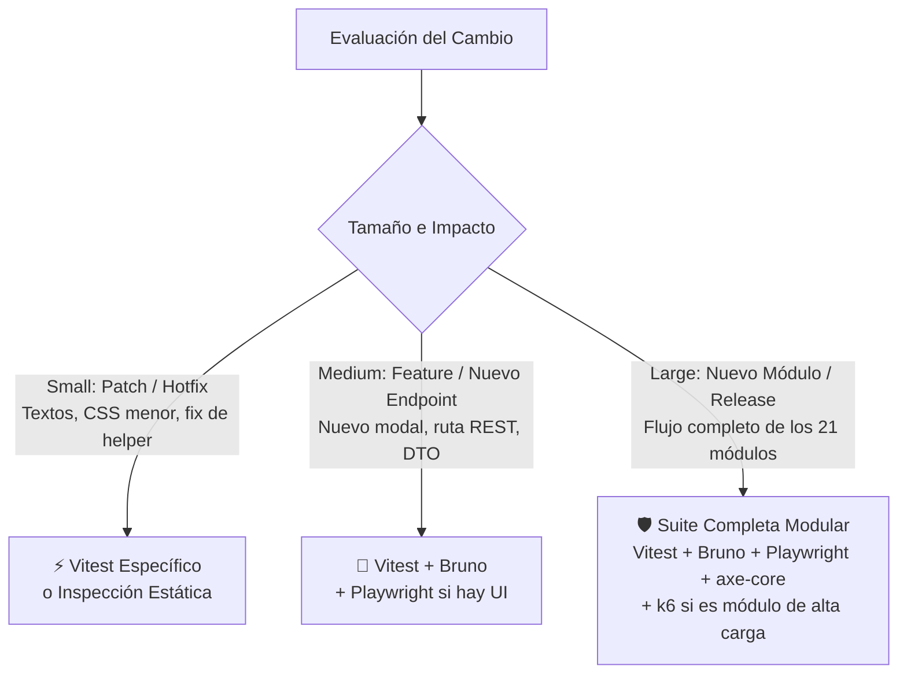

# 🧭 GUÍA OFICIAL DEL ARSENAL DE QA: CASOS DE USO, CRITERIO CRÍTICO Y PROPORCIONALIDAD

> **Audiencia:** QA Lead & Security Compliance Director, SDET, E2E & Accessibility Specialist, Performance Auditor.  
> **Propósito:** Definir exhaustivamente qué hace cada herramienta del arsenal, cómo se ejecuta, **CUÁNDO SÍ debe utilizarse** y **CUÁNDO NO debe utilizarse**, imponiendo un criterio crítico estricto para evitar la sobreingeniería ("overkill") en cambios pequeños.

---

## 1. Principio Rector: Pensamiento Crítico y Proporcionalidad

> ⚠️ **REGLA MANDATORIA DE EFICIENCIA:**  
> **Está terminantemente prohibido disparar todo el arsenal tecnológico para cambios menores o ajustes puntuales.**  
> Cada ejecución de prueba consume tiempo de cómputo y recursos. El QA Lead debe evaluar el **impacto y radio de afectación (Blast Radius)** del cambio antes de decidir qué herramientas convocar.

### Matriz de Proporcionalidad según Tamaño del Cambio



| Nivel de Cambio | Ejemplos Típicos | Herramientas a Emplear | Herramientas Prohibidas / Omitidas |
| :--- | :--- | :--- | :--- |
| **Small (Pequeño / Parche)** | Corrección tipográfica, cambio de padding/color en CSS, fix de regex en validador Zod, ajuste de un helper unitario. | • **Vitest** dirigido (`vitest run ruta/al/test`).<br>• Auditoría regex (colores). | ❌ Prohibido ejecutar k6.<br>❌ Prohibido ejecutar Playwright si no se alteró flujo interactivo.<br>❌ Prohibido correr Bruno para un cambio cosmético. |
| **Medium (Mediano / Feature)** | Nuevo endpoint en módulo existente, nuevo modal React en vista previa, cambio de restricción en base de datos. | • **Vitest** (suite del módulo).<br>• **Bruno CLI** (para probar nuevo endpoint).<br>• **Playwright + axe-core** (si se agregó o alteró el modal). | ❌ Omitir k6 (a menos que sea módulo crítico). |
| **Large (Grande / Módulo Nuevo / Release)** | Implementación de un módulo completo del sistema, o versión mayor/menor. | • **Vitest** (suite unitaria e integración DB).<br>• **Bruno CLI** (colección completa del módulo).<br>• **Playwright** (flujo E2E integral en Chromium).<br>• **@axe-core/playwright** (auditoría WCAG 2.1 AA).<br>• **k6** (obligatorio en módulos de alta concurrencia o mutación masiva). | Ninguna; se justifica el despliegue del arsenal completo para certificación de Gate 4. |

---

## 2. Fichas Técnicas por Herramienta del Arsenal

---

### 🟢 1. Vitest (Sub-rol: SDET)

#### ¿Qué hace?
Es el motor de pruebas unitarias y de integración ultra-rápido para TypeScript/Node.js. Ejecuta aserciones sobre funciones aisladas, contratos Zod, servicios de negocio, transacciones Prisma 6 en PostgreSQL y stores Zustand 5.

#### ¿Cómo usarla?
```bash
# Ejecutar toda la suite del backend
cd backend && npm test

# Ejecutar una sola suite específica de un módulo
npx vitest run tests/modules/04_estructura.test.ts

# Ejecutar con reporte de cobertura
npx vitest run --coverage
```

#### ✅ CUÁNDO SÍ USARLA:
1. En **CADA** cambio de lógica de negocio en backend (servicios, controladores, helpers).
2. Al modificar o crear esquemas y contratos Zod.
3. Para validar transacciones ACID en PostgreSQL (`prisma.$transaction()`).
4. Para probar cálculos complejos, reglas de negocio e inmutabilidad.
5. En cambios en stores de Zustand 5 o utilitarios puros de TypeScript en frontend.

#### ❌ CUÁNDO NO USARLA:
1. Para validar flujos visuales de usuario navegando de una página a otra.
2. Para comprobar si un botón tiene el color correcto de Tailwind (eso se hace con Playwright o inspección estática).
3. Para pruebas de carga o concurrencia masiva con múltiples conexiones simultáneas.

---

### 🎭 2. Playwright (Sub-rol: E2E Specialist)

#### ¿Qué hace?
Automatiza un navegador Chromium headless real. Simula interacciones humanas idénticas: hacer login real, diligenciar inputs, abrir y cerrar modales, hacer clics en botones, inspeccionar cookies/localStorage y validar la reactividad del Virtual DOM en React 19 / Next.js 15.

#### ¿Cómo usarla?
```bash
# Ejecutar toda la suite E2E
cd frontend && npm run test:e2e

# Ejecutar una prueba específica
npx playwright test tests/e2e/auth_dashboard_a11y.spec.ts

# Ejecutar en modo interactivo con interfaz gráfica (UI Mode)
npx playwright test --ui

# Ejecutar en modo debug con inspector paso a paso
npx playwright test --debug
```

#### ✅ CUÁNDO SÍ USARLA:
1. Al certificar la entrega de un **nuevo módulo funcional** que posee vista de usuario.
2. Al crear un nuevo flujo interactivo de formularios (ej. abrir modal -> llenar campos -> submit -> verificar que aparece en la tabla).
3. Para verificar el ciclo de vida de la sesión (login, token en localStorage, redirección por rol, logout).
4. Para validar la navegación por pestañas (tabs) y la persistencia de filtros en cliente.

#### ❌ CUÁNDO NO USARLA:
1. **Para un cambio pequeño de texto o tipografía en un párrafo:** No abras un navegador headless de 30 segundos solo para verificar que un texto cambió; lee el archivo o haz una prueba unitaria ligera.
2. **Para validar una regla de validación de backend:** Si el backend rechaza cédulas inválidas, eso se prueba con Vitest en 15 milisegundos, no mediante Playwright en 2 segundos.
3. **En refactorizaciones puramente internas:** Si se refactorizó un servicio sin tocar la UI ni sus contratos, Playwright no debe ejecutarse si la suite previa está intacta.

---

### ♿ 3. @axe-core/playwright (Sub-rol: A11y Specialist)

#### ¿Qué hace?
Es el motor de auditoría de accesibilidad líder en la industria. Se ejecuta directamente dentro de las pruebas de Playwright, inyectándose en el DOM vivo para verificar el cumplimiento estricto del estándar **WCAG 2.1 Niveles A y AA** (reglas de etiquetas en formularios, `aria-label`, nombres accesibles en botones de solo icono, jerarquía de encabezados `h1-h6`, roles ARIA).

#### ¿Cómo usarla?
```typescript
import AxeBuilder from '@axe-core/playwright';

// En tu prueba de Playwright:
const accessibilityScanResults = await new AxeBuilder({ page })
  .withTags(['wcag2a', 'wcag2aa'])
  .disableRules(['color-contrast']) // Opcional si hay gradientes decorativos autorizados
  .analyze();

expect(accessibilityScanResults.violations).toEqual([]);
```

#### ✅ CUÁNDO SÍ USARLA:
1. En conjunto con Playwright siempre que se audite una vista principal o modal nuevo.
2. Cuando se agreguen botones con iconos interactivos que no contengan texto visible (ej. botones de ojo para contraseñas, lápiz para editar, caneca para eliminar).
3. Cuando se construyan formularios con selectores desplegables o inputs complejos.

#### ❌ CUÁNDO NO USARLA:
1. En módulos y tareas de Backend puro (no existe DOM que auditar).
2. En pruebas unitarias de TypeScript o consultas de Prisma.
3. Para auditar contraste de ilustraciones o banners artísticos estáticos.

---

### 📬 4. Bruno CLI (Sub-rol: SDET)

#### ¿Qué hace?
Es una herramienta de testing de API REST declarativa basada en texto plano (`.bru`), 100% amigable con Git. Permite versionar peticiones HTTP con assertions, payloads JSON y variables de entorno (`baseUrl`, tokens) sin depender de software propietario en la nube (Postman/Insomnia).

#### ¿Cómo usarla?
```bash
# Ejecutar todas las colecciones de Bruno con el entorno Local
bru run tests/bruno --env Local

# Ejecutar una colección modular específica
bru run tests/bruno/04_estructura --env Local
```

#### ¿Dónde están los archivos?
`tests/bruno/`
- `bruno.json`: Configuración de la colección.
- `environments/Local.bru`: Variables (`baseUrl: http://localhost:3000/api/v1`).
- `[XX_modulo]/[endpoint].bru`: Cada endpoint tipado con sus assertions HTTP.

#### ✅ CUÁNDO SÍ USARLA:
1. Siempre que se implemente un **nuevo endpoint REST** en un módulo.
2. Para verificar códigos de estado HTTP (200, 201, 400, 401, 403, 404, 409).
3. Para validar que las respuestas JSON coincidan con los DTOs de salida del contrato Zod.
4. Para pruebas de regresión rápida de API sin requerir levantar el navegador ni el frontend.

#### ❌ CUÁNDO NO USARLA:
1. Para validar lógica interna que no se expone vía HTTP.
2. Para verificar la reactividad o el renderizado de la UI de Vue.
3. En cambios puramente cosméticos de estilos en frontend.

---

### ⚡ 5. k6 (Sub-rol: Performance Auditor)

#### ¿Qué hace?
Es el estándar de la industria para pruebas de carga, estrés y rendimiento con scripting en JavaScript moderno. Simula decenas o cientos de Usuarios Virtuales (VUs) concurrentes realizando transacciones simultáneas para medir latencia (p95, p99), consumo de sockets y resistencia del pool de conexiones de PostgreSQL.

#### ¿Cómo usarla?
```bash
# Ejecutar script de carga de estrés con k6
k6 run tests/load/k6_stress_auth_sedes.js

# Ejecutar con sobreescritura de VUs para prueba rápida de humo
k6 run --vus 5 --duration 10s tests/load/k6_stress_auth_sedes.js
```

#### ✅ CUÁNDO SÍ USARLA (Uso Crítico y Quirúrgico):
1. **Módulos Transaccionales Masivos:** Obligatorio antes del release para simular decenas de usuarios concurrentes en operaciones de alto volumen.
2. **Módulos de Cierre y Bloqueo:** Obligatorio para certificar la inmutabilidad de datos bajo concurrencia.
3. **Módulos de Reportes y Procesamiento en Lote:** Obligatorio para medir el impacto de operaciones pesadas.
4. **Hitos Mayores de Release:** Antes del paso a `v1.0.0` para certificar la estabilidad global del servidor.

#### ❌ CUÁNDO NO USARLA (Estricta Prohibición de Overkill):
1. ❌ **Módulos Administrativos de Baja Frecuencia:** Prohibido correr k6 en catálogos de baja mutación durante tareas rutinarias.
2. ❌ **Cambios tipo Small o Medium:** No ejecutes k6 para probar un bugfix en un formulario o un cambio de texto.
3. ❌ **En entornos de CI/CD rápidos de desarrollo:** k6 toma minutos y puede saturar innecesariamente bases de datos de desarrollo.

---

## 3. Guía de Redacción de QA Reports

A partir de la versión `v0.5.1`, **TODO reporte de QA (`QA_REPORT.md`) DEBE incluir un encabezado y desglose explícito de las herramientas utilizadas y el criterio de selección aplicado.**

### Formato Obligatorio a Incluir en Cada Reporte:

```markdown
## 2. Herramientas de QA Empleadas y Desglose de Pruebas

### 2.1 Criterio de Selección Crítica (Proporcionalidad del Cambio)
- **Tamaño del Cambio Evaluado:** [Small / Medium / Large]
- **Justificación de Herramientas Activadas:** [Explicar por qué se seleccionaron las herramientas elegidas según el impacto].
- **Herramientas Omitidas y Motivo:** [Explicar por qué se omitieron k6, Playwright o Bruno si no aplicaban, evitando sobreingeniería].

### 2.2 Desglose de Pruebas Ejecutadas por Instrumento
| Herramienta | Sub-Rol Responsable | Suites / Archivos Ejecutados | Casos Probados | Resultado |
| :--- | :--- | :--- | :---: | :---: |
| **Vitest** | SDET | `backend/tests/modules/XX_*.test.ts` | X tests | ✅ PASS (X ms) |
| **Playwright** | E2E Specialist | `frontend/tests/e2e/XX_*.spec.ts` | X suites | ✅ PASS (X s) |
| **@axe-core/playwright** | A11y Specialist | Integrado en Playwright (`wcag2aa`) | Vistas y Modales | ✅ 0 violaciones |
| **Bruno CLI** | SDET | `tests/bruno/XX_*/` | X endpoints | ✅ PASS |
| **k6** | Performance | `tests/load/k6_*.js` | X VUs / p95 | [✅ PASS / Omitido con justificación] |
```

---

## 4. Resumen Mnemotécnico para el Agente

Antes de lanzar una herramienta, hazte estas 3 preguntas:
1. *¿Este cambio afecta la lógica o los datos?* ➔ **Vitest**.
2. *¿Este cambio agrega o altera una interfaz donde el usuario hace clic o navega?* ➔ **Playwright + axe-core**.
3. *¿Este cambio está en una ruta crítica que sufrirá cientos de peticiones simultáneas?* ➔ **k6**. Si la respuesta es no, **NO lo ejecutes**.
