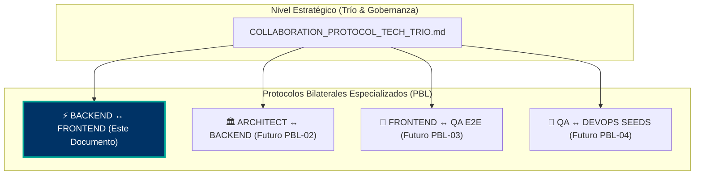
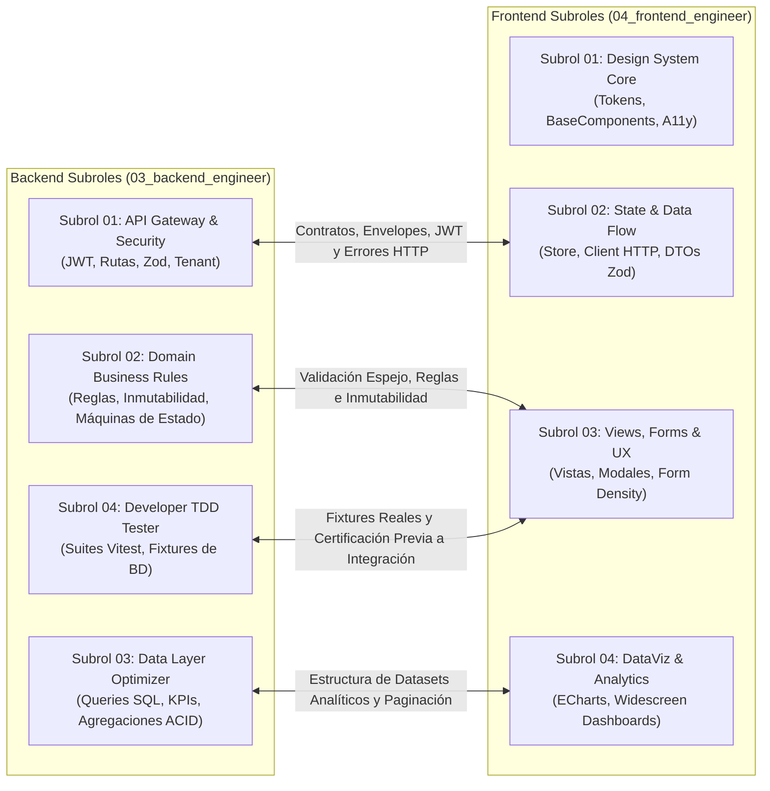

# ⚡ PROTOCOLO BILATERAL DE SINCRONIZACIÓN Y RELEVO: SUBROLES BACKEND ⇄ SUBROLES FRONTEND (PBL-01)

> **Tipo de Documento:** Protocolo Bilateral de Líderes (PBL)  
> **Identificador:** `PBL-01`  
> **Líderes Regulados:** `03_backend_engineer` (Fase 3A) y `04_frontend_engineer` (Fase 3B)  
> **Compuerta de Calidad Afectada:** Stage-Gate 3A (Backend) ➔ Stage-Gate 3B (Frontend)  
> **Estado:** OBLIGATORIO / VIGENTE  
> **Objetivo:** Eliminar la fricción, desacoples y supuestos entre Backend y Frontend mediante sincronización directa subrol a subrol.

---

## 1. Contexto y Taxonomía: La Familia de Protocolos Bilaterales (PBL)

En proyectos complejos de alta densidad, las guías globales (como `COLLABORATION_PROTOCOL_TECH_TRIO.md`) definen el marco estratégico general. Sin embargo, cuando dos áreas técnicas entran a la fase de construcción activa, necesitan un **manual de operaciones milimétrico bilateral** que resuelva los roces diarios de implementación sin involucrar a roles que no participan directamente en ese código.

Este protocolo es el primer artefacto de la serie de **Protocolos Bilaterales de Líderes (PBL)**:



---

## 2. El Principio del "Espejo Técnico": Mapeo Subrol a Subrol

Cada subrol del Backend tiene un **interlocutor natural** en el Frontend. No se trabaja de manera genérica ("backend le pasa a frontend"), sino de **especialista a especialista**:



---

## 3. Matriz Operativa de Sincronización Bilateral

### Vía 1: Subrol 01 Backend ⇄ Subrol 02 Frontend (Seguridad, Contratos y Envelopes)
* **Objetivo:** Zero runtime exceptions por discrepancias en transporte JSON.
* **Compromisos de Backend (01):**
  1. El 100% de las respuestas siguen el sobre canónico `{ success: true, data: T }` o `{ success: false, error: ... }`.
  2. Los códigos HTTP deben ser semánticos: `200` (OK), `201` (Created), `400` (Bad Request), `401` (Unauthorized), `403` (Forbidden/IDOR), `404` (Not Found), `409` (Conflict), `422` (Unprocessable).
  3. Toda validación perimetral Zod rechaza campos extra no autorizados.
* **Compromisos de Frontend (02):**
  1. El cliente HTTP inyecta automáticamente el token Bearer desde la store de autenticación.
  2. Manejo global de expiración de sesión (código `401` redirige al login sin recargar bruscamente).
  3. Los stores extraen siempre `response.data.data` y nunca acceden a propiedades directas sin desenvolver el Envelope.

---

### Vía 2: Subrol 02 Backend ⇄ Subrol 03 Frontend (Reglas de Negocio y Formularios)
* **Objetivo:** Coherencia absoluta entre la lógica de negocio y los formularios de usuario.
* **Compromisos de Backend (02):**
  1. Si una entidad está en estado terminal o bloqueado, cualquier intento de mutación responde con código HTTP `409 Conflict` y código interno descriptivo.
  2. Las reglas y rangos válidos se validan con Zod en backend.
* **Compromisos de Frontend (03):**
  1. **UX Proactiva:** Los formularios deshabilitan campos y botones de acción (o muestran banners informativos de solo lectura) cuando el recurso esté bloqueado.
  2. **Validación Espejo:** Si el backend valida un rango numérico o formato, el input en cliente aplica validación espejo en tiempo real.
  3. **Visualización de Errores de Negocio:** Si backend responde `409`, la vista captura el mensaje descriptivo y muestra una alerta accesible.

---

### Vía 3: Subrol 03 Backend ⇄ Subrol 04 Frontend (Analítica, KPIs y Visualizaciones)
* **Objetivo:** Dashboards ejecutivos fluidos, con datos 100% reales y cero impacto negativo en la base de datos.
* **Compromisos de Backend (03):**
  1. Los endpoints analíticos realizan agregaciones SQL eficientes (`count`, `groupBy`, filtros de índice por tenant).
  2. NUNCA enviar arrays masivos de miles de filas para que el frontend los cuente en JavaScript. El cálculo estadístico se hace en el servidor/BD.
  3. Estructurar el DTO de respuesta en formatos amigables para gráficos (`{ series, categories }` o pares `{ name, value }`).
* **Compromisos de Frontend (04):**
  1. Conectar las gráficas exclusivamente a los datos devueltos por el backend (Cero mocks ficticios en producción).
  2. Implementar estados de carga (`SkeletonLoader` o spinner oficial) mientras el endpoint responde.
  3. Gestionar estados vacíos con gracia cuando la organización no tenga registros históricos.

---

### Vía 4: Subrol 04 Backend ⇄ Subroles 03/04 Frontend (Fixtures Reales y Certificación Previa)
* **Objetivo:** El desarrollador de Frontend NUNCA debe integrar contra un endpoint "teórico" que falla al primer llamado.
* **Compromisos de Backend (04):**
  1. Antes de declarar un endpoint como disponible para Frontend, el Subrol 04 de Backend DEBE haber ejecutado su suite de integración interna (`npm test`).
  2. La suite debe certificar casos felices, casos de validación y rechazos de seguridad.
  3. Se proporciona un ejemplo de payload real y colección para prueba inmediata.

---

## 4. Matriz de Relevo (Handshake) en WORKLOG.md

Cuando el Backend Lead y sus subroles finalizan un endpoint o módulo, **DEBEN** dejar en su `WORKLOG.md` el siguiente bloque estandarizado:

```markdown
### 🤝 RELEVO TÉCNICO BILATERAL: BACKEND ➔ FRONTEND
- **Módulo / Característica:** [Nombre del Módulo]
- **Subroles de Backend Actores:** 01 (Gateway) + 02 (Domain) + 03 (Data) + 04 (TDD)
- **Subroles de Frontend Receptores:** 02 (State) + 03 (Views)
- **Contrato Zod Oficial:** `docs/contracts/XX_[modulo].contract.ts`
- **Endpoints Verificados (100% PASS):**
  - `GET  /api/v1/[modulo]` -> Retorna lista con Envelope.
  - `POST /api/v1/[modulo]` -> Crea registro validado (ACID).
- **Ejemplo de Payload Válido:**
  ```json
  {
    "name": "Ejemplo",
    "amount": 100
  }
  ```
- **Códigos de Error Previstos:**
  - `RESOURCE_LOCKED_CONFLICT` (409): Recurso bloqueado o cerrado.
- **Estado de Pruebas:** Suites de integración 100% PASS.
```
