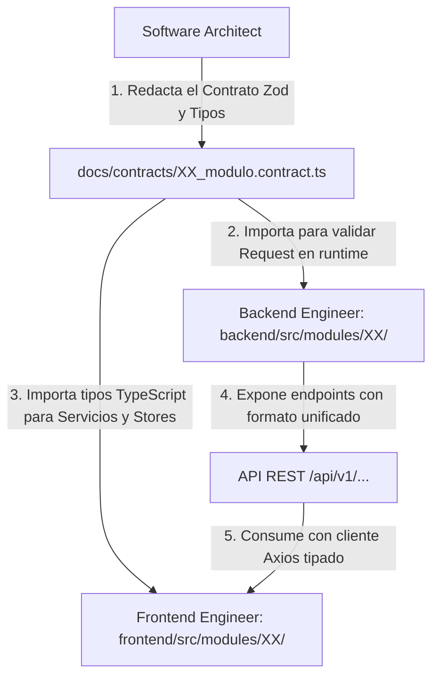

# 🤝 PROTOCOLO DE COLABORACIÓN Y SINCRONIZACIÓN TÉCNICA
## (Arquitecto ↔ Backend Engineer ↔ Frontend Engineer)

> **Propósito:** Definir el canal exacto, los formatos de intercambio y las reglas de interacción entre los 3 agentes responsables de la construcción del código, eliminando suposiciones, discrepancias de nombres y desalineaciones de endpoints.

---

## 1. El Núcleo de la Cooperación: Contratos Tipados de Extremo a Extremo

Frontend y Backend **NO se comunican por chat informal**; se comunican mediante **Contratos Zod en TypeScript**:



### Regla de Oro del Tipado Compartido:
- El Arquitecto define el validador Zod:
  ```typescript
  export const createItemSchema = z.object({
    entityId: z.string().uuid(),
    code: z.string().min(2).max(50),
    amount: z.number().positive(),
    notes: z.string().max(300).optional()
  });
  // Tipo inferido automáticamente para Backend y Frontend
  export type CreateItemDTO = z.infer<typeof createItemSchema>;
  ```
- **Backend** usa `createItemSchema` para validar la petición HTTP entrante antes de que llegue a la base de datos.
- **Frontend** usa `CreateItemDTO` como tipo estático de TypeScript en sus formularios y stores.
- **Resultado:** Si el contrato cambia, **ambos lados se enteran en tiempo de compilación**, no cuando el usuario hace clic en producción.

---

## 2. El Formato Estándar de Respuesta HTTP (Envelope Inmutable)

Para que el Frontend siempre sepa qué esperar de cualquier controlador del Backend, **todas las respuestas de la API deben usar el mismo envoltorio (Envelope)**:

### A. Respuesta Exitosa (`success: true`)
```json
{
  "success": true,
  "data": {
    "id": "b3e3e29f-...",
    "calificacion": 4.5,
    "desempeno": "Alto"
  },
  "message": "Calificación registrada exitosamente"
}
```

### B. Respuesta con Paginación Escolar (`success: true`)
```json
{
  "success": true,
  "data": [ ... ],
  "pagination": {
    "page": 1,
    "limit": 30,
    "total": 120,
    "totalPages": 4
  }
}
```

### C. Respuesta de Error Controlado (`success: false`)
```json
{
  "success": false,
  "error": {
    "code": "RESOURCE_LOCKED_CONFLICT",
    "message": "Operación rechazada: La entidad se encuentra en estado CERRADO e inmutable",
    "details": null
  }
}
```

---

## 3. El Flujo de Trabajo en 4 Pasos (Handshake Paso a Paso)

```text
┌────────────────────────────────────────────────────────────────────────┐
│ PASO 1: El Arquitecto publica el Contrato y el Mapa de Rutas           │
│         - Escribe docs/contracts/XX_modulo.contract.ts                 │
│         - Actualiza docs/modules/XX/04_ARQUITECTURA_Y_CODIGO.md        │
└───────────────────────────────────┬────────────────────────────────────┘
                                    │
                                    ▼
┌────────────────────────────────────────────────────────────────────────┐
│ PASO 2: El Backend Engineer implementa y publica datos de prueba       │
│         - Crea backend/src/modules/XX/                                 │
│         - Valida contra el contrato Zod y Prisma                       │
│         - Deja en su WORKLOG.md: Métodos HTTP, payloads y curl ejemplo │
└───────────────────────────────────┬────────────────────────────────────┘
                                    │
                                    ▼
┌────────────────────────────────────────────────────────────────────────┐
│ PASO 3: El Frontend Engineer consume e implementa la UI                │
│         - Crea frontend/src/modules/XX/                                │
│         - Usa los tipos TypeScript del contrato                        │
│         - Construye vistas, componentes React y stores Zustand         │
└───────────────────────────────────┬────────────────────────────────────┘
                                    │
                                    ▼
┌────────────────────────────────────────────────────────────────────────┐
│ PASO 4: Sincronización y Feedback Loop (Si faltan campos)              │
│         - Si Frontend necesita un dato nuevo en la tabla, NUNCA lo     │
│           inventa en el template.                                      │
│         - Emite una "Solicitud de Extensión de Contrato" al Backend.   │
└────────────────────────────────────────────────────────────────────────┘
```

---

## 4. Protocolo de "Solicitud de Extensión" (Feedback Loop Frontend ➔ Backend)

Si durante la construcción de la interfaz el Frontend nota que la vista necesita un dato adicional (ejemplo: mostrar el estado de auditoría junto al registro):

1. **El Frontend NO simula datos fijos (hardcodeados) en la UI.**
2. Agrega una nota en su `WORKLOG.md` y en el del Backend:
   ```markdown
   > ⚠️ **SOLICITUD DE EXTENSIÓN DE ENDPOINT**
   > **Módulo:** 02_operaciones
   > **Endpoint:** `GET /api/v1/operaciones/:id`
   > **Campo solicitado:** `auditStatus: string`
   > **Motivo:** Requisito de visualización en la vista de detalle.
   ```
3. El Backend Engineer actualiza la persistencia y el contrato Zod, y notifica al Frontend para que consuma el nuevo campo con tipado real.
