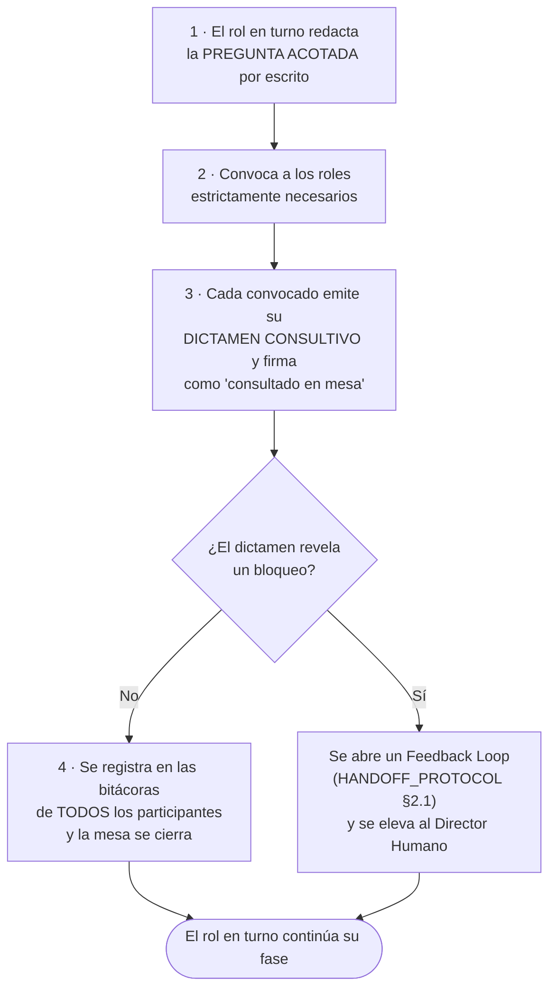

# 🪑 PROTOCOLO DE MESA DE CONSULTA ACOTADA (BYPASS DE CONVOCATORIA)

> **Propósito:** Permitir que el rol que tiene el turno convoque a otros roles líderes para un acto
> **consultivo y acotado**, sin transferir el turno ni abrir una fase, cuando un entregable exige la
> participación formal de varios roles a la vez.
>
> **Problema que resuelve:** el SDLC asume los roles de forma **secuencial**, pero algunos ritos son
> por definición **simultáneos**. El caso canónico es la mesa ATDD (*Three Amigos*), que la
> Definition of Ready del Product Manager exige firmada por PM + Arquitecto + QA antes de Gate 1,
> cuando ni el Arquitecto ni el QA han tomado todavía su turno. Sin este protocolo, el rito es
> imposible de cumplir y el equipo acaba simulándolo o saltándoselo: ambas salidas son peores.

---

## 1. Qué es y qué NO es

| ✅ La Mesa de Consulta **SÍ** permite | ❌ La Mesa de Consulta **NO** permite |
| :--- | :--- |
| Convocar a uno o varios roles para responder una **pregunta acotada y escrita** | Aprobar, firmar o avanzar un **Stage-Gate** |
| Emitir un **dictamen consultivo** (testabilidad, viabilidad, riesgo de seguridad) | Producir los **entregables propios** del rol convocado |
| Firmar una ficha de rito (`01_ATDD_SPEC.md`) en calidad de **consultado** | Sustituir la firma del **Director Humano** |
| Detectar un bloqueo y abrir un Feedback Loop | Saltarse el **Alto Mecánico** (Regla de Oro #10) |
| Dejar constancia en las bitácoras de todos los participantes | Escribir en un **dominio reservado** a otro rol (p. ej. DevOps) |

> 🔒 **Las Reglas de Oro #4 y #10 quedan intactas.** Este protocolo abre un canal **consultivo**,
> nunca una vía de autoaprobación. Ningún agente puede, mediante una Mesa de Consulta,
> aprobarse a sí mismo una compuerta ni encadenar la fase siguiente.

---

## 2. Cuándo se puede convocar

La Mesa de Consulta es de **activación restringida**. Solo procede en estos tres escenarios:

| # | Escenario | Convoca | Convocados | Artefacto que firma |
| :---: | :--- | :--- | :--- | :--- |
| **C-1** | **Rito ATDD / Three Amigos** — certificar la testabilidad de los escenarios BDD antes de Gate 1 | `01_product_manager` | `02_software_architect`, `05_qa_security_tester` | `docs/modules/[XX]/01_ATDD_SPEC.md` |
| **C-2** | **Dictamen de viabilidad técnica** — el PM o el Arquitecto necesitan saber si un requisito es construible antes de fijarlo | Rol en turno | El rol constructor afectado | Nota en el artefacto en curso |
| **C-3** | **Consulta de seguridad o cumplimiento** — una decisión de diseño roza M20/M17 o normativa | Rol en turno | `05_qa_security_tester` y/o `01_product_manager` (subrol 02 Legal) | Nota en el artefacto en curso |

> Cualquier otro escenario **no está cubierto** y exige el traspaso de turno ordinario del
> [`HANDOFF_PROTOCOL.md`](HANDOFF_PROTOCOL.md).

---

## 3. Procedimiento en 4 pasos



1. **Pregunta acotada.** El rol en turno escribe qué necesita saber. Una mesa sin pregunta escrita es
   una conversación, no un rito, y no produce firma válida.
2. **Convocatoria mínima.** Se convoca solo a los roles estrictamente necesarios. Convocar al consejo
   entero para una duda puntual es un antipatrón.
3. **Dictamen y firma.** Cada convocado responde **desde su especialidad y solo sobre la pregunta**.
   Firma con el sello `🪑 Consultado en mesa`, nunca con el de `✅ Firmado en turno propio`.
4. **Constancia.** La mesa se registra en el `WORKLOG.md` del convocante **y en el de cada convocado**.

---

## 4. Formato obligatorio del Acta de Mesa

```markdown
### 🪑 Acta de Mesa de Consulta Acotada
- **Escenario:** [C-1 / C-2 / C-3]
- **Convoca:** [rol en turno] · **Fecha:** [AAAA-MM-DD] · **Módulo:** [MXX]
- **Pregunta acotada:** [una sola pregunta, verificable]
- **Convocados:** [roles]
- **Dictámenes:**
  - 🪑 `[rol]` — [dictamen en una o dos frases] — **[CONFORME / CONFORME CON RESERVA / NO CONFORME]**
- **Resultado:** [la mesa se cierra conforme / se abre Feedback Loop]
- **Alcance de la firma:** consultiva. No aprueba Stage-Gate alguno.
```

---

## 5. Sellos de firma — distinción obligatoria

Para que una firma consultiva **nunca se confunda** con una firma de turno, los artefactos usan tres
sellos distintos:

| Sello | Significado | Quién lo pone |
| :--- | :--- | :--- |
| ✅ **Firmado en turno propio** | El rol ejecutó su fase completa y responde por el entregable | El rol en su turno |
| 🪑 **Consultado en mesa** | El rol respondió una pregunta acotada; **no** ha ejecutado su fase | El rol convocado |
| 🖊️ **Firma del Director Humano** | Aprobación de compuerta | Solo el Director Humano |

> ⚠️ Un sello 🪑 **no exime** al rol de ejecutar su fase y firmar ✅ cuando le llegue el turno. Si al
> tomar su turno el rol contradice su propio dictamen consultivo, prevalece el de turno y se registra
> la discrepancia en su `WORKLOG.md`.

---

## 6. Potestad del Director Humano

El Director Humano puede, en cualquier compuerta:
- **Revocar** un dictamen consultivo y exigir que el rol lo reemita en su turno propio.
- **Exigir mesa presencial** para un rito concreto, desactivando el bypass en ese caso.
- **Ampliar** el catálogo de escenarios de §2 mediante un RFC
  ([`TECHNICAL_PROPOSALS_PROTOCOL.md`](TECHNICAL_PROPOSALS_PROTOCOL.md)).

---

## 7. Trazabilidad

Toda Mesa de Consulta deja rastro en tres sitios, sin excepción:
1. El **artefacto** firmado, con el sello 🪑 y la fecha.
2. El `WORKLOG.md` del **convocante**, con el acta completa de §4.
3. El `WORKLOG.md` de **cada convocado**, con su dictamen.

Omitir cualquiera de los tres invalida la mesa (Regla de Oro #5: prohibido omitir la bitácora).
