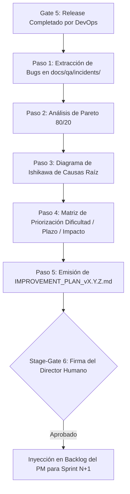

# 📈 PROTOCOLO DE RETROSPECTIVA TÉCNICA Y MEJORA CONTINUA KAIZEN

> **Fase del SDLC:** Fase 6 — Retrospectiva Técnica, Análisis de Causa Raíz y Plan de Mejora  
> **Comité de Calidad Responsable:** `00_orchestrator`, `05_qa_security_tester`, `06_devops_release`, `02_software_architect`, `01_product_manager`  
> **Plantilla Vinculante:** [`protocols/TEMPLATES/CONTINUOUS_IMPROVEMENT_TEMPLATE.md`](file:///multiAgents/protocols/TEMPLATES/CONTINUOUS_IMPROVEMENT_TEMPLATE.md)  
> **Artefacto Emitido:** `docs/quality/IMPROVEMENT_PLAN_v[X.Y.Z].md`  
> **Compuerta Asociada:** **Stage-Gate 6** (Aprobación del Plan de Mejora para el Siguiente Sprint)

---

## 1. Filosofía de Operación: La Calidad como Proceso que Aprende

El aseguramiento de la calidad en el sistema multiagente no culmina con el despliegue del software. Si un equipo se limita a corregir errores sin analizar por qué ocurrieron, está condenado a repetir los mismos fallos en las iteraciones siguientes.

El **Protocolo Kaizen** formaliza la **Fase 6 del SDLC**:
1. **Transformar Incidentes en Aprendizaje:** Analizar objetivamente todos los defectos (`BUG-[MOD]-[NUM]`) resueltos durante la versión para erradicar sus causas raíz.
2. **Focalización Eficiente (Pareto 80/20):** Concentrar los esfuerzos de ingeniería en el 20% de las debilidades que originaron el 80% de las fricciones.
3. **Priorización Pragmática:** Clasificar mejoras evaluando Dificultad, Plazo e Impacto para separar soluciones inmediatas (*Quick Wins*) de reingenierías profundas.
4. **Alimentación Continua del Backlog:** Los compromisos de mejora no quedan en papel mojado; se convierten en requerimientos técnicos innegociables para el Product Manager en el Sprint N+1.

---

## 2. Flujo de Ejecución de la Sesión Kaizen (Paso a Paso)



### Paso 1: Recolección y Clasificación de Defectos
Inmediatamente tras el release en Stage-Gate 5, el QA Lead y DevOps extraen todos los reportes de incidentes generados en el ciclo:
- Revisión de fichas en `docs/qa/incidents/BUG-[MOD]-[NUM].md`.
- Conteo de fallos por área: backend, frontend, contratos, seeds, base de datos, tipado o configuración.

### Paso 2: Análisis de Pareto (80/20)
El comité agrupa los defectos por tipología y calcula porcentajes acumulados:
- **Criterio 80/20:** Identificar las 1 o 2 categorías principales que concentran la gran mayoría de problemas.
- **Directriz:** Queda prohibido plantear planes de mejora dispersos que aborden 15 temas secundarios a la vez; el esfuerzo debe centrarse en la cabeza de Pareto.

### Paso 3: Análisis Forense de Causa Raíz con Ishikawa (Espina de Pescado)
Para las categorías críticas identificadas, se mapean las causas profundas a través de 5 ramas:
1. **Métodos de Trabajo:** ¿Faltaron checklists? ¿Los criterios ATDD omitieron casos frontera?
2. **Personas / Supuestos:** ¿El desarrollador asumió una convención no documentada? ¿Faltó capacitación en la herramienta?
3. **Herramientas & Linters:** ¿Por qué el compilador o linter no detectó el fallo antes de QA?
4. **Entorno & Datos:** ¿Los seeds de prueba estaban desactualizados? ¿Hubo diferencias entre local y CI?
5. **Arquitectura & Código:** ¿Falta un helper centralizado? ¿Hay código duplicado o excesivamente acoplado?

### Paso 4: Matriz de Priorización Multicriterio (Dificultad vs Plazo vs Impacto)
Cada propuesta de solución se califica según las 3 variables del estándar industrial:

```
                      MATRIZ DE DECISIÓN KAIZEN
         Impacto
           ▲
      ALTO │   [QUICK WINS]              [PROYECTOS ESTRATÉGICOS]
           │   Baja Dificultad / Corto   Alta Dificultad / Medio Plazo
           │   Acción Inmediata (P1)     Planificar en Roadmap (P2)
           │
      BAJO │   [TAREAS MENORES]          [DESCARTADOS / POSPUESTOS]
           │   Baja Dificultad / Corto   Alta Dificultad / Poco Impacto
           │   Backlog secundario        No justificado
           └────────────────────────────────────────────────────────►
              BAJA                      ALTA            Dificultad
```

* **Dificultad de Implantación:** Ninguna / Poca / Bastante / Mucha.
* **Plazo de Implantación:** Inmediato / Corto / Medio / Largo.
* **Impacto en la Organización:** Mucho / Bastante / Poco / Ninguno.

### Paso 5: Formulación del Plan de Mejora (`IMPROVEMENT_PLAN_vX.Y.Z.md`)
El DevOps Lead consolida el informe utilizando [`protocols/TEMPLATES/CONTINUOUS_IMPROVEMENT_TEMPLATE.md`](file:///multiAgents/protocols/TEMPLATES/CONTINUOUS_IMPROVEMENT_TEMPLATE.md), asignando a cada acción:
- Tareas concretas y verificables.
- Agente líder responsable (Backend Lead, Frontend Lead, Architect o DevOps).
- Tiempos de inicio y fin dentro del siguiente sprint.
- **KPI cuantitativo de éxito** (ej. *"0 incidencias por timezone en el siguiente reporte de QA"*).

---

## 3. Criterio de Salida y Aprobación (Stage-Gate 6)

Para que el Orquestador dé por concluido formalmente el ciclo de la versión y habilite el inicio del siguiente módulo:
- [ ] Documento `docs/quality/IMPROVEMENT_PLAN_v[X.Y.Z].md` redactado y firmado por el Comité Kaizen.
- [ ] Al menos 1 acción de mejora de tipo **Quick Win** programada para los primeros 3 días del siguiente sprint.
- [ ] Firma de aprobación del **Director Humano** en Stage-Gate 6.
- [ ] Transferencia formal al **Product Manager Lead** para incluir las tareas técnicas en el nuevo PRD / Backlog.
