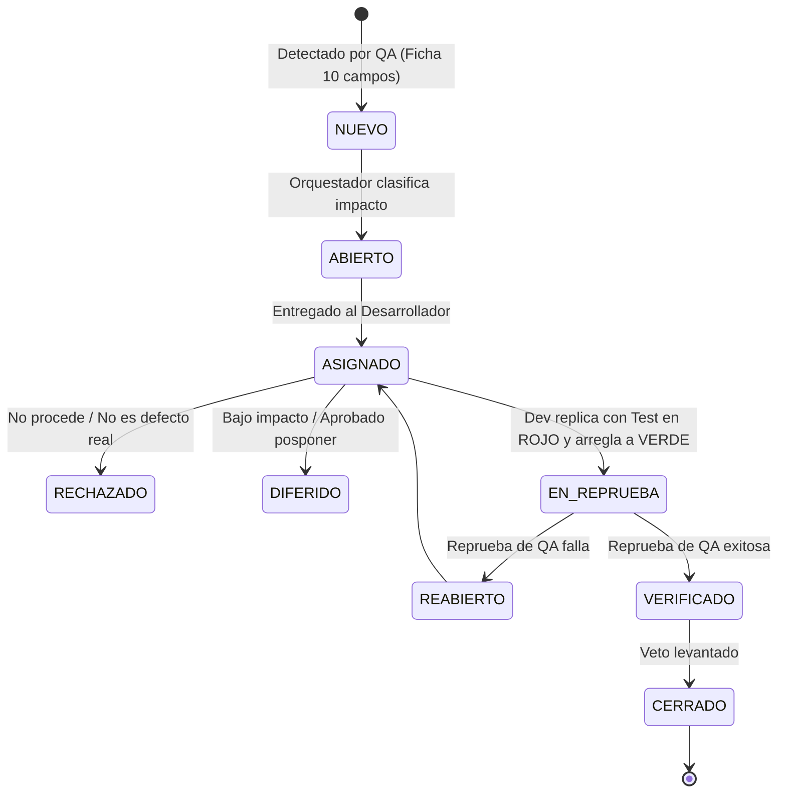

# 🤝 PROTOCOLO DE TRASPASO ENTRE AGENTES (HANDOFF PROTOCOL)

> **Propósito:** Regular el intercambio formal de responsabilidades entre agentes al completar cada fase del SDLC, evitando vacíos de comunicación y garantizando la trazabilidad.

---

## 1. El Formato de Acta de Traspaso (Handoff Certificate)
Cada vez que un agente completa su labor, debe anexar al final de su artefacto o presentar al Orquestador un **Certificado de Traspaso**:

```markdown
### 📋 Certificado de Traspaso de Fase
- **Fase Emisora:** [Ej. Fase 1: Requerimientos]
- **Agente Emisor:** [Ej. Product Manager Agent]
- **Fase Receptora:** [Ej. Fase 2: Arquitectura de Software]
- **Agente Receptor:** [Ej. Software Architect Agent]
- **Artefactos Entregados:**
  - `docs/01_prd.md` (Versión 1.0)
- **Checklist de Calidad:**
  - [x] Historias de Usuario en formato INVEST y BDD (Given-When-Then).
  - [x] Reglas normativas y de negocio del dominio integradas.
  - [x] Sin mención a código o librerías de implementación.
- **Aprobación del Director Humano:** [PENDIENTE / APROBADO por Usuario el AAAA-MM-DD]
```

### 1.1. 📢 Tabla Obligatoria de Pase de Lista del Consejo Multiagente (Roll Call de Relevo)
Cada vez que un **Rol Líder culmina su labor en cualquier compuerta o entrega de fase (Gate 1, Gate 2, Gate 3A, Gate 3B, Gate 4, Gate 5 o Gate 6)**, es **MANDATORIO E INELUDIBLE** incluir en su comunicación al Director Humano la **Tabla de Pase de Lista del Consejo Multiagente**. 

Esta tabla debe actualizar en tiempo real el estado de los roles líderes, los subroles convocados y el estado vivo de sus compromisos en el ciclo:

```markdown
### 📢 Pase de Lista del Consejo Multiagente (`multiAgents/`)

| Rol Líder | Estado Operativo | Kit de Subroles Activado | Compromiso Técnico / Estado de Entrega |
| :--- | :---: | :--- | :--- |
| 🤖 **[00_orchestrator](file:///multiAgents/00_orchestrator/)** | 🟢 **ACTIVO** | Gobernanza HITL, Máquina de Estados, Semáforo | Supervisión de compuertas y transición de estados. |
| 📋 **[01_product_manager](file:///multiAgents/01_product_manager/)** | 🟢 **CULMINADO** | `01_discovery`, `02_legal`, `03_atdd_bdd`, `04_uat` | PRD, HUs INVEST y criterios de aceptación ATDD aprobados. |
| 🏛️ **[02_software_architect](file:///multiAgents/02_software_architect/)** | 🟢 **CULMINADO** | `system_modular`, `relational_ddl`, `api_contracts`, `security` | DDL relacional y contratos Zod API-First entregados. |
| ⚙️ **[03_backend_engineer](file:///multiAgents/03_backend_engineer/)** | 🟢 **CULMINADO** | `api_gateway`, `domain_business`, `data_layer`, `developer_tdd` | API REST, lógica Red-Green-Refactor y tests PASS. |
| 🎨 **[04_frontend_engineer](file:///multiAgents/04_frontend_engineer/)** | 🟡 **EN TURNO** | `design_system`, `state_flow`, `views_ux`, `dataviz`, `comp_tdd` | Vistas SPA, tests unitarios de componentes y walkthrough. |
| 🧪 **[05_qa_security_tester](file:///multiAgents/05_qa_security_tester/)** | ⚪ **LISTO (Espera)** | `sdet_api`, `e2e_a11y`, `perf_security`, `exploratory` | Preparado para auditar en 4 Cuadrantes y OWASP ZAP. |
| 🚀 **[06_devops_release](file:///multiAgents/06_devops_release/)** | ⚪ **LISTO (Espera)** | `env_container`, `seeder_lifecycle`, `cicd`, `release_ops` | Preparado para seeders, changelog y release SemVer. |
| 📈 **[06_kaizen_committee](file:///multiAgents/protocols/CONTINUOUS_IMPROVEMENT_PROTOCOL.md)** | ⚪ **LISTO (Espera)** | `ishikawa`, `pareto_80_20`, `action_matrix` | Preparado para retrospectiva causal y plan de mejora. |
```

*Estados Operativos Válidos:*
- 🟢 **CULMINADO / ENTREGADO:** Rol que completó su labor y validaciones con éxito.
- 🟡 **EN TURNO / ACTIVO:** Rol que actualmente asume la posta y ejecuta su fase.
- ⚪ **LISTO / EN ESPERA:** Rol a la expectativa de insumos en la cola del SDLC.
- 🔴 **BLOQUEADO (STOP-THE-LINE):** Rol detenido por veto de QA o feedback loop.

---

## 2. Reglas del Feedback Loop y Sub-Bucle de Defectos (Incidencias)

### 2.1. Inconsistencias en Requerimientos o Arquitectura

Si un agente encuentra un error o un vacío en el artefacto de otro:

1. **NO modificar el artefacto ajeno directamente.** La potestad sobre un entregable es de quien lo
   emitió; eso vale especialmente para un dictamen de QA.

2. **📍 DESTINO ÚNICO DEL BLOQUE: el `WORKLOG.md` del DESTINATARIO.**

   > El bloque de devolución se escribe en la bitácora de **quien debe corregir**, no en la de quien
   > detecta. Una solicitud archivada en la bitácora propia solo la encuentra quien ya sabe que
   > existe, y el destinatario no tiene ningún motivo para leer bitácoras ajenas. **Una devolución
   > que nadie ve no es una devolución.**

3. **El emisor deja en su propia bitácora una sola línea de referencia**, para que su registro no
   mienta por omisión:
   `> Solicitud de corrección abierta hacia [rol] sobre [artefacto] — ver su WORKLOG.md.`

4. **Si además bloquea el avance**, se registra en `bloqueos[]` de `.workflow/current_state.json`,
   para que el Orquestador y cualquier agente que aterrice lo vean sin leer bitácora alguna.

5. **Formato del bloque:**
   ```markdown
   > ⚠️ **SOLICITUD DE CORRECCIÓN (FEEDBACK LOOP)**
   > **De:** [rol emisor] · **Para:** [rol destinatario] · **Fecha:** [AAAA-MM-DD]
   > **Artefacto:** [ruta exacta y sección o fila concreta]
   > **Motivo:** [qué está mal, con la evidencia: ruta y línea del código que lo contradice]
   > **Por qué importa:** [consecuencia real si no se corrige; si no la hay, quizá no merece una devolución]
   > **Acción requerida:** [qué debe hacer el destinatario]
   ```

6. **El destinatario responde en su propia bitácora**, bajo el mismo bloque: `ACEPTADA` con la
   corrección aplicada, o `RECHAZADA` con su motivo. Una solicitud sin respuesta queda abierta y el
   Orquestador la reactiva.

> 📌 **Esta regla resuelve una contradicción real entre protocolos.** `COLLABORATION_PROTOCOL_TECH_TRIO.md`
> §4 pedía anotar «en ambas» bitácoras y esta sección no decía dónde, así que cada agente elegía. En
> M20, una solicitud de corrección sobre el `QA_REPORT.md` acabó solo en la bitácora del emisor,
> donde el auditor no iba a verla nunca. **Este criterio prevalece sobre cualquier otro protocolo.**

### 2.2. Sub-Bucle de Incidencias de Software (Veto QA - Stop-the-Line)
Cuando el QA Lead o sus subroles detectan un defecto funcional o de seguridad durante Fase 4, se ejecuta mandatoriamente la **Máquina de Estados de Incidencias (7 Estados)** utilizando la ficha técnica de 10 campos (`protocols/TEMPLATES/INCIDENT_DEFECT_TEMPLATE.md`):



- **Regla Inquebrantable:** El desarrollador asignado **DEBE escribir primero una prueba unitaria o de integración automatizada que falle (Red)** reproduciendo el bug reportado, antes de modificar el código de producción hasta que la prueba pase (Green).

---

## 3. Matriz de Firmas de Aprobación (Stage-Gates)

| Gate | Fase Origen -> Destino | Aprobador Requerido | Condición de Desbloqueo |
| :--- | :--- | :--- | :--- |
| **Gate 1** | Requerimientos -> Arquitectura | **Director Humano** | PRD completo, HUs INVEST con BDD Gherkin y firma de *Testability* del rito ATDD (*Three Amigos*), admitida en Mesa de Consulta Acotada con sello 🪑 ([`CONSULTATION_BYPASS_PROTOCOL.md`](file:///multiAgents/protocols/CONSULTATION_BYPASS_PROTOCOL.md)). Detención obligatoria del agente. |
| **Gate 2** | Arquitectura -> Construcción TDD | **Director Humano** | DDL relacional normalizado 3FN, contratos de API Zod compartidos y matriz RBAC revisados. Detención obligatoria del agente. |
| **Fase 3A**| Backend TDD -> Frontend TDD | **Orquestador** | Endpoints implementados con Prisma, suite Vitest en verde y contratos sincronizados. Pase continuo sin detención. |
| **Gate 3B**| Frontend TDD -> QA Cuadrantes | **Director Humano** | Componentes y vistas SPA validados con tests unitarios (`@testing-library`) y Walkthrough reproducible emitido. Detención para revisión UI/UX. |
| **Gate 4** | QA -> Release / Despliegue | **Director Humano** | Dictamen `PASS` del QA Lead en los 4 Cuadrantes (`docs/03_qa_report.md`), 0 defectos S1/S2 abiertos y 0 violaciones en `npm run check:no-any`. Detención obligatoria. |
| **Gate 5** | Release -> Operaciones | **Director Humano** | Seeders idempotentes, imagen Docker funcional, changelog SemVer y tag de Git listos. Firma humana para paso a producción. |
| **Gate 6** | Retrospectiva -> Próximo Sprint | **Director Humano** | Plan Kaizen aprobado (`docs/quality/IMPROVEMENT_PLAN_vX.Y.Z.md`) con análisis Ishikawa, Pareto 80/20 y matriz priorizada para el siguiente ciclo. |

> 📌 **Implementación y Estado Operativo:**  
> Consulta el protocolo vinculante en [`.workflow/STAGE_GATES.md`](file:///.workflow/STAGE_GATES.md) y la máquina de estados en tiempo real en [`.workflow/current_state.json`](file:///.workflow/current_state.json).


> 📌 **Implementación y Estado Operativo:**  
> Consulta el protocolo vinculante en [`.workflow/STAGE_GATES.md`](file:///.workflow/STAGE_GATES.md) y la máquina de estados en tiempo real en [`.workflow/current_state.json`](file:///.workflow/current_state.json).

