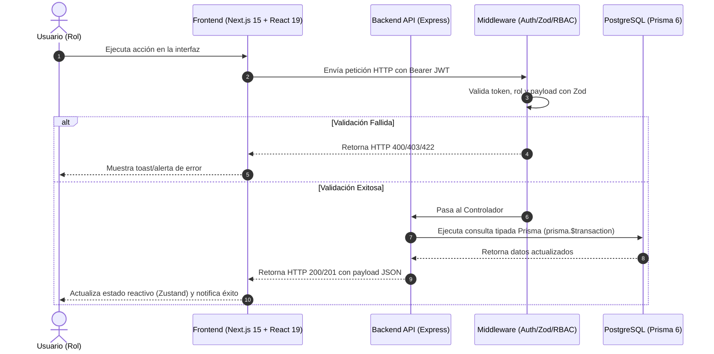
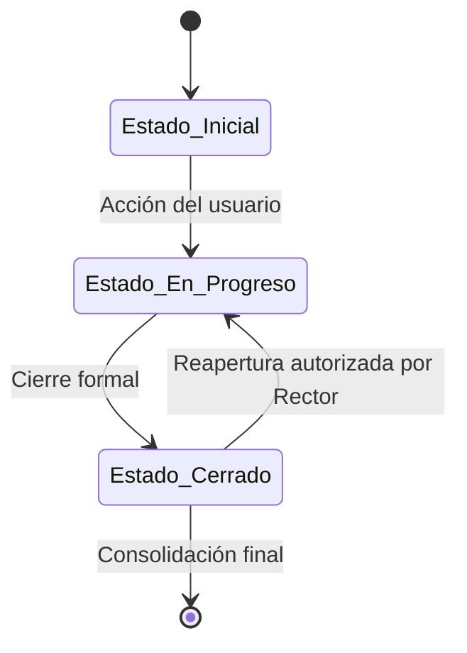

# 🔄 PLANTILLA: 03_FLUJO_Y_ESTADOS — [Nombre del Módulo]

> **Módulo:** [XX. Nombre del Módulo]  
> **Responsable:** Product Manager & Software Architect  

---

## 1. Diagrama de Flujo de Interacción (Secuencia)

---

## 2. Máquina de Estados de la Entidad Principal

- **Estados Posibles:**
  - `ESTADO_1`: [Descripción y reglas aplicables].
  - `ESTADO_2`: [Descripción y reglas aplicables].

---

## 3. Casos de Uso Extremo a Extremo (E2E Journeys)

### Caso de Uso CU-[MOD]-01: [Nombre del Flujo Completo]
1. **Precondición:** [Qué debe estar configurado antes].
2. **Paso 1:** [Usuario navega a la vista...].
3. **Paso 2:** [Completa el formulario y envía...].
4. **Paso 3:** [El sistema procesa y emite...].
5. **Resultado Final:** [Estado resultante del sistema y datos guardados].
