# 📘 Arquitectura y Documentación del Esquema de Base de Datos - PINTUCLIC

> **Versión Actual:** 3.0 — esquema 4.2 (M04 Cuentas: unicidad, hash OTP, anti-fuerza bruta y cambio de clave).  
> **Motor de Base de Datos:** PostgreSQL 13+ (`gen_random_uuid()` nativo; compatible con PostgreSQL 18)  
> **Total de Tablas:** 53  
> **Script DDL Oficial:** [`../sql/schema_pintuclic.sql`](../sql/schema_pintuclic.sql)  
> **Script de Mocks / Seed Oficial:** [`../sql/seed_pintuclic.sql`](../sql/seed_pintuclic.sql)  
> **Guía Oficial de Mocks y Datos de Prueba:** [`./GUIA_MOCKS_Y_DATOS_PRUEBA.md`](./GUIA_MOCKS_Y_DATOS_PRUEBA.md)  
> **Walkthrough Detallado de Migraciones:** [`./WALKTHROUGH_DATABASE.md`](./WALKTHROUGH_DATABASE.md)

---

## 📜 Historial Resumido de Versiones (Changelog)

| Versión | Fecha | Tablas Nuevas | Tablas Deprecadas | Cambios Destacados | Detalle Completo |
| :---: | :---: | :--- | :--- | :--- | :--- |
| **v3.0** (esquema 4.2) | 2026-10-21 | `control_intento_acceso` (1) | Ninguna | M04 Cuentas: aprobados en bloque C-2 y C-4 a C-9 de `RFC-M04-001`. Nueva tabla `control_intento_acceso` (Tabla 53) para control anti-fuerza bruta e indisitnguibilidad (`RN-CUE-06/07`). Unicidad parcial en solicitudes pendientes (`RN-CUE-14/19`). Unicidad y predeterminada única en `direccion_cliente` (`RN-CUE-21`). Hash BCrypt en `codigo_verificacion.codigo_hash` (`RN-CUE-03`). Correo insensible a mayúsculas `uq_usuario_correo_lower` (`RN-CUE-01`). Columna `cambio_contrasena_pendiente` en `usuario`. Permiso 21 `empresas.validar` en el catálogo de permisos. Total 53 tablas. | [Ver v3.0](./WALKTHROUGH_DATABASE.md#-versión-30-2026-10-21) |
| **v2.9** (esquema 4.1) | 2026-10-21 | `parametro_sistema` (1) | Ninguna | M17 Configuración general: el catálogo de parámetros (`HU-ADM-05`, `HU-ADM-07`) pasa de un `Map` en memoria (`ADR-007`) a una tabla con clave única, valor vigente y por defecto en `JSONB`, rango y último autor. **La base impone el tipo y el rango** (`ck_parametro_*`). Seed con las 10 filas del catálogo actual. Nuevos `enum_area_parametro` y `enum_tipo_dato_parametro`. Total 52 tablas. La fecha de última modificación la mantiene un **disparador** (el primero del esquema) y el rango de la complejidad de contraseña queda alineado con el piso de M20 (12–32). **El código de M17 aún lee de memoria** (RFC-M17-001 §5). | [Ver v2.9](./WALKTHROUGH_DATABASE.md#-versión-29-2026-10-21) |
| **v2.8** (esquema 4.0) | 2026-10-21 | `cuenta_empresa`, `documento_soporte` (2) | Ninguna (se depreca la columna `solicitud_actualizacion_nit.documento_adjunto_url`) | M04 Cuentas: `cuenta_empresa` guarda el NIT **vigente** de cada cuenta empresa aprobada (1:1 con `usuario`, `nit` UNIQUE) y deja las solicitudes como historial inmutable. `documento_soporte` almacena el RUT adjunto (PDF/JPG/PNG, hasta 5 MB, huella SHA-256) y `solicitud_actualizacion_nit` lo referencia por `id_documento`. Decisiones del Director Humano sobre el RFC-M04-001 (C-1 y C-3, opción A). Total 51 tablas. | [Ver v2.8](./WALKTHROUGH_DATABASE.md#-versión-28-2026-10-21) |
| **v2.7 / v0.3.37.0** (esquema 3.9) | 2026-09-29 | `linea_orden_descuento`, `consecutivo` (2) | Ninguna | M08 Orden de venta: copia histórica completa. `orden` añade solicitud SOL de origen, modo y costo de entrega, base, importe y tasa de IVA (dirección opcional en recogida). `linea_orden` añade color solicitado, precio inicial, referencia a la variante sin FK, entonado y base consumida, y pasa a `ON DELETE RESTRICT`. Descuentos por línea en orden y consecutivo sin huecos para `PC-AAAA-NNNNN`. Nuevo `enum_modo_entrega`. Total 49 tablas. | [Ver v2.7](./WALKTHROUGH_DATABASE.md#-versión-27--v03370-2026-09-29) |
| **v2.6 / v0.3.34.0** (esquema 3.8) | 2026-09-29 | `historial_estado_orden`, `nota_orden`, `contacto_orden` (3) | Ninguna | M08 Orden de venta: `enum_estado_orden` pasa al ciclo de HU-ORD-03 (`orden_confirmada` … `devuelto`) con migración idempotente para bases existentes (`pagado` → `orden_confirmada`, `enviado` → `despachado`); `orden.estado` nace en `orden_confirmada`; historial de transiciones con autor, notas internas y registro de contactos. Total 47 tablas. | [Ver v2.6](./WALKTHROUGH_DATABASE.md#-versión-26--v03340-2026-09-29) |
| **v2.5 / v3.29.0** | 2026-09-22 | Ninguna (Ajuste estructural de 6 tablas) | Ninguna | Sincronización del modelo ER: bloque fusionado `variante` $\rightarrow$ `base` (`id_variante`, `prefijo`) $\rightarrow$ `color` (`id_base`) $\rightarrow$ `tonos` (`nombre`, `hexagesimal`), `linea_carrito.ref_viva`, `cotizacion.id_usuario/id_rol` y `orden.carrito_o_cotizacion`. Total 44 tablas. | [Ver v2.5](./WALKTHROUGH_DATABASE.md#-versión-25--v3290-2026-09-22) |
| **v2.4** | 2026-09-05 | `direccion_cliente`, `solicitud_empresa`, `solicitud_actualizacion_nit`, `usuario_identidad_externa`, `codigo_verificacion` (5) | Ninguna | Módulo Cuentas y Perfil (M04). Múltiples direcciones (`HU-CUE-07`), flujo B2B corporativo con aprobación admin (`HU-CUE-03/09`), federación Google Identity (`HU-CUE-02`) y almacén OTP efímero con TTL (`HU-CUE-01/05`). Total 36 tablas. | [Ver v2.4](./WALKTHROUGH_DATABASE.md#-versión-24-2026-09-05) |
| **v2.3** | 2026-09-05 | `aviso_privacidad`, `consentimiento_usuario`, `solicitud_supresion` (3) | Ninguna | Protección de datos personales, términos legales y Habeas Data (M20 HU-SEG-05). Trazabilidad de consentimiento inmutable y radicación de supresión de datos. Preserva `sesion` (v2.2). | [Ver v2.3](./WALKTHROUGH_DATABASE.md#-versión-23-2026-09-05) |
| **v2.2** | 2026-09-05 | `sesion` (1) | Ninguna | Estado de sesión persistido para M20: cierre manual, caducidad por inactividad e invalidación en bloque. PK `UUID` no enumerable y 3 ENUMs nuevos. Cambio puramente aditivo. | [Ver v2.2](./WALKTHROUGH_DATABASE.md#-versión-22-2026-09-05) |
| **v2.1** | 2026-09-04 | `linea_carrito`, `cotizacion`, `orden`, `linea_orden` (4) | `pedido`, `detalle_carrito` (2) | Patrón de órdenes inmutables con snapshot de compra, cotizaciones B2B/B2C, carrito vivo desacoplado con soporte de visitantes anónimos (`token_visitante`) y variantes, y clasificación `enum_tipo_usuario`. | [Ver v2.1](./WALKTHROUGH_DATABASE.md#-versión-21-2026-09-04) |
| **v2.0** | 2026-09-03 | `categoria`, `subcategorias`, `sub_subcategorias`, `linea`, `color`, `tonos`, `variante`, `caracteristica`, `combo`, `variante_combo` (10) | `descripcion`, `nesesidad`, `presentacion`, `producto_descripcion`, `producto_presentacion` (5) | Catálogo multinivel de 4 capas, variantes por color/tono, combos, 8 ENUMs nativos y `UNIQUE(id_usuario)` en `usuario_rol`. | [Ver v2.0](./WALKTHROUGH_DATABASE.md#-versión-20-2026-09-03) |
| **v1.0** | 2026-09-02 | 21 tablas iniciales | Ninguna | Esquema fundacional derivado del diagrama `Pre-Final`. | [Ver v1.0](./WALKTHROUGH_DATABASE.md#-versión-10-2026-09-02) |

---

## 🎯 1. Visión General del Sistema

El esquema de base de datos de **Pintuclic** soporta las operaciones integrales de comercio electrónico B2B y B2C, cotizaciones comerciales, catálogo multinivel, inventario de colores/tonos/variantes, carritos vivos, órdenes inmutables, facturación, pagos y reservación de servicios.

### 🌟 Pilares Arquitectónicos del Modelo:
1. **Reestructuración Completa del Catálogo (v2.0):**  
   Jerarquía precisa de 4 niveles: `categoria` $\rightarrow$ `subcategorias` $\rightarrow$ `sub_subcategorias` $\rightarrow$ `linea` $\rightarrow$ `producto`.
2. **Desglose de Colores, Tonos y Variantes (v2.0):**  
   - `color` $\rightarrow$ `tonos` (con variación de precios por matiz).
   - `producto` $\rightarrow$ `variante` (asociado a un color y precio vigente propio).
   - `variante` $\rightarrow$ `caracteristica` (atributos técnicos de la variante).
3. **Módulo de Combos y Paquetes Promocionales (v2.0):**  
   `producto` $\rightarrow$ `combo` + `variante` $\rightarrow$ `variante_combo` (especifica variantes y cantidades exactas incluidas en cada combo).
4. **Patrón de E-Commerce Inmutable y Cotizaciones (v2.1):**  
   - Desacoplamiento de carrito vivo (`carrito` + `linea_carrito` vinculadas a `variante`) y carritos de visitantes anónimos vía `token_visitante`.
   - Creación de órdenes formales (`orden`) originadas desde el carrito o desde cotizaciones aprobadas (`cotizacion`).
   - Almacenamiento histórico inmutable en `linea_orden` (preservando nombre de producto, copia de variante y precio cobrado en el momento de la transacción).
5. **Blindaje de Integridad:**  
   - 10 tipos `ENUM` nativos de PostgreSQL para evitar estados inconsistentes o errores tipográficos.
   - Restricción `UNIQUE` en `usuario(correo)`, `rol(nombre)`, `permisos(nombre)`, `asignacion_permiso(id_rol, id_permiso)`, `orden(codigo_visible)` y `variante_combo(id_variante, id_combo)`.
6. **Cuentas B2B con NIT vigente y documentos sensibles (v2.8):**  
   - `cuenta_empresa` guarda el NIT vigente de cada cuenta empresa aprobada; las solicitudes (`solicitud_empresa`, `solicitud_actualizacion_nit`) quedan como historial inmutable.
   - `documento_soporte` almacena el RUT adjunto con tipo y tamaño acotados por `CHECK` y su huella SHA-256, detrás de un puerto de almacenamiento sustituible.
7. **Configuración general persistente (v2.9):**  
   - `parametro_sistema` guarda cada parámetro con su valor vigente, su valor por defecto y su rango; la base impone que el valor sea del tipo correcto y esté dentro del rango.
   - Un parámetro nuevo es una fila nueva en el seed, no un cambio de DDL.

---

## 🗺️ 2. Diagrama Entidad-Relación (Mermaid ER)

```mermaid
erDiagram
    %% ==== Catálogo / Jerarquía de producto ====
    Categoria {
        int UniqueID PK
        string nombre
    }
    Subcategorias {
        int UniqueID PK
        int id_categoria FK
        string nombre
    }
    Sub_Subcategorias {
        int UniqueID PK
        int id_subcategoria FK
        string nombre
    }
    Marca {
        int UniqueID PK
        string nombre
    }
    Linea {
        int UniqueID PK
        int id_sub_subcategoria FK
        string nombre
        string marca
    }
    Producto {
        int UniqueID PK
        int id_linea FK
        string nombre
    }

    %% ==== Bloque fusionado (diagrama 1: Variante -> Bases -> Color -> tonos) ====
    Variante {
        int UniqueID PK
        int id_producto FK
        float precio_vigente
        string estado
    }
    Bases {
        int id_base PK
        string nombre
        int id_variante FK
        string prefijo
    }
    Color {
        int UniqueID PK
        string nombre
        int id_base FK
    }
    tonos {
        int UniqueID PK
        int id_color FK
        string nombre
        string hexagesimal
        float precio
    }

    Caracteristica {
        int UniqueID PK
        int id_variante FK
        string nombre
    }
    Combo {
        int UniqueID PK
        int id_producto FK
    }
    variante_Combo {
        int UniqueID PK
        int id_variante FK
        int id_combo FK
        int cantidad
    }

    %% ==== Roles, permisos y descuentos ====
    descuento {
        int id_descuento PK
        float tope
        float porcentaje_descuento
        string estado
    }
    sub_roll_empresa {
        int id_sub_roll_empresa PK
        string nombre
        int id_descuento FK
        string estado
    }
    roll {
        int id_roll PK
        string nombre
        int id_sub_roll_empresa FK
        string estado
    }
    permisos {
        int id_permiso PK
        string nombre
        string descripcion
        string estado
    }
    asignacion_permiso {
        int id_asignacion_permiso PK
        int id_roll FK
        int id_permiso FK
    }

    %% ==== Usuarios y privacidad ====
    usuario {
        int id PK
        string nombre
        string telefono
        string correo
        string contrasena
        int id_roll FK
        string estado
        string tipo "normal_o_empresa"
    }
    usuario_rol {
        int id_usuario_rol PK
        int id_usuario FK
        int id_rol FK
    }
    solicitud_supresion {
        int id_solicitud_supresion PK
        int id_usuario FK
        date fecha_solicitud
        string fecha_resolucion
        string estado
    }
    aviso_privacidad {
        int id_aviso_privacidad PK
        string version
        string descripcion
        boolean es_vigente
    }
    consentimiento_usuario {
        int id_consentimiento PK
        int id_usuario FK
        int id_aviso_privacidad FK
        date fecha
    }

    %% ==== Catálogo: marca, resina, presentación, imágenes y relaciones N:M (M01) ====
    tipo_resina {
        int id_tipo_resina PK
        string nombre UK
        enum estado
    }
    presentacion {
        int id_presentacion PK
        string nombre UK
        decimal volumen "mayor que 0"
        enum estado
    }
    imagen {
        int id_imagen PK
        int id_producto FK
        int id_variante FK "nullable"
        int id_color FK "nullable"
        bytea datos
        string mime_type
        int orden
        boolean es_principal "unica por producto"
    }
    producto_base {
        int id_producto PK, FK
        int id_base PK, FK
    }
    producto_subcategoria {
        int id_producto PK, FK
        int id_subcategoria PK, FK
    }

    %% ==== Búsqueda: analítica sin identidad de usuario (M02) ====
    busqueda_sin_resultado {
        int id_busqueda PK "BIGSERIAL"
        string termino "normalizado"
        timestamp fecha
    }


    %% ==== M04: cuentas, direcciones, empresa y verificación (v2.4 y v2.8) ====
    direccion_cliente {
        uuid id_direccion PK
        int id_usuario FK
        string direccion
        string barrio
        boolean es_predeterminada
        decimal latitud "nullable"
        decimal longitud "nullable"
    }
    solicitud_empresa {
        uuid id_solicitud PK
        int id_usuario FK
        string nit
        enum tipo_solicitud "registro, ascenso_particular"
        enum estado "pendiente, aprobada, rechazada"
        string motivo_rechazo "nullable"
        int id_admin_revisor FK "nullable"
    }
    cuenta_empresa {
        int id_usuario PK, FK
        string nit UK "NIT VIGENTE (v2.8)"
        string nombre_empresa
        uuid id_solicitud_origen FK "nullable"
    }
    solicitud_actualizacion_nit {
        uuid id_solicitud PK
        int id_usuario FK
        string nit_anterior
        string nit_nuevo
        uuid id_documento FK "v2.8"
        string documento_adjunto_url "deprecada v2.8"
        enum estado "pendiente, aprobada, rechazada"
    }
    documento_soporte {
        uuid id_documento PK
        string tipo_mime "pdf, jpeg, png"
        int tamano_bytes "max 5 MB"
        string sha256
        bytea contenido
    }
    usuario_identidad_externa {
        int id_identidad PK
        int id_usuario FK
        string proveedor "google"
        string id_proveedor "sub"
    }
    codigo_verificacion {
        uuid id_codigo PK
        string correo
        string codigo
        enum tipo "registro, recuperacion_password, cambio_correo"
        timestamp expiracion
        int intentos
    }

    %% ==== M17: configuración general (v2.9) ====
    parametro_sistema {
        int id_parametro PK
        string clave UK "auth.x, comms.x, comercial.x"
        enum area "autenticacion, comunicaciones, comercial"
        enum tipo_dato "numero, texto, booleano"
        jsonb valor "validado por tipo y rango"
        jsonb valor_por_defecto
        decimal rango_minimo "nullable"
        decimal rango_maximo "nullable"
        timestamp fecha_actualizacion
        int id_usuario_actualizo FK "nullable"
    }

    %% ==== Ventas: cotización, carrito, reservas, orden ====
    Cotizacion {
        int id PK
        int id_usuario FK
        int id_rol FK
        string estado "M21_no_analizado"
    }
    Carrito {
        int id PK
        string token_visitante "nullable"
        int cliente_id FK "nullable"
        date fecha_ultima_actividad
    }
    LineaCarrito {
        int id PK
        int carrito_id FK
        int variante_id FK
        int ref_viva
        int cantidad
    }
    reservaciones {
        int id_reservacion PK
        int id_producto FK
        int id_usuario FK
        date fecha
        time hora
        string estado
    }
    Orden {
        int id PK "interno"
        string codigo_visible
        int cliente_id FK
        string origen
        int cotizacion_id FK "nullable"
        string carrito_o_cotizacion
        enum estado "M08 v3.8: orden_confirmada, revision_disponibilidad, en_preparacion, preparada, despachado, entregado, cancelado, devuelto"
        int transaccion_pago_id "unico"
        string codigo_solicitud "M08 v3.9: SOL de M07, unico, nullable"
        enum modo_entrega "M08 v3.9: domicilio, recogida"
        decimal costo_entrega "M08 v3.9"
        string direccion "nullable en recogida"
        decimal sub_total
        decimal descuento
        decimal total
        decimal base_sin_impuesto "M08 v3.9"
        decimal importe_iva "M08 v3.9"
        decimal tasa_iva "M08 v3.9"
        string observaciones "nullable"
        date fecha
    }
    LineaOrden {
        int id PK
        int orden_id FK
        string nombre_producto "copia"
        string variante_copia "copia"
        decimal precio_aplicado "copia"
        int cantidad
        string color_solicitado "M08 v3.9, copia"
        decimal precio_inicial "M08 v3.9, copia"
        int id_variante_ref "M08 v3.9, sin FK"
        boolean es_entonado "M08 v3.9"
        string base_consumida "M08 v3.9, copia"
    }
    %% ==== M08 v3.9: descuentos por línea y consecutivo ====
    linea_orden_descuento {
        int id_linea_orden_descuento PK
        int id_linea_orden FK
        int orden_aplicacion
        string origen
        decimal porcentaje "nullable = importe fijo"
        decimal importe
    }
    consecutivo {
        int id_consecutivo PK
        string nombre "unico: orden, solicitud"
        bigint ultimo_valor
    }
    %% ==== M08 v3.8: historial de estados, notas internas y contactos ====
    historial_estado_orden {
        int id_historial_estado_orden PK
        int id_orden FK
        enum estado_anterior "nullable al nacer la orden"
        enum estado_nuevo
        int id_usuario_autor FK "nullable = sistema"
        string motivo "nullable"
        string referencia_externa "nullable"
        timestamp fecha
    }
    nota_orden {
        int id_nota_orden PK
        int id_orden FK
        int id_usuario_autor FK
        string texto "solo insercion, no visible al cliente"
        timestamp fecha
    }
    contacto_orden {
        int id_contacto_orden PK
        int id_orden FK
        int id_usuario_autor FK
        string medio
        string detalle "nullable"
        timestamp fecha
    }
    factura {
        int id_factura PK
        int id_orden FK
        date fecha
        string estado
    }
    pagos {
        int id_pago PK
        int id_orden FK
        int id_metodo_pago FK
        string estado
        float monto
    }
    metodo_pago {
        int id_metodo_pago PK
        string nombre
        string descripcion
        string estado
    }

    %% ================== RELACIONES ==================

    %% Jerarquía de catálogo
    Categoria         ||--o{ Subcategorias        : "divide_en"
    Subcategorias      ||--o{ Sub_Subcategorias     : "subdivide_en"
    Sub_Subcategorias  ||--o{ Linea                 : "agrupa"
    Marca               ||--o{ Linea                 : "agrupa"
    Linea               ||--o{ Producto              : "clasifica"
    Producto            ||--o{ Combo                 : "es_un"

    %% Bloque fusionado: Variante -> Bases -> Color -> tonos
    Producto  ||--o{ Variante          : "tiene"
    Variante  ||--o{ Bases             : "tiene"
    Bases     ||--o{ Color             : "clasifica"
    Color     ||--o{ tonos             : "desglosa_en"
    Variante  ||--o{ Caracteristica    : "describe"
    Combo     ||--o{ variante_Combo    : "compuesto_por"
    Variante  ||--o{ variante_Combo    : "incluida_en"
    Variante  ||--o{ LineaCarrito      : "referencia (ref_viva)"

    %% Roles / permisos / descuentos
    descuento          ||--o{ sub_roll_empresa   : "aplica_a"
    sub_roll_empresa   ||--o{ roll               : "agrupa"
    roll               ||--o{ usuario            : "define_perfil"
    roll               ||--o{ asignacion_permiso : "asignado_en"
    permisos           ||--o{ asignacion_permiso : "asignado_en"
    usuario            ||--o{ usuario_rol        : "posee"
    roll               ||--o{ usuario_rol        : "posee"

    %% Usuario y privacidad
    usuario                 ||--o{ solicitud_supresion    : "solicita"
    usuario                 ||--o{ consentimiento_usuario : "puede_tener"
    aviso_privacidad        ||--o{ consentimiento_usuario : "puede_aceptar"

    %% Catálogo: marca, resina, presentación, imágenes y relaciones N:M
    Marca                        ||--o{ Producto                    : "fabrica"
    tipo_resina                  |o--o{ Producto                    : "clasifica"
    presentacion                 ||--o{ Variante                    : "presenta"
    Producto                     ||--o{ imagen                      : "tiene"
    Variante                     |o--o{ imagen                      : "ilustra"
    Color                        |o--o{ imagen                      : "ilustra"
    Producto                     ||--o{ producto_subcategoria       : "pertenece_a"
    Subcategorias                ||--o{ producto_subcategoria       : "agrupa"
    Producto                     ||--o{ producto_base               : "ofrece"
    Bases                        ||--o{ producto_base               : "ofrecida_en"


    %% M04: cuentas, empresa y verificación
    usuario                      ||--o{ direccion_cliente            : "guarda"
    usuario                      ||--o{ solicitud_empresa            : "solicita"
    usuario                      ||--o| cuenta_empresa               : "es_empresa (v2.8)"
    solicitud_empresa            |o--o| cuenta_empresa               : "da_origen"
    usuario                      ||--o{ solicitud_actualizacion_nit  : "renueva_nit"
    documento_soporte            |o--o| solicitud_actualizacion_nit  : "adjunta_rut (v2.8)"
    usuario                      ||--o{ usuario_identidad_externa    : "vincula"

    %% M17: configuración general
    usuario                      |o--o{ parametro_sistema            : "modifica (ultimo autor)"

    %% Ventas
    usuario      ||--o{ Cotizacion     : "1:N (realiza)"
    roll         ||--o{ Cotizacion     : "1:N (realiza)"
    usuario      ||--o{ Carrito        : "tiene"
    Cotizacion   ||--o{ Orden          : "origen_opcional"
    Carrito      ||--o{ Orden          : "revalidado_en_checkout"
    usuario      ||--o{ Orden          : "realiza"
    Carrito      ||--o{ LineaCarrito   : "1:N"
    usuario      ||--o{ reservaciones  : "1_0_N (crea)"
    Producto     ||--o{ reservaciones  : "reservado_en"
    Orden        ||--o{ factura        : "emite"
    Orden        ||--o{ pagos          : "registra"
    metodo_pago  ||--o{ pagos          : "utilizado_en"
    Orden        ||--o{ LineaOrden     : "1:N"

    %% M08 v3.8: historial, notas internas y contactos
    Orden        ||--o{ historial_estado_orden : "cambia_de_estado"
    usuario      |o--o{ historial_estado_orden : "registra (nullable = sistema)"
    Orden        ||--o{ nota_orden             : "tiene_notas"
    usuario      ||--o{ nota_orden             : "escribe"
    Orden        ||--o{ contacto_orden         : "registra_contactos"
    usuario      ||--o{ contacto_orden         : "contacta"

    %% M08 v3.9: descuentos por línea
    LineaOrden   ||--o{ linea_orden_descuento  : "aplica_descuentos"
```



---

## 🏛️ 3. Módulos del Sistema y Diccionario de Datos (52 Tablas)

### Módulo 1: Seguridad, Roles y Descuentos (5 Tablas)
| Tabla | PK | FKs | Descripción |
| :--- | :--- | :--- | :--- |
| **`descuento`** | `id_descuento` | Ninguna | Define topes monetarios y porcentajes de descuento (0 a 100%). |
| **`sub_rol_empresa`** | `id_sub_rol_empresa` | `id_descuento` $\rightarrow$ `descuento` | Sub-clasificación de perfiles de clientes comerciales asociados a descuentos. |
| **`rol`** | `id_rol` | `id_sub_rol_empresa` $\rightarrow$ `sub_rol_empresa` | Roles base del sistema (`nombre` UNIQUE). |
| **`permisos`** | `id_permiso` | Ninguna | Permisos atómicos del sistema (`nombre` UNIQUE). |
| **`asignacion_permiso`** | `id_asignacion_permiso` | `id_rol`, `id_permiso` | Matriz N:M con restricción `UNIQUE(id_rol, id_permiso)`. |

### Módulo 2: Cuentas de Usuario y Control de Acceso (3 Tablas)
| Tabla | PK | FKs | Descripción |
| :--- | :--- | :--- | :--- |
| **`usuario`** | `id_usuario` | `id_rol` $\rightarrow$ `rol` | Cuentas con `correo` UNIQUE, hash BCrypt en `contrasena`, tipo (`normal`/`empresa`) y estado. |
| **`usuario_rol`** | `id_usuario_rol` | `id_usuario`, `id_rol` | Asignación con restricción `UNIQUE(id_usuario)` (máximo 1 rol por usuario). |
| **`sesion`** | `id_sesion` (**UUID**) | `id_usuario` $\rightarrow$ `usuario` (CASCADE) | Sesiones abiertas por dispositivo (M20 / HU-SEG-02). Guarda último acceso y expiración. |

### Módulo 3: Catálogo Multinivel, Colores, Bases y Variantes (18 Tablas)
| Tabla | PK | FKs | Descripción |
| :--- | :--- | :--- | :--- |
| **`categoria`** | `id_categoria` | Ninguna | Nivel 1 del catálogo (e.g. Pinturas Arquitectónicas, Esmaltes). |
| **`subcategorias`** | `id_subcategoria` | `id_categoria` $\rightarrow$ `categoria` | Nivel 2 de agrupación. |
| **`sub_subcategorias`** | `id_sub_subcategoria` | `id_subcategoria` $\rightarrow$ `subcategorias` | Nivel 3 de agrupación. |
| **`linea`** | `id_linea` | `id_sub_subcategoria` $\rightarrow$ `sub_subcategorias` | Nivel 4: Línea de marca (e.g. Viniltex, Koraza). |
| **`producto`** | `id_producto` | `id_marca` $\rightarrow$ `marca` (RESTRICT), `id_linea` $\rightarrow$ `linea`, `id_tipo_resina` $\rightarrow$ `tipo_resina`, `id_categoria_complementaria` $\rightarrow$ `categoria` (SET NULL) | Entidad base del producto, con su clase de color (`enum_clase_color`), rendimiento, indicador de publicación y de patrocinio. |
| **`variante`** | `id_variante` | `id_producto` $\rightarrow$ `producto` (CASCADE), `id_presentacion` $\rightarrow$ `presentacion` (RESTRICT), `id_color` $\rightarrow$ `color` (SET NULL), `id_base` $\rightarrow$ `base` (RESTRICT) | SKU vendible con `precio_vigente`, existencia referencial, código de proveedor y `estado` comercial. |
| **`base`** | `id_base` | `id_variante` $\rightarrow$ `variante` | Base vinculada a variante con `prefijo` y nombre. |
| **`color`** | `id_color` | `id_base` $\rightarrow$ `base` | Catálogo de colores clasificados por base (`id_base`). |
| **`tonos`** | `id_tono` | `id_color` $\rightarrow$ `color` | Tonos/matices derivados con `nombre`, `hexagesimal` y precio adicional. |
| **`caracteristica`** | `id_caracteristica` | `id_variante` $\rightarrow$ `variante` | Ficha técnica o especificaciones de la variante. |
| **`combo`** | `id_combo` | `id_producto` $\rightarrow$ `producto` | Paquete comercial ligado a un producto. |
| **`variante_combo`** | `id_variante_combo` | `id_variante`, `id_combo` | Detalle N:M de las variantes y `cantidad` que componen el combo. |
| **`marca`** | `id_marca` | Ninguna | Catálogo maestro de marcas (HU-CAT-04): `nombre` UNIQUE, logotipo en `BYTEA` con su tipo MIME (máx. 5 MB; jpeg, png o webp validados en el servicio; el límite exacto del Anexo B de la Tanda 2 sigue pendiente de confirmar) y `estado`. |
| **`tipo_resina`** | `id_tipo_resina` | Ninguna | Catálogo administrable de tipos de resina (RF-CAT-02-04); reemplaza cualquier lista fija en el código. `nombre` UNIQUE. |
| **`presentacion`** | `id_presentacion` | Ninguna | Presentación comercial como entidad propia (RF-CAT-03-05): `nombre` UNIQUE y `volumen` (mayor que 0) para comparar precios entre productos. Si tiene variantes no se elimina, solo se desactiva (CA-CAT-03-10). |
| **`producto_base`** | `(id_producto, id_base)` | `id_producto` $\rightarrow$ `producto` (CASCADE), `id_base` $\rightarrow$ `base` (RESTRICT) | Bases que ofrece un producto entonable (HU-CAT-12, RF-CAT-12-02). Una variante entonable solo puede usar una base declarada aquí. |
| **`producto_subcategoria`** | `(id_producto, id_subcategoria)` | `id_producto` $\rightarrow$ `producto` (CASCADE), `id_subcategoria` $\rightarrow$ `subcategorias` (RESTRICT) | Relación N:M producto↔subcategoría (RF-CAT-02-02: al menos una). Reemplaza el remanente `linea.id_sub_subcategoria` del árbol previo. |
| **`imagen`** | `id_imagen` | `id_producto` $\rightarrow$ `producto` (CASCADE), `id_variante` $\rightarrow$ `variante` (CASCADE), `id_color` $\rightarrow$ `color` (SET NULL) | Imágenes del producto en `BYTEA` (HU-CAT-07, RF-CAT-07-03), asociables a una variante o a un color. A lo sumo una principal por producto (índice único parcial `uq_imagen_principal`). Las miniaturas (RNF-CAT-07-01) siguen pendientes. |

### Módulo 4: Carrito Vivo de Compras (2 Tablas)
| Tabla | PK | FKs | Descripción |
| :--- | :--- | :--- | :--- |
| **`carrito`** | `id_carrito` | `id_usuario` $\rightarrow$ `usuario` (opcional) | Carrito vivo con `token_visitante` para usuarios anónimos y fecha de actividad. |
| **`linea_carrito`** | `id_linea_carrito` | `id_carrito`, `id_variante` | Ítems agregados vivos vinculados a variante con `ref_viva` y `cantidad`. |

### Módulo 5: Cotizaciones y Órdenes Inmutables (8 Tablas)
| Tabla | PK | FKs | Descripción |
| :--- | :--- | :--- | :--- |
| **`cotizacion`** | `id_cotizacion` | `id_usuario`, `id_rol` | Cotización comercial B2B/B2C vinculada a usuario y rol. |
| **`orden`** | `id_orden` | `id_usuario`, `id_cotizacion` | Orden de compra confirmada con `codigo_visible`, `origen`, `carrito_o_cotizacion`, pasarela y estado (nace en `orden_confirmada`). Desde v3.9 conserva la solicitud SOL de origen (`codigo_solicitud` UNIQUE), el modo y costo de entrega, y la base, el importe y la tasa de IVA; la dirección es opcional en recogida. |
| **`linea_orden`** | `id_linea_orden` | `id_orden` $\rightarrow$ `orden` (RESTRICT) | Snapshot congelado inmutable (`nombre_producto`, `variante_copia`, `precio_aplicado`, `cantidad`). Desde v3.9: `color_solicitado`, `precio_inicial`, `id_variante_ref` sin FK, `es_entonado` y `base_consumida`. |
| **`linea_orden_descuento`** | `id_linea_orden_descuento` | `id_linea_orden` $\rightarrow$ `linea_orden` | Descuentos aplicados a cada línea con origen, porcentaje, importe y orden de aplicación (M08 - RF-ORD-02-02). Solo inserción. |
| **`consecutivo`** | `id_consecutivo` | Ninguna | Numeración corrida sin huecos por tipo de documento (M08 - RF-ORD-06-04; reutilizable por M07). |
| **`historial_estado_orden`** | `id_historial_estado_orden` | `id_orden` $\rightarrow$ `orden`, `id_usuario_autor` $\rightarrow$ `usuario` (NULL = sistema) | Transiciones de la orden con estado anterior y nuevo, autor, motivo, referencia externa y fecha (M08 - HU-ORD-03). Solo inserción. |
| **`nota_orden`** | `id_nota_orden` | `id_orden` $\rightarrow$ `orden`, `id_usuario_autor` $\rightarrow$ `usuario` | Notas internas del personal, nunca visibles al cliente (M08 - HU-ORD-10). Solo inserción. |
| **`contacto_orden`** | `id_contacto_orden` | `id_orden` $\rightarrow$ `orden`, `id_usuario_autor` $\rightarrow$ `usuario` | Contactos con el cliente iniciados desde la orden: medio, detalle, autor y fecha (M08 - HU-ORD-09). Solo inserción. |

### Módulo 6: Pagos y Facturación (3 Tablas)
| Tabla | PK | FKs | Descripción |
| :--- | :--- | :--- | :--- |
| **`metodo_pago`** | `id_metodo_pago` | Ninguna | Pasarelas / métodos habilitados (PSE, Tarjeta, Efectivo). |
| **`pagos`** | `id_pago` | `id_orden`, `id_metodo_pago` | Registro de transacciones financieras con estado (`enum_estado_pago`). |
| **`factura`** | `id_factura` | `id_orden` $\rightarrow$ `orden` | Comprobante fiscal con fecha y estado (`enum_estado_factura`). |

### Módulo 7: Servicios y Reservaciones (1 Tabla)
| Tabla | PK | FKs | Descripción |
| :--- | :--- | :--- | :--- |
| **`reservaciones`** | `id_reservacion` | `id_producto`, `id_usuario` | Citas de asesoría técnica o aplicación con fecha, hora y estado. |

### Módulo 8: Privacidad, Consentimiento y Habeas Data (3 Tablas)
| Tabla | PK | FKs | Descripción |
| :--- | :--- | :--- | :--- |
| **`aviso_privacidad`** | `id_aviso_privacidad` | Ninguna | Versiones normativas y términos de tratamiento de datos personales (`version` UNIQUE, `es_vigente`). |
| **`consentimiento_usuario`** | `id_consentimiento` | `id_usuario`, `id_aviso_privacidad` | Registro de consentimiento informado con fecha exacta de aceptación y restricción `UNIQUE(id_usuario, id_aviso_privacidad)`. |
| **`solicitud_supresion`** | `id_solicitud_supresion` | `id_usuario` $\rightarrow$ `usuario` | Gestión de derechos ARCO y supresión de datos con estado de resolución (`enum_estado_solicitud_supresion`). |

### Módulo 9: Cuentas, Direcciones, Empresa y Verificación — M04 (7 Tablas)
| Tabla | PK | FKs | Descripción |
| :--- | :--- | :--- | :--- |
| **`direccion_cliente`** | `id_direccion` (**UUID**) | `id_usuario` $\rightarrow$ `usuario` (CASCADE) | Libreta de direcciones de entrega con designación de predeterminada y coordenadas opcionales (HU-CUE-07). |
| **`solicitud_empresa`** | `id_solicitud` (**UUID**) | `id_usuario`, `id_admin_revisor` $\rightarrow$ `usuario` | Solicitudes de registro de empresa y de ascenso de particular a empresa, con estado, motivo de rechazo y revisor (HU-CUE-03, HU-CUE-09). |
| **`cuenta_empresa`** *(v2.8)* | `id_usuario` (PK y FK, **1:1**) | `id_usuario` $\rightarrow$ `usuario` (CASCADE), `id_solicitud_origen` $\rightarrow$ `solicitud_empresa` (SET NULL) | **NIT vigente** y datos de la cuenta empresa aprobada. `nit` es `UNIQUE`. La renovación de NIT actualiza esta fila; las solicitudes quedan como historial (HU-CUE-09, HU-CUE-10). |
| **`solicitud_actualizacion_nit`** | `id_solicitud` (**UUID**) | `id_usuario`, `id_admin_revisor` $\rightarrow$ `usuario`; `id_documento` $\rightarrow$ `documento_soporte` (RESTRICT, v2.8) | Renovación de NIT con el RUT adjunto (HU-CUE-09, HU-CUE-10). `documento_adjunto_url` queda **deprecada** desde v2.8. |
| **`documento_soporte`** *(v2.8)* | `id_documento` (**UUID**) | Ninguna | RUT adjunto en `BYTEA`: PDF, JPG o PNG de hasta 5 MB, con huella SHA-256 y verificación de tamaño real por `CHECK`. El contenido nunca se selecciona en listados. |
| **`usuario_identidad_externa`** | `id_identidad` | `id_usuario` $\rightarrow$ `usuario` (CASCADE) | Identidades federadas (Google). `UNIQUE(proveedor, id_proveedor)` y `UNIQUE(id_usuario, proveedor)` (HU-CUE-02). |
| **`codigo_verificacion`** | `id_codigo` (**UUID**) | Ninguna (se identifica por `correo`) | Códigos OTP efímeros con expiración y contador de intentos: registro, recuperación de contraseña y cambio de correo (HU-CUE-01, 05, 06). |

### Módulo 10: Configuración General — M17 (1 Tabla)
| Tabla | PK | FKs | Descripción |
| :--- | :--- | :--- | :--- |
| **`parametro_sistema`** *(v2.9)* | `id_parametro` | `id_usuario_actualizo` $\rightarrow$ `usuario` (SET NULL) | Catálogo de parámetros modificables en caliente (HU-ADM-05, HU-ADM-07): `clave` única con prefijo de área, valor vigente y por defecto en `JSONB`, y rango numérico opcional. La base impone el tipo y el rango (`ck_parametro_*`); guarda solo el último autor (el historial completo es de HU-SEG-04) y su fecha de última modificación la mantiene el disparador `trg_parametro_sistema_fecha`. |

### Módulo 11: Búsqueda y Analítica — M02 (1 Tabla)
| Tabla | PK | FKs | Descripción |
| :--- | :--- | :--- | :--- |
| **`busqueda_sin_resultado`** | `id_busqueda` (**BIGSERIAL**) | Ninguna | Analítica de búsquedas sin resultado (M02 HU-BUS-06): una fila por evento, con el `termino` normalizado y su `fecha`, **sin identidad de usuario** (M20 HU-SEG-06). Permite acotar por periodo y agregar repeticiones con `GROUP BY termino`. |

---

## 🛡️ 4. Tipos Enumerados (ENUMs)

Para asegurar la máxima robustez en PostgreSQL, el esquema utiliza 21 tipos enumerados nativos:

```sql
enum_estado_general     -- ('activo', 'inactivo')
enum_tipo_usuario       -- ('normal', 'empresa')
enum_estado_usuario     -- ('activo', 'inactivo', 'bloqueado', 'pendiente')
enum_estado_producto    -- ('activo', 'inactivo', 'agotado', 'descontinuado')
enum_origen_orden       -- ('carrito', 'cotizacion')
enum_estado_orden       -- ('orden_confirmada', 'revision_disponibilidad', 'en_preparacion', 'preparada',
                        --  'despachado', 'entregado', 'cancelado', 'devuelto')  -- v3.8 (M08)
enum_modo_entrega       -- ('domicilio', 'recogida')  -- v3.9 (M08)
enum_estado_cotizacion  -- ('borrador', 'enviada', 'aprobada', 'rechazada', 'vencida')
enum_estado_pago        -- ('pendiente', 'completado', 'fallido', 'reembolsado')
enum_estado_factura     -- ('emitida', 'pagada', 'anulada')
enum_estado_reservacion -- ('pendiente', 'confirmada', 'cancelada', 'finalizada')

-- Sesiones de usuario (v2.2 - M20)
enum_estado_sesion        -- ('activa', 'cerrada', 'expirada', 'revocada')
enum_tipo_sesion          -- ('admin', 'cliente')
enum_motivo_cierre_sesion -- ('cierre_manual', 'inactividad', 'cambio_contrasena',
                          --  'cuenta_desactivada', 'permisos_retirados')

-- Privacidad y Habeas Data (v2.3 - M20)
enum_estado_solicitud_supresion -- ('pendiente', 'en_proceso', 'aprobada', 'rechazada')

-- Cuentas, empresas y verificación (v2.4 - M04)
enum_tipo_solicitud_empresa   -- ('registro', 'ascenso_particular')
enum_estado_solicitud_empresa -- ('pendiente', 'aprobada', 'rechazada')
enum_tipo_codigo_otp          -- ('registro', 'recuperacion_password', 'cambio_correo')

-- Configuración general (v2.9 - M17)
enum_area_parametro           -- ('autenticacion', 'comunicaciones', 'comercial')
enum_tipo_dato_parametro      -- ('numero', 'texto', 'booleano')

-- Catálogo (M01 - HU-CAT-02, RF-CAT-02-03)
enum_clase_color              -- ('entonable', 'colores_fijos', 'sin_color')
```

---

## ⚡ 5. Recomendaciones para el Stack de Desarrollo

### Backend (Node.js / Express / TypeScript / Prisma 6):
1. **Modelo Prisma como contrato tipado:**
   Reflejar cada tabla en `backend/prisma/schema.prisma` (con `@map`/`@@map` al nombre real de la tabla y la columna) y regenerar el cliente con `npm run db:generate`. Los repositorios usan los tipos generados (`Prisma.XxxGetPayload`, `Prisma.XxxCreateInput`), nunca `any`. El archivo es **compartido** entre módulos: aplica la Directiva #3 de `AGENTS.md`.
2. **Uso de Transacciones en Creación de Órdenes:**
   - Abrir `prisma.$transaction(async (tx) => { ... })` para crear la orden, insertar los snapshots en `linea_orden` leyendo el precio vigente actual de cada variante y vaciar las líneas correspondientes de `linea_carrito`.
   - Las consultas complejas usan `prisma.$queryRaw` con `Prisma.sql` (plantilla etiquetada), nunca concatenación de cadenas.
3. **Hashing Seguro:**  
   Las contraseñas de `usuario` deben ser hasheadas con **BCrypt** (costo mínimo 12) antes de persistirse.

### Frontend (React / Vue / Next.js):
1. **Gestión de Carrito Anónimo:**  
   Generar y conservar un `token_visitante` (UUID v4) en `localStorage` o cookie para carritos sin sesión iniciada. Al autenticarse el usuario, invocar endpoint de fusión para asociar el carrito a su `id_usuario`.
2. **Navegación de Catálogo en Cascada:**  
   Aprovechar la jerarquía `categoria` $\rightarrow$ `subcategorias` $\rightarrow$ `sub_subcategorias` $\rightarrow$ `linea` para implementar menús desplegables y filtros dinámicos.
3. **Selector de Variantes y Tonos:**  
   Al seleccionar un producto, cargar sus variantes y si el usuario escoge un color, calcular el precio vigente de la variante más el ajuste del tono seleccionado.

