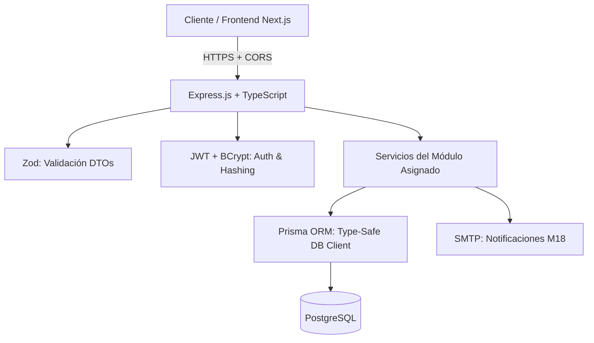
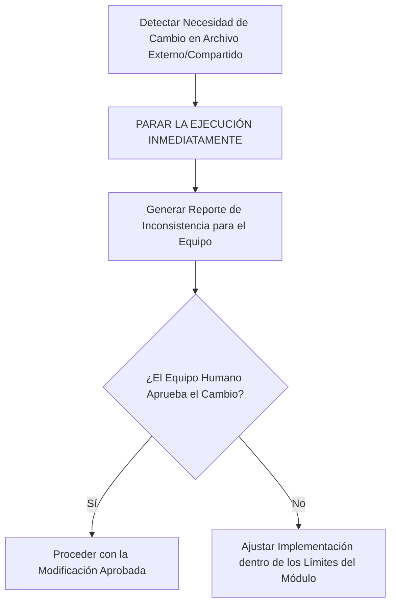

# Arquitectura Backend y Stack Tecnológico - PINTU CLIC

Este documento define el **stack tecnológico oficial y las reglas de seguridad e implementación** para el desarrollo de módulos en **Pintu Clic**.

---

## 1. Stack Tecnológico Oficial



### Herramientas y Responsabilidades

| Tecnología | Rol en el Sistema | Regla de Uso |
| :--- | :--- | :--- |
| **TypeScript** | Lenguaje principal (Backend & DTOs) | Tipado estricto (`strict: true`). Prohibido el uso de `any`; tipar todas las entradas, salidas y entidades. |
| **Express.js** | Framework HTTP / Enrutamiento | Exponer únicamente las rutas y controladores correspondientes al módulo asignado. |
| **Prisma ORM** | Acceso a Base de Datos Type-Safe | El esquema central reside en `backend/prisma/schema.prisma`. Prisma genera los tipos automáticamente. Prohibido escribir SQL crudo o crear tipos de entidad manualmente fuera de Prisma. Usar `prisma.$transaction` para operaciones atómicas. |
| **Zod** | Validación de Entradas y DTOs | Validar en tiempo de ejecución todos los `req.body`, `req.query` y `req.params`. Inferir tipos directamente (`z.infer<typeof Schema>`). |
| **JWT (jsonwebtoken)** | Gestión de Sesión y Tokens | Emisión y verificación de tokens de acceso y refresco (`HU-SEG-02`). No incluir datos sensibles en el payload (`HU-SEG-06`). |
| **BCrypt** | Hashing de Contraseñas | Hashing con salt dinámico (costo mínimo: 12) para contraseñas (`HU-SEG-01`). |
| **SMTP (Nodemailer / Transport)** | Correos Transaccionales | Envío asíncrono de códigos de verificación y notificaciones (`M18` / `HU-NOT-01`). |
| **CORS** | Seguridad HTTP | Configuración restrictiva de orígenes y cabeceras permitidas. |

---

## 2. Aislamiento de Módulo y Límites de Trabajo (Scope Boundaries)

> ⛔ **DIRECTIVA DEL PRODUCT OWNER:**  
> La estructura de carpetas global del proyecto ya está establecida para toda la organización.  
> **NO se debe reconstruir el backend desde cero ni modificar archivos, rutas o controladores que pertenecen a otros equipos.**

1. **Enfoque 100% en Historias de Usuario:** El trabajo del equipo y del Agente de IA debe centrarse exclusivamente en cumplir los Criterios de Aceptación (CA) y Requisitos Funcionales (RF) del módulo asignado.
2. **Encapsulamiento:** Todo controlador, servicio, repositorio, esquema Zod o ruta nueva debe vivir estrictamente dentro del espacio del módulo asignado.
3. **Nomenclatura Obligatoria de Carpetas (`m[xx]-[nombre-modulo]`):** Cada módulo nuevo debe residir en su propia carpeta bajo `backend/src/modules/` nombrada con el código del módulo en minúsculas y kebab-case (ej: `m20-seguridad/`, `m17-permisos/`, `m18-notificaciones/`, `m04-cuentas/`). Está prohibido crear carpetas sin el prefijo de código asignado.

---

## 3. Protocolo de Parada Obligatoria e Inconsistencias (Stop & Report)

Si durante el desarrollo de una Historia de Usuario, el Agente de IA detecta que:
- Requiere modificar un archivo existente que pertenezca a otro equipo o módulo compartido.
- Requiere alterar una tabla, ruta o controlador fuera de su alcance asignado.
- Encuentra una contradicción entre la especificación del módulo y el código existente en el repositorio.

El Agente **TIENE PROHIBIDO** aplicar cambios automáticos. Debe seguir este protocolo:



1. **Detener la ejecución inmediatamente:** No realizar escrituras ni modificaciones sobre archivos externos.
2. **Informar al equipo:** Describir con precisión qué archivo externo se requiere tocar, por qué la HU lo demanda y qué impacto tendría.
3. **Esperar confirmación:** Solo continuar si el equipo o el Product Owner aprueba explícitamente la acción.

---

## 4. Patrones de Código Aprobados

### A. Validación de Entradas con Zod (`schemas.ts`)
```typescript
import { z } from 'zod';

export const RegisterUserSchema = z.object({
  body: z.object({
    email: z.string().email('Formato de correo inválido'),
    password: z.string().min(8, 'Mínimo 8 caracteres')
      .regex(/[A-Z]/, 'Debe incluir mayúscula')
      .regex(/[0-9]/, 'Debe incluir número'),
    fullName: z.string().min(2, 'Nombre requerido'),
    phone: z.string().optional()
  })
});

export type RegisterUserDTO = z.infer<typeof RegisterUserSchema>['body'];
```

### B. Acceso a Base de Datos con Prisma (`prisma/schema.prisma` y `repository.ts`)

> 🔒 **Regla Estricta para la IA y Desarrolladores:**  
> El esquema de la base de datos reside **únicamente** en `backend/prisma/schema.prisma`.  
> Prisma genera automáticamente los tipos TypeScript al ejecutar `prisma generate`.  
> Está **prohibido** definir tipos de entidad de BD manualmente dentro de los módulos. Usar siempre los tipos generados por Prisma (`Prisma.UsuarioGetPayload`, etc.).

```prisma
// backend/prisma/schema.prisma — fuente única de la estructura de BD
generator client {
  provider = "prisma-client-js"
}

datasource db {
  provider = "postgresql"
  url      = env("DATABASE_URL")
}

model Usuario {
  id            Int      @id @default(autoincrement())
  correo        String   @unique
  password_hash String
  nombre_completo String
  activo        Boolean  @default(true)
  creado_en     DateTime @default(now())
  actualizado_en DateTime @updatedAt

  @@map("usuario")
}
```

```typescript
// Uso en el Repositorio del Módulo (ej: cuentas.repository.ts)
import { PrismaClient, Prisma } from '@prisma/client';

export class CuentasRepository {
  constructor(private prisma: PrismaClient) {}

  async buscarPorCorreo(correo: string) {
    return await this.prisma.usuario.findUnique({ where: { correo } });
  }

  async crearUsuario(data: Prisma.UsuarioCreateInput) {
    return await this.prisma.usuario.create({ data });
  }
}
```

### C. Hashing de Contraseñas con BCrypt (`security.ts`)
```typescript
import bcrypt from 'bcrypt';

const SALT_ROUNDS = 12; // M20 - HU-SEG-01

export async function hashPassword(plainText: string): Promise<string> {
  return await bcrypt.hash(plainText, SALT_ROUNDS);
}

export async function comparePassword(plainText: string, hash: string): Promise<boolean> {
  return await bcrypt.compare(plainText, hash);
}
```

### D. Verificación de Permisos Individuales M17 en Servidor
```typescript
// Comprobación en backend ante cada petición (HU-ADM-03 / HU-SEG-03)
export function requirePermission(permissionCode: string) {
  return async (req: Request, res: Response, next: NextFunction) => {
    const userId = req.user?.id;
    const hasPermission = await permissionService.checkUserPermission(userId, permissionCode);
    
    if (!hasPermission) {
      return res.status(403).json({ error: 'Acceso denegado: permiso insuficiente' });
    }
    next();
  };
}
```
