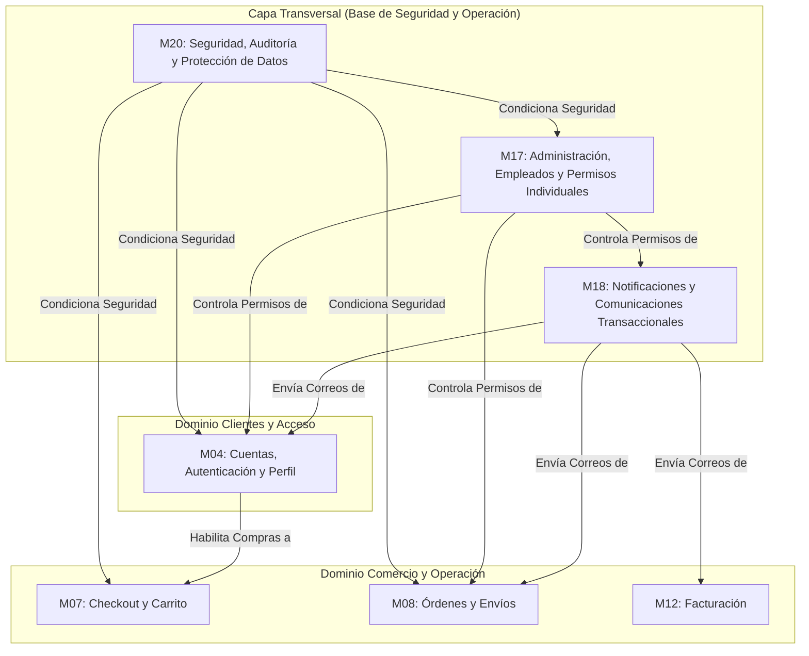
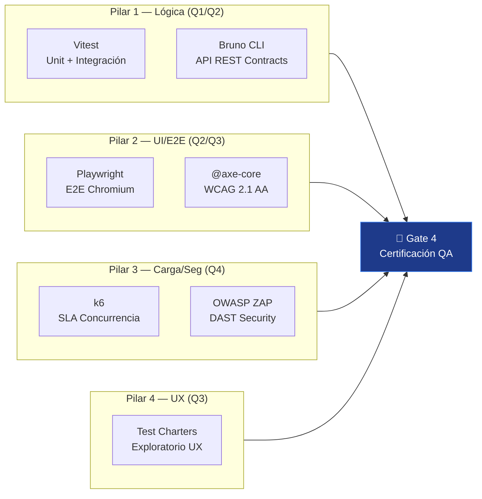

# Arquitectura General y Dominios del Sistema - PINTU CLIC

## 1. Visión del Sistema
**Pintu Clic** es una plataforma de comercio electrónico especializada en la venta de pinturas, revestimientos y suministros relacionados, dirigida tanto a **clientes particulares (B2C)** como a **clientes empresariales (B2B)**, operada mediante un panel de control interno para empleados y administradores.

---

## 2. Mapa de Dominios y Módulos

---

## 3. Actores del Sistema

1. **Visitante (Anónimo):** Usuario no autenticado que explora el catálogo o inicia el registro/login.
2. **Cliente Particular (B2C):** Usuario con cuenta personal verificada por correo o Google Identity.
3. **Cliente Empresa (B2B):** Usuario corporativo sujeto a validación y aprobación administrativa de su NIT/RUT para acceder a precios mayoristas y condiciones comerciales especiales.
4. **Empleado:** Personal interno con un conjunto de **permisos asignados de forma estrictamente individual** (sin roles rígidos preestablecidos).
5. **Administrador:** Usuario con control total del sistema, configuración operativa y gobernanza de cuentas.
6. **Sistema (Procesos Automáticos):** Servicios en background, triggers de auditoría y envío de correos.

---

## 4. Principios Clave de Diseño y Desarrollo

1. **Seguridad por Defecto (Security by Default):** Ningún endpoint asume que el cliente tiene permisos. La autenticación y autorización se comprueban en el backend ante cada petición (`M20`).
2. **Permisos Granulares:** No se deben codificar condicionales basados en "roles" hardcodeados (`if (user.role == 'admin')`). Se debe validar el **permiso atómico específico** (`user.hasPermission('CLIENT_APPROVE')`).
3. **Desacoplamiento de Notificaciones:** Ningún módulo funcional envía correos directamente por SMTP; los módulos emiten eventos que el módulo de notificaciones (`M18`) procesa de manera asíncrona.
4. **Trazabilidad e Inmutabilidad:** Toda acción de impacto administrativo o cambio de estado sensible debe registrarse en la bitácora de auditoría con fecha, actor, IP y valor modificado.

---

## 5. Capa de Calidad y Testing (QA) — Arsenal Oficial

> **Responsable:** QA Lead & Security Compliance Director (`05_qa_security_tester`)  
> **Guía completa de uso y criterio de proporcionalidad:** [`.sdlc/multiAgents/05_qa_security_tester/QA_TOOLING_GUIDE.md`](../../../.sdlc/multiAgents/05_qa_security_tester/QA_TOOLING_GUIDE.md)  
> **Regla rector:** Ningún módulo pasa el Stage-Gate 4 sin haber superado los 4 Pilares del Arsenal.

### 5.1. Stack de Testing por Capa

| Herramienta | Capa | Cuadrante Ágil | Ubicación de Tests | Propósito |
| :--- | :--- | :---: | :--- | :--- |
| **Vitest** | Backend + Frontend | Q1 / Q2 | `backend/tests/modules/` · `frontend/src/modules/[mXX]/tests/` | Tests unitarios e integración: lógica de dominio, servicios, contratos Zod, repositorios Prisma |
| **Bruno CLI** | Backend (API) | Q1 / Q2 | `tests/bruno/[XX_modulo]/` | Testing declarativo de endpoints REST: assertions HTTP, DTOs, status codes (`.bru` files, 100% versionables en Git) |
| **Playwright** | Frontend (E2E) | Q2 / Q3 | `frontend/tests/e2e/` | Simulación de usuario real en Chromium headless: flujos de navegación, formularios, sesión, modales |
| **@axe-core/playwright** | Frontend (A11y) | Q2 / Q3 | Integrado en suites Playwright | Auditoría WCAG 2.1 AA: aria-labels, jerarquía de encabezados, contraste, roles ARIA |
| **k6** | Backend (Performance) | Q4 | `tests/load/k6_*.js` | Pruebas de carga y estrés concurrente: SLA p95/p99, pool de conexiones Prisma/PostgreSQL |
| **OWASP ZAP** | Backend (Seguridad DAST) | Q4 | Reporte DAST externo | Análisis dinámico: SQLi, XSS, IDOR, cabeceras de seguridad HTTP |

### 5.2. Scripts AST de Verificación de Tipos (Integrados en CI)

Estos scripts residen en `.sdlc/tooling/` y se ejecutan como parte del Gate 4 y del pipeline CI:

| Script | Propósito | Cuándo se ejecuta |
| :--- | :--- | :--- |
| `check-no-any-backend.ts` | Verifica AST: cero uso de `any` en todo `backend/src/` | Obligatorio en cada entrega de Backend (Gate 3A y Gate 4) |
| `check-no-any-frontend.mjs` | Verifica AST: cero uso de `any` en todo `frontend/src/` | Obligatorio en cada entrega de Frontend (Gate 3B y Gate 4) |
| `validate-contracts.mjs` | Valida que los contratos Zod en `docs/contracts/` compilen sin errores | Gate 2 y Gate 3A |
| `audit-a11y.mjs` | Auditoría de accesibilidad automatizada (complementa Playwright + axe-core) | Gate 3B y Gate 4 |
| `audit-security-runtime.mjs` | Auditoría de seguridad en runtime sobre los endpoints expuestos | Gate 4 |
| `run-load-test.mjs` | Orquestador de ejecución de scripts k6 | Gate 4 (módulos de alta carga) |

### 5.3. Los 4 Pilares del Arsenal QA (Mandato Inviolable en Gate 4)

### 5.4. Reglas de Alcance QA (Qué puede y NO puede hacer el QA Lead)

- ✅ **Puede:** auditar código, emitir reportes, ejercer poder de veto (Stop-the-Line), ejecutar el arsenal de herramientas.
- ❌ **No puede:** corregir código de Backend ni Frontend — devuelve el ticket con RCA al desarrollador correspondiente.
- ❌ **No puede:** tocar archivos de `.github/workflows/`, Docker ni infraestructura — dominio exclusivo del DevOps designado.
- ❌ **No puede:** aprobar su propio Stage-Gate — la firma del Gate 4 requiere al Director Humano.
