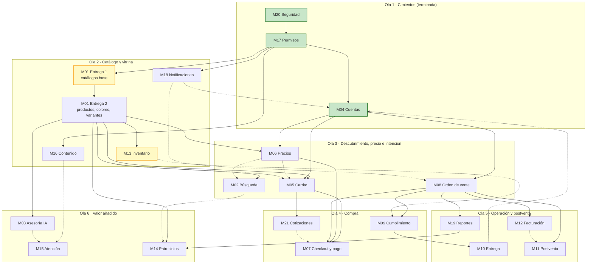

# Ruta del Proyecto — Olas de Construcción y Grafo de Dependencias

> **Versión:** 2.0 — propuesta de reordenamiento, pendiente de aprobación del Tech Lead
> **Alcance:** 21 módulos (`M01` a `M21`) en 6 olas y 4 carriles de trabajo
> **Qué cambió respecto a la v1:** Sección 7.

---

## 1. Qué es este documento

Es el mapa de construcción de Pintu Clic: qué módulos existen, en qué orden se construyen y de qué depende cada uno.
Es una **guía de orden**, no un bloqueo: la decide el Tech Lead (ver [AGENTS.md](../../../AGENTS.md)).

La v2 corrige el grafo con lo que dicen los contratos, las specs y el código ya fusionado, y separa dos tipos de dependencia
que la v1 mezclaba:

| Tipo | Flecha | Significa | ¿Bloquea empezar? |
| :--- | :---: | :--- | :---: |
| **Construcción** | `A --> B` | `B` lee tablas, datos o servicios que crea `A`. Sin `A` en `main`, `B` no se puede probar de verdad. | Sí |
| **Puerto** | `A -.-> B` | `B` consume a `A` a través de un puerto (interfaz en `interfaces/` + adaptador en memoria). Cuando `A` llega, se cambia el adaptador sin tocar los servicios de `B`. | No |

El patrón de puerto ya está probado en el proyecto: `AuditoriaPort` (M20 → M17) y `NotificacionesPort` (M04 → M18, [ADR-009](../../adrs/ADR-009-puerto-notificaciones-desacople-m18.md)).
M04 se construyó completo antes que M18 gracias a él.

---

## 2. Dónde se responde cada pregunta

| Pregunta | Dónde |
| :--- | :--- |
| ¿Qué módulos existen y en qué orden se construyen? | **Este documento** |
| ¿Qué hace funcionalmente un módulo (RF, RNF, CA)? | `docs/02_MODULOS_FUNCIONALES/` y `docs/01_TRANSVERSALES/` |
| ¿Cómo se implementa técnicamente? | [`backend/ARQUITECTURA.md`](../../../backend/ARQUITECTURA.md) y [`frontend/ARQUITECTURA.md`](../../../frontend/ARQUITECTURA.md) |
| ¿Cuál es la API de un módulo? | `contracts/m[xx]-*.contract.ts` |
| ¿Cuál es el estado de avance? | Los PR fusionados en `main` y el tablero del equipo |

---

## 3. Grafo de dependencias



Verde: fusionado en `main`. Amarillo: con contrato en rama (`feature/m01-catalogo`, `feature/m01-bd-catalogo`, `feature/m13-inventario`).

---

## 4. Inventario de los 21 módulos

El **scope** es obligatorio para carpetas y commits ([GUIA_GIT_COMMITS_Y_PUSH.md](../02_GUIAS_Y_ESTANDARES/GUIA_GIT_COMMITS_Y_PUSH.md)). No cambia respecto a la v1.

| Módulo | Nombre | Ola | Scope | Construcción (bloquea) | Puerto (no bloquea) | Estado |
| :--- | :--- | :---: | :--- | :--- | :--- | :--- |
| **M20** | Seguridad, Auditoría y Protección de Datos | 1 | `m20-seguridad` | — | — | ✅ En `main` |
| **M17** | Administración, Empleados y Permisos | 1 | `m17-permisos` | M20 | — | ✅ En `main` |
| **M04** | Cuentas, Autenticación y Perfil | 1 | `m04-cuentas` | M20, M17 | M18, M10 (direcciones) | ✅ En `main` |
| **M01** | Catálogo de Productos | 2 | `m01-catalogo` | M17 | — | 🟡 Contrato E1 en rama |
| **M13** | Inventario (referencial; SAMIT a futuro) | 2 | `m13-inventario` | M01 (E2) | — | 🟡 Contrato en rama |
| **M16** | Contenido Institucional | 2 | `m16-contenido` | M17 | — | ❌ Sin spec |
| **M18** | Notificaciones y Comunicaciones | 2 | `m18-notificaciones` | M17 | — | 🟠 Spec ✅; SMTP ya conectado dentro de M04 y M17 |
| **M02** | Búsqueda, Filtros y Descubrimiento | 3 | `m02-busqueda` | M01 (E2) | M06 | Spec ✅ |
| **M06** | Precios, Promociones y Descuentos | 3 | `m06-precios` | M01 (E2), M04 | — | ❌ Sin spec |
| **M05** | Carrito de Compras | 3 | `m05-carrito` | M01 (E2), M04 | M06, M13 | Spec ✅ |
| **M08** | Orden de Venta | 3 | `m08-ordenes` | M04, M17 | M18 | Spec ✅ (ver 8.1) |
| **M21** | Cotizaciones | 4 | `m21-cotizaciones` | M05 | — | ❌ Sin spec |
| **M07** | Checkout y Pago | 4 | `m07-checkout` | M05, M06, M08 | M21 | ❌ Sin spec |
| **M09** | Cumplimiento y Preparación | 4 | `m09-cumplimiento` | M08 | M13 | ❌ Sin spec |
| **M10** | Entrega y Transporte | 5 | `m10-entrega` | M09 | — | ❌ Sin spec |
| **M12** | Facturación | 5 | `m12-facturacion` | M08 | — | ❌ Sin spec |
| **M11** | Postventa (Devoluciones/Reembolsos) | 5 | `m11-postventa` | M08 | M12 | ❌ Sin spec |
| **M19** | Reportes y Analítica | 5 | `m19-reportes` | M08 | — | ❌ Sin spec |
| **M03** | Asesoría y IA (Simulador/Chatbot) | 6 | `m03-asesoria` | M01 (E2) | — | ❌ Sin spec |
| **M15** | Atención al Cliente (WhatsApp/FAQ) | 6 | `m15-atencion` | — | M16, M03 | ❌ Sin spec |
| **M14** | Patrocinios y Campañas | 6 | `m14-patrocinios` | M01 (E2), M19 | M02 | ❌ Sin spec |

**M01 se entrega en dos partes** (no son módulos nuevos, es el mismo scope): la **Entrega 1** (categorías, marcas, líneas, bases, resinas, presentaciones) ya tiene contrato; la **Entrega 2** (colores, productos, variantes con precio base, combos, consulta pública, imágenes) es la que desbloquea casi todo lo demás.

---

## 5. Olas y carriles

Con 4 desarrolladores conviene pensar en **4 carriles** que avanzan en paralelo. Una ola puede empezar en un carril mientras otro
termina la anterior, siempre que sus dependencias de **construcción** estén en `main`.

| Ola | Carril 1 · Catálogo | Carril 2 · Venta | Carril 3 · Plataforma | Carril 4 · Operación | Hito al cerrar |
| :---: | :--- | :--- | :--- | :--- | :--- |
| **1** | M20 ✅ | M17 ✅ | M04 ✅ | — | Acceso, cuentas y panel |
| **2** | M01 E1 → M01 E2 | Contrato M06 + contrato M08 | M18 (consolidar) → M16 | M13 (tras M01 E2; mientras, su front con datos de seed) | **Vitrina pública:** catálogo navegable con contenido institucional |
| **3** | M02 | M06 | M05 | M08 | **Intención de compra:** buscar, ver precio B2C/B2B y armar carrito |
| **4** | M21 | M07 | M09 | — | **Primera venta real:** pago → orden → preparación |
| **5** | M19 | M12 | M11 | M10 | **Ciclo comercial completo** |
| **6** | M03 | M14 | M15 | — | Valor añadido |

Criterios del reparto:

- **M01 Entrega 2 es el cuello de botella de la Ola 2.** Si se retrasa, el carril 2 adelanta contratos (M06, M08, M07) en vez de esperar.
- **M08 sube a la Ola 3.** Su spec dice que la línea de la orden copia los datos sin FK al catálogo (ADR-05 de M08) y que la orden nace por un servicio interno que M07 invoca. M08 no necesita a M07 para construirse; es M07 quien necesita a M08.
- **M06 sube a la Ola 3**, junto a M05. El carrito arranca con el precio base de la variante (M01) detrás de un `PreciosPort`; M06 añade luego promociones y precio B2B sin tocar el carrito.
- **M18 baja a la Ola 2.** Ya hay envío SMTP real dentro de M04 y M17; M18 lo centraliza (plantillas administrables, HU-NOT-03) antes de que M08 y M21 empiecen a emitir eventos.
- **M16 y M03 son relleno de bajo riesgo**: no bloquean a nadie y sirven para equilibrar carga cuando un carril queda esperando.

---

## 6. Camino crítico

v1 (sin contar lo ya terminado): `M13 → M01 → M05 → M21 → M07 → M08 → M09 → M10` — **8 módulos en serie.**

v2:

```text
M01 E1 → M01 E2 → M05 → M07 → (integración con M08 ya hecho)
                         ↑
           M06 y M08 se construyen en paralelo con M05
```

**4 pasos en serie hasta la primera venta.** M09 y M10 salen del camino crítico porque dependen de M08, no de M07, y pueden avanzar
en la Ola 4 en paralelo al checkout.

| Módulo | Habilita (construcción) | Riesgo si se retrasa |
| :--- | :--- | :--- |
| **M01 E2** Catálogo | M13, M02, M05, M06, M03, M14 | 🔴 Crítico — sin variantes no hay nada que vender |
| **M08** Orden | M07, M09, M11, M12, M19 | 🔴 Crítico — bloquea la venta y toda la postventa |
| **M05** Carrito | M07, M21 | 🟠 Alto — único camino a la compra |
| **M07** Checkout | Primera venta real | 🟠 Alto — es el último eslabón |

---

## 7. Qué cambió respecto a la v1 y por qué

| # | Cambio | Evidencia |
| :---: | :--- | :--- |
| 1 | **`M13 → M01` se invierte a `M01 → M13`.** | El contrato de M13 (`feature/m13-inventario`) lleva "la existencia referencial de cada variante del catálogo", sin SAMIT. Necesita las variantes de M01, no al revés. |
| 2 | **`M13 → M06` se reemplaza por `M01 → M06` y `M04 → M06`.** | El precio vive en la variante (M01) y depende del tipo de cliente B2C/B2B (M04). M13 no toca precios ("No toca precios, promociones ni combos"). |
| 3 | **`M07 → M08` se invierte a `M08 → M07`.** | Spec M08: "Al confirmarse [el pago], [M07] llama al servicio de creación de M08". HU-ORD-01: "Implementada en M08; falta que M07 la invoque". |
| 4 | **`M21 → M08` desaparece; `M21 → M07` pasa a puerto.** | La cotización aceptada entra a la compra por el carrito/checkout; M08 solo recibe la solicitud ya pagada. |
| 5 | **`M18 → M04` pasa a puerto; `M08 → M18` se invierte a puerto `M18 -.-> M08`.** | Resuelve el ciclo M18 → M04 → M07 → M08 → M18 de la v1 (era una flecha de evento mezclada con una de construcción). M04 ya se construyó así (ADR-009). |
| 6 | **Se añaden `M04 → M05` y `M04 → M08`.** | Spec M05: "Depende de M04 Cuentas (para autenticación y tipo de cliente)". M08 consulta la orden por cliente titular. |
| 7 | **Se añade el puerto `M06 -.-> M02`.** | Spec M02: depende de M06 "para calcular el precio real en los filtros por rango de precio". No estaba en el grafo. |
| 8 | **`M02 → M14` pasa a puerto.** | HU-BUS-04 (prioridad de patrocinio en resultados) está *Bloqueada / Descartada* en la spec de M02. |
| 9 | **M16 se conecta a M17; M15 a M16 por puerto.** | El contenido se administra desde el panel. La FAQ de M15 es contenido institucional (hipótesis: confirmarla con el cliente). |
| 10 | **M04 pasa a la Ola 1 y M18 a la Ola 2.** | Reflejan lo que ya ocurrió en `main`. |
| 11 | **Se quitan los `classDef` sin uso** y se colorea por estado. | Observación 7.4 de la v1. |

Las cuatro observaciones de la v1 (ciclo M18, Ola 4 dependiente de Ola 5, M16 suelto, estilos sin aplicar) quedan resueltas por los cambios 5, 3–4 y la nueva ubicación de M06/M08, 9 y 11.

---

## 8. Decisiones pendientes del Tech Lead

1. **M08 sin código.** Su spec dice que el backend "cumple 41 de 49 criterios" y remite a `docs/walkthroughs/M08/`, pero en `main` no hay `backend/src/modules/m08-ordenes/` ni esa carpeta de walkthroughs, y tampoco hay rama remota. ¿Existe ese código en otro repositorio que haya que traer, o la spec describe un estado que no aplica a este repo?
2. **Contrato de la solicitud `SOL-AAAA-NNNNN`.** La comparten M07 (la crea) y M08 (la consume). Conviene acordarla en la Ola 2, antes de que cualquiera de los dos escriba código.
3. **M18.** ¿Se consolida en un módulo propio (plantillas, cola de envío) o se acepta que cada módulo mantenga su adaptador SMTP y M18 queda solo como plantillas?
4. **Direcciones de M04 (HU-CUE-07) dependen del modelo de entrega de M10.** Mientras M10 no exista, M04 sigue con su modelo actual.
5. **Seis módulos de las Olas 3–4 no tienen spec** (M06, M07, M09, M21, y luego M10, M12). Su contrato debe escribirse una ola antes de construirlos para no frenar los carriles.

---

## 9. Cómo usar esta ruta

1. **Antes de empezar un módulo**, revisa sus dependencias de **construcción** (Sección 4). Si una no está en `main`, avisa al Tech Lead y propón una alternativa.
2. **Las dependencias de puerto no bloquean.** Define la interfaz en `interfaces/` del módulo consumidor y un adaptador en memoria para los tests, como en ADR-009.
3. **No se crean, renombran ni fusionan módulos** sin acuerdo del equipo. Los scopes son los de la Sección 4.
4. **Un módulo sin spec** se define primero en su contrato `contracts/m[xx]-*.contract.ts`.
5. **En el PR**, indica qué módulos habilita lo entregado y qué puertos quedaron con adaptador en memoria.
