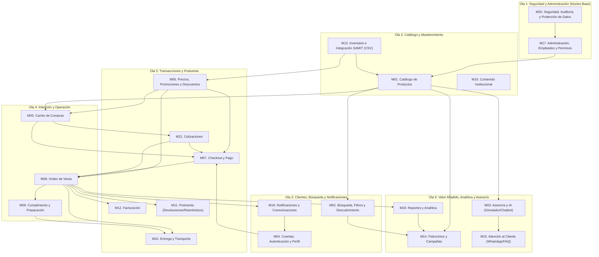

# Ruta del Proyecto — Olas de Construcción y Grafo de Dependencias

> **Autoridad:** Product Owner de Pintu Clic  
> **Estado:** Vigente — Contrato de orden de construcción  
> **Alcance:** 21 módulos (`M01` a `M21`) organizados en 6 olas secuenciales

---

## 1. Qué es este documento y por qué es obligatorio

Este es **el mapa maestro de construcción de Pintu Clic**. Define *qué* módulos componen el sistema completo, *en qué orden* deben construirse y *de qué depende cada uno*.

El diagrama de la Sección 3 es un **contrato de ingeniería**, no una ilustración. Igual que los diagramas de flujo por módulo (Directiva #5 de [AGENTS.md](../../../AGENTS.md)), fue consensuado por el equipo y define dependencias reales:

- **Una flecha `A --> B` significa que `B` depende de `A`.** No se implementa `B` mientras `A` no esté terminado y certificado.
- **Las olas son secuenciales.** Una ola no arranca hasta que la anterior esté cerrada, salvo autorización explícita del Product Owner.
- **Ningún agente puede inventar, renombrar, fusionar o saltarse un módulo** de esta ruta. El inventario y la nomenclatura de los 21 módulos son los de este documento.

> ⚠️ **Todo agente de IA DEBE leer este documento completo antes de escribir código**, para entender
> no solo su módulo asignado sino **la ruta a la totalidad**: qué hay antes, qué hay después y a quién
> habilita su trabajo. Sin ese contexto es imposible dimensionar correctamente una implementación.

---

## 2. Cómo leer la ruta en relación con el resto del proyecto

| Pregunta | Dónde se responde |
| :--- | :--- |
| ¿Qué módulos existen y en qué orden se construyen? | **Este documento** |
| ¿Qué hace funcionalmente un módulo (RF, RNF, CA)? | `docs/02_MODULOS_FUNCIONALES/` y `docs/01_TRANSVERSALES/` |
| ¿Cómo se implementa técnicamente? | `docs/00_SISTEMA/01_ARQUITECTURA/ARQUITECTURA_BACKEND.md` |
| ¿Qué HU toca qué política transversal y qué diagrama? | `docs/00_SISTEMA/01_ARQUITECTURA/MATRIZ_TRAZABILIDAD.md` |
| ¿Cuál es el Stage-Gate activo y quién tiene el turno? | `.sdlc/.workflow/current_state.json` |
| ¿Cuál es el estado de avance real por módulo? | `.sdlc/multiAgents/00_orchestrator/PROJECT_STATUS.md` |

**Stack confirmado para todos los módulos** (no negociable sin RFC aprobado):
Backend `Express 5` + `Prisma 6` + `Zod 4` + `Vitest 3` · Frontend `Next.js 15` + `React 19` + `Tailwind CSS 4` + `Zustand 5` + `React Hook Form` + `Axios`.

---

## 3. Grafo de Dependencias y Olas de Construcción



---

## 4. Inventario de los 21 Módulos

La columna **Scope** es el identificador obligatorio para nombres de carpeta (`backend/src/modules/`, `frontend/src/modules/`) y para el scope de los commits, según [GUIA_GIT_COMMITS_Y_PUSH.md](../02_GUIAS_Y_ESTANDARES/GUIA_GIT_COMMITS_Y_PUSH.md).

| Módulo | Nombre | Ola | Scope | Depende de | Spec funcional |
| :--- | :--- | :---: | :--- | :--- | :--- |
| **M20** | Seguridad, Auditoría y Protección de Datos | 1 | `m20-seguridad` | — | ✅ [`M20_SEGURIDAD_Y_AUDITORIA.md`](../../01_TRANSVERSALES/M20_SEGURIDAD_Y_AUDITORIA.md) |
| **M17** | Administración, Empleados y Permisos | 1 | `m17-permisos` | M20 | ✅ [`M17_PERMISOS_Y_ROLES.md`](../../01_TRANSVERSALES/M17_PERMISOS_Y_ROLES.md) |
| **M13** | Inventario e Integración SAMIT (CSV) | 2 | `m13-inventario` | — | ❌ Pendiente |
| **M01** | Catálogo de Productos | 2 | `m01-catalogo` | M17, M13 | ✅ [`M01_ESPECIFICACION_CATALOGO.md`](../../02_MODULOS_FUNCIONALES/M01_ESPECIFICACION_CATALOGO.md) |
| **M16** | Contenido Institucional | 2 | `m16-contenido` | — | ❌ Pendiente |
| **M18** | Notificaciones y Comunicaciones | 3 | `m18-notificaciones` | M08 ⚠️ | ✅ [`M18_NOTIFICACIONES.md`](../../01_TRANSVERSALES/M18_NOTIFICACIONES.md) |
| **M04** | Cuentas, Autenticación y Perfil | 3 | `m04-cuentas` | M18 | ✅ [`M04_CUENTAS_AUTH_PERFIL.md`](../../02_MODULOS_FUNCIONALES/M04_CUENTAS_AUTH_PERFIL.md) |
| **M02** | Búsqueda, Filtros y Descubrimiento | 3 | `m02-busqueda` | M01 | ✅ [`M02_ESPECIFICACION_BUSQUEDA.md`](../../02_MODULOS_FUNCIONALES/M02_ESPECIFICACION_BUSQUEDA.md) |
| **M05** | Carrito de Compras | 4 | `m05-carrito` | M01, M06 ⚠️ | ✅ [`M05_ESPECIFICACION_CARRITO.md`](../../02_MODULOS_FUNCIONALES/M05_ESPECIFICACION_CARRITO.md) |
| **M08** | Orden de Venta | 4 | `m08-ordenes` | M06 ⚠️, M07 ⚠️, M21 ⚠️ | ✅ [`M08_ESPECIFICACION_ORDEN.md`](../../02_MODULOS_FUNCIONALES/M08_ESPECIFICACION_ORDEN.md) |
| **M09** | Cumplimiento y Preparación | 4 | `m09-cumplimiento` | M08 | ❌ Pendiente |
| **M06** | Precios, Promociones y Descuentos | 5 | `m06-precios` | M13 | ❌ Pendiente |
| **M07** | Checkout y Pago | 5 | `m07-checkout` | M04, M05, M06, M21 | ❌ Pendiente |
| **M21** | Cotizaciones | 5 | `m21-cotizaciones` | M05 | ❌ Pendiente |
| **M10** | Entrega y Transporte | 5 | `m10-entrega` | M08, M09 | ❌ Pendiente |
| **M12** | Facturación | 5 | `m12-facturacion` | M08 | ❌ Pendiente |
| **M11** | Postventa (Devoluciones/Reembolsos) | 5 | `m11-postventa` | M08 | ❌ Pendiente |
| **M03** | Asesoría y IA (Simulador/Chatbot) | 6 | `m03-asesoria` | M01 | ❌ Pendiente |
| **M19** | Reportes y Analítica | 6 | `m19-reportes` | M08 | ❌ Pendiente |
| **M14** | Patrocinios y Campañas | 6 | `m14-patrocinios` | M01, M02, M19 | ❌ Pendiente |
| **M15** | Atención al Cliente (WhatsApp/FAQ) | 6 | `m15-atencion` | M03 | ❌ Pendiente |

⚠️ Ver las observaciones de la Sección 7.

---

## 5. Lectura de las Olas: Qué Habilita Cada Una

### Ola 1 — Seguridad y Administración (Cimientos)
`M20` es la **única raíz absoluta del sistema**: no depende de nada y todo depende de ella. Establece el hashing BCrypt, la gestión de sesiones JWT, la autorización en servidor y la bitácora inmutable de auditoría. `M17` construye sobre ella el modelo de **permisos atómicos individuales por empleado** — sin roles rígidos. Nada del panel administrativo puede existir antes de esta ola.

### Ola 2 — Catálogo y Abastecimiento
`M13` es la segunda raíz: ingesta de inventario vía CSV desde SAMIT. Sin datos de inventario no hay productos que mostrar ni precios que calcular. `M01` convierte esos datos en el catálogo navegable, y es el **segundo nodo más conectado de la ruta**: habilita búsqueda, carrito, patrocinios y asesoría IA.

### Ola 3 — Clientes, Búsqueda y Notificaciones
`M18` centraliza el envío transaccional por SMTP. Es la pieza que hace posible la verificación de correo de `M04`, respetando el principio de **notificaciones desacopladas**: ningún módulo de negocio llama a SMTP directamente, solo emite eventos. `M04` habilita cuentas B2C y B2B (con aprobación de NIT/RUT) y Google Identity. `M02` hace el catálogo descubrible.

### Ola 4 — Intención y Operación
`M05` captura la intención de compra. `M08` es el **nodo más crítico de todo el sistema**: habilita por sí solo seis módulos (cumplimiento, entrega, postventa, facturación, notificaciones y analítica). Cualquier retraso aquí bloquea la mitad de la Ola 5 y buena parte de la Ola 6.

### Ola 5 — Transacciones y Postventa
Cierra el ciclo comercial completo: `M06` resuelve precios diferenciados B2C/B2B, `M07` ejecuta el pago, `M21` atiende el canal de cotizaciones B2B, y `M10`, `M12` y `M11` cubren la operación posterior a la venta.

### Ola 6 — Valor Añadido, Analítica y Asesoría
Funcionalidad diferencial que exige el sistema ya operando: `M03` (simulador de pintura y chatbot), `M19` (reportes sobre datos reales de órdenes), `M14` (patrocinios, que necesita catálogo, búsqueda y analítica) y `M15` (atención por WhatsApp y FAQ).

---

## 6. Camino Crítico

La cadena más larga de dependencias determina el tiempo mínimo del proyecto. Ningún eslabón puede paralelizarse con el siguiente:

```text
M20 → M17 → M01 → M05 → M21 → M07 → M08 → M09 → M10
```

**Nueve módulos en secuencia estricta.** Los nodos de mayor impacto por cantidad de módulos que desbloquean:

| Módulo | Módulos que habilita | Riesgo si se retrasa |
| :--- | :---: | :--- |
| **M08** Orden de Venta | 6 (M09, M10, M11, M12, M18, M19) | 🔴 Crítico — bloquea Ola 5 y Ola 6 |
| **M01** Catálogo | 4 (M02, M05, M14, M03) | 🔴 Crítico — bloquea descubrimiento y compra |
| **M06** Precios | 3 (M05, M07, M08) | 🟠 Alto — bloquea el camino crítico |
| **M20** Seguridad | Todo el sistema (transitivamente) | 🔴 Crítico — raíz absoluta |

---

## 7. Observaciones Técnicas para Resolución del Product Owner

Al trazar el grafo surgen cuatro puntos que **requieren decisión del PO**. Hasta que se resuelvan, la ruta se respeta tal como está y **el agente que se tope con uno de ellos debe detenerse y reportar** (Directiva #3 de [AGENTS.md](../../../AGENTS.md)), no improvisar.

### 7.1. Ciclo de dependencia M18 ↔ cadena de venta
El grafo contiene un ciclo: `M18 → M04 → M07 → M08 → M18`.

La lectura más probable es que las flechas tienen **dos semánticas mezcladas**: `M18 → M04` significa *"M18 debe existir antes que M04"* (orden de construcción), mientras que `M08 → M18` significa *"M08 emite eventos hacia M18"* (consumo en runtime). Si es así, no hay ciclo real de construcción y `M18` es un servicio transversal — consistente con el principio de notificaciones desacopladas de `ARQUITECTURA_GENERAL.md`.

**Pendiente:** confirmar la semántica y, si procede, separar las flechas de orden de construcción de las de flujo de eventos.

### 7.2. Módulos de Ola 4 que dependen de Ola 5
Dos módulos están ubicados en una ola anterior a sus dependencias:

| Módulo (ola) | Depende de (ola) |
| :--- | :--- |
| `M05` Carrito (**Ola 4**) | `M06` Precios (**Ola 5**) |
| `M08` Orden de Venta (**Ola 4**) | `M06` Precios, `M07` Checkout, `M21` Cotizaciones (**Ola 5**) |

Tal como está, la Ola 4 no puede cerrarse sin construir primero tres módulos de la Ola 5. **Pendiente:** mover `M06` a la Ola 4 (resolvería el caso de `M05`) y decidir si `M08` baja a la Ola 5 o si `M07` y `M21` suben a la Ola 4.

### 7.3. M16 Contenido Institucional sin conexiones
`M16` aparece en la Ola 2 pero no tiene dependencias ni dependientes. **Pendiente:** confirmar si es verdaderamente independiente (en tal caso puede construirse en cualquier momento, incluso en paralelo) o si falta trazar su relación — por ejemplo con `M17`, si su contenido se administra desde el panel.

### 7.4. Estilos por dominio declarados sin aplicar
El diagrama declara cinco `classDef` (`adm`, `cat`, `cli`, `ven`, `ope`) que nunca se asignan a ningún nodo, por lo que no tienen efecto visual. **Pendiente:** si se desea el coloreado por dominio, el PO debe indicar a qué dominio pertenece cada módulo; no se asume para no inventar una taxonomía.

---

## 8. Reglas Obligatorias para Agentes

1. **Verificar dependencias antes de empezar.** Antes de implementar `MXX`, confirmar en [`PROJECT_STATUS.md`](../../../.sdlc/multiAgents/00_orchestrator/PROJECT_STATUS.md) que todos sus predecesores en el grafo están certificados. Si alguno no lo está, **detenerse y reportar**.
2. **No saltarse olas.** Una ola posterior no se inicia sin cierre de la anterior ni autorización explícita del Product Owner.
3. **Respetar el inventario y la nomenclatura.** Los 21 módulos, sus nombres y sus scopes son los de la Sección 4. Prohibido crear módulos no listados, renombrarlos o fusionarlos.
4. **Usar el scope exacto** de la Sección 4 para carpetas y commits (`m[xx]-[nombre]`, minúsculas y kebab-case).
5. **Declarar el impacto en el Walkthrough.** La sección de dependencias externas debe citar explícitamente qué módulos de esta ruta habilita el trabajo entregado y qué necesita de otros para operar al 100%.
6. **Un módulo sin spec no se implementa.** Los 13 módulos marcados ❌ en la Sección 4 requieren primero su especificación funcional (Gate 1, Product Manager) antes de cualquier código.
