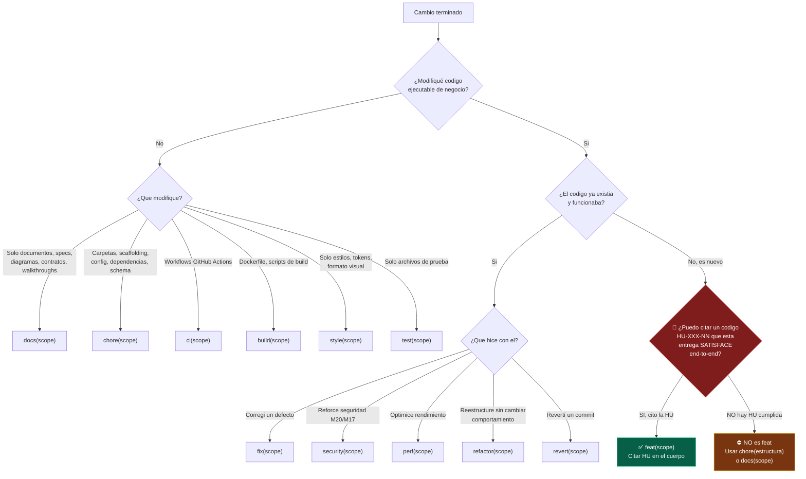
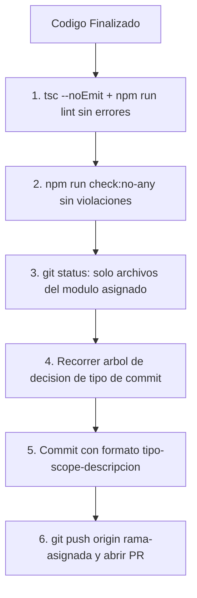

# Guía de Convención de Commits y Flujo de Push - PINTU CLIC

Este documento establece el **estándar obligatorio para la creación de commits y el envío de cambios (push)** al repositorio del proyecto **Pintu Clic**.

Aplica estrictamente tanto a **desarrolladores humanos** como a **Agentes de Inteligencia Artificial (IA)**.

> ## ⚖️ FUENTE ÚNICA DE VERDAD DE NOMENCLATURA
>
> **Este archivo es la autoridad final sobre tipos de commit y scopes para todo el proyecto.**
> Ningún otro documento puede definir tipos de commit distintos a los catalogados aquí.
> Si existe discrepancia, **esta guía prevalece**. Documentos alineados:
> [`AGENTS.md`](../../../AGENTS.md) y `.agents/rules/03_git_commits.md`.

---

## 1. Formato de Commit y de Título de PR

Ambos usan el mismo formato y **ninguno lleva versión**: el tag de versión lo calcula
`.github/workflows/release.yml` a partir de los mensajes de commit al llegar a `main`.

| Artefacto | Formato Obligatorio | Ejemplo |
| :--- | :--- | :--- |
| **Commit individual** | `tipo(scope): descripcion` | `feat(m04-cuentas): implementar registro con verificacion HU-CUE-01` |
| **Título de la PR** | `tipo(scope): descripcion` | `feat(m04-cuentas): registro de cuentas con verificacion` |

> ⛔ **PROHIBIDO** colocar un prefijo de versión (`[vX.Y.Z]`) en el commit o en el título de la PR.

Estructura completa de un commit:

```text
tipo(scope): descripción clara en minúsculas y modo imperativo

[Cuerpo opcional: HUs cubiertas, criterios de aceptación, decisiones técnicas]
```

Reglas de forma:
- Descripción en **minúsculas**, **modo imperativo** (`implementar`, no `implementado` ni `implementa`).
- Sin punto final en la línea de asunto.
- Máximo ~72 caracteres en la línea de asunto.
- Scope **siempre obligatorio** entre paréntesis.
- Sin tildes en el asunto (compatibilidad de terminal y lint).

---

## 2. 🔴 LA REGLA DE ORO: `feat` EXIGE UNA HISTORIA DE USUARIO

> ## ⚠️ ESTE ES EL ERROR MÁS FRECUENTE DE LOS AGENTES DE IA
>
> **`feat` se reserva EXCLUSIVAMENTE para la implementación de funcionalidad real de negocio
> que satisface una o más Historias de Usuario (HU) con código verificable.**
>
> **Si no puedes citar un código `HU-XXX-NN` concreto que esta entrega satisface,
> el commit NO ES `feat`.**

### ¿Qué NO es `feat`?

| Trabajo realizado | ❌ Tipo incorrecto | ✅ Tipo correcto |
| :--- | :--- | :--- |
| Crear la estructura de carpetas del proyecto | `feat` | **`chore(estructura)`** |
| Definir arquitectura, infraestructura o scaffolding | `feat` | **`chore(estructura)`** o **`docs(arquitectura)`** |
| Agregar documentos de arquitectura o especificación | `feat` | **`docs(arquitectura)`** |
| Configurar Docker, ESLint, tsconfig, Prisma init | `feat` | **`chore(config)`** |
| Instalar o actualizar dependencias | `feat` | **`chore(deps)`** |
| Crear el schema Prisma sin lógica de negocio | `feat` | **`chore(bd)`** |
| Crear carpetas vacías de un módulo (`controllers/`, `services/`) | `feat` | **`chore(estructura)`** |
| Agregar contratos Zod sin implementar endpoints | `feat` | **`docs(contratos)`** |
| Configurar workflows de GitHub Actions | `feat` | **`ci(workflows)`** |
| Agregar tests a código ya existente | `feat` | **`test(mXX-nombre)`** |

### ¿Qué SÍ es `feat`?

Solo cuando se cumplen **las tres** condiciones:

1. ✅ Existe un endpoint, vista o flujo **funcionando end-to-end**.
2. ✅ Satisface Criterios de Aceptación (CA) de una HU documentada en `docs/02_MODULOS_FUNCIONALES/`.
3. ✅ El cuerpo del commit puede citar el código de la HU (`HU-CUE-01`, `HU-ADM-03`, etc.).

```text
feat(m04-cuentas): implementar registro con verificacion de correo HU-CUE-01

- Endpoint POST /api/v1/auth/register con validacion Zod perimetral.
- Hashing BCrypt costo 12 (HU-SEG-01) y emision de evento SMTP a M18.
- Cumple CA-01-01 a CA-01-04 y politica de unicidad HU-CUE-08.
```

---

## 3. Catálogo Completo de Tipos de Commit Permitidos

| Tipo | Cuándo usarlo | Requiere HU | Ejemplo |
| :--- | :--- | :---: | :--- |
| **`feat`** | Funcionalidad real de negocio que satisface una HU completa | ✅ **SÍ** | `feat(m04-cuentas): implementar login con google identity HU-CUE-04` |
| **`fix`** | Corrección de un defecto en código existente y funcional | No | `fix(m04-cuentas): corregir expiracion de tokens de verificacion` |
| **`security`** | Refuerzo de políticas de seguridad transversales (M20/M17) | No | `security(m20-seguridad): elevar costo de salt bcrypt a 12` |
| **`perf`** | Optimización de rendimiento sin cambio funcional | No | `perf(m01-catalogo): indexar busqueda de productos por sku` |
| **`refactor`** | Reestructuración de código sin alterar comportamiento observable | No | `refactor(m04-cuentas): extraer repositorio prisma de cuentas` |
| **`test`** | Creación o modificación de pruebas automatizadas | No | `test(m04-cuentas): agregar pruebas de integracion de login` |
| **`docs`** | Documentación, especificaciones, diagramas, contratos, walkthroughs, reportes QA | No | `docs(arquitectura): agregar seccion de herramientas qa` |
| **`style`** | Cambios cosméticos: formato, tokens del Design System, sin lógica | No | `style(ui): aplicar tokens semanticos en modal de confirmacion` |
| **`chore`** | **Estructura, scaffolding, configuración, dependencias, mantenimiento** | No | `chore(estructura): crear estructura modular de backend y frontend` |
| **`ci`** | Workflows de GitHub Actions, pipelines, automatización de CI/CD | No | `ci(workflows): configurar lint de titulo de pr` |
| **`build`** | Sistema de compilación, Dockerfiles, scripts de build | No | `build(docker): optimizar imagen de produccion de backend` |
| **`revert`** | Reversión de un commit previo | No | `revert(m04-cuentas): revertir cambio en validacion de nit` |

> ⛔ **Cualquier tipo fuera de esta tabla queda RECHAZADO.** No existen `update`, `add`, `change`,
> `improve`, `WIP`, `misc` ni variantes en inglés distintas a las listadas.

---

## 4. Árbol de Decisión Obligatorio: ¿Qué Tipo Debo Usar?

Todo agente DEBE recorrer este árbol antes de redactar el mensaje de commit:



---

## 5. Catálogo Canónico de Scopes

El scope es **siempre obligatorio**. Debe ser uno de los siguientes:

### A. Scopes de Módulo Funcional

Formato: `m[xx]-[nombre-modulo]` en minúsculas y kebab-case, idéntico al nombre de la carpeta en
`backend/src/modules/` y `frontend/src/modules/`.

> El inventario autoritativo de los 21 módulos, sus olas y sus dependencias está en
> [RUTA_DEL_PROYECTO.md](../01_ARQUITECTURA/RUTA_DEL_PROYECTO.md). Prohibido usar un scope de módulo que no esté en esta tabla.

| Scope | Módulo | Ola |
| :--- | :--- | :---: |
| `m01-catalogo` | M01: Catálogo de Productos | 2 |
| `m02-busqueda` | M02: Búsqueda, Filtros y Descubrimiento | 3 |
| `m03-asesoria` | M03: Asesoría y IA (Simulador/Chatbot) | 6 |
| `m04-cuentas` | M04: Cuentas, Autenticación y Perfil | 3 |
| `m05-carrito` | M05: Carrito de Compras | 4 |
| `m06-precios` | M06: Precios, Promociones y Descuentos | 5 |
| `m07-checkout` | M07: Checkout y Pago | 5 |
| `m08-ordenes` | M08: Orden de Venta | 4 |
| `m09-cumplimiento` | M09: Cumplimiento y Preparación | 4 |
| `m10-entrega` | M10: Entrega y Transporte | 5 |
| `m11-postventa` | M11: Postventa (Devoluciones/Reembolsos) | 5 |
| `m12-facturacion` | M12: Facturación | 5 |
| `m13-inventario` | M13: Inventario e Integración SAMIT (CSV) | 2 |
| `m14-patrocinios` | M14: Patrocinios y Campañas | 6 |
| `m15-atencion` | M15: Atención al Cliente (WhatsApp/FAQ) | 6 |
| `m16-contenido` | M16: Contenido Institucional | 2 |
| `m17-permisos` | M17: Administración, Empleados y Permisos | 1 |
| `m18-notificaciones` | M18: Notificaciones y Comunicaciones | 3 |
| `m19-reportes` | M19: Reportes y Analítica | 6 |
| `m20-seguridad` | M20: Seguridad, Auditoría y Protección de Datos | 1 |
| `m21-cotizaciones` | M21: Cotizaciones | 5 |

### B. Scopes Transversales (No Modulares)

| Scope | Uso |
| :--- | :--- |
| `estructura` | Creación de estructura de carpetas, scaffolding, organización de proyecto |
| `arquitectura` | Documentos de arquitectura general, backend, frontend, matriz de trazabilidad |
| `contratos` | Contratos Zod API-First en `contracts/` |
| `bd` | Schema Prisma, DDL, seeds, migraciones, documentación de base de datos |
| `core` | Código compartido: `apiClient`, middlewares globales, theme, DTOs transversales |
| `ui` | Design System, componentes base, tokens de color |
| `qa` | Reportes de QA, suites de prueba transversales, tooling de calidad |
| `devops` | Docker, entornos, `.env.example`, infraestructura (⚠️ solo DevOps designado) |
| `workflows` | GitHub Actions, pipelines de CI/CD (⚠️ solo DevOps designado) |
| `gobernanza` | `AGENTS.md`, `CONTRIBUTING.md`, guías y estándares del sistema |
| `deps` | Dependencias de npm, lockfiles |
| `config` | ESLint, tsconfig, Prettier, configuración de herramientas |
| `docs` | Documentación general que no encaja en un scope más específico |

---

## 6. Ejemplos Correctos por Categoría

### A. Implementación de HU real (`feat`)
```text
feat(m04-cuentas): implementar registro con confirmacion de correo HU-CUE-01

- Endpoint POST /api/v1/auth/register con validacion Zod perimetral.
- Hashing BCrypt costo 12 y emision de evento SMTP desacoplado hacia M18.
- Cumple HU-SEG-01, HU-CUE-08 y criterios CA-01-01 a CA-01-04.
```

### B. Estructura y scaffolding (`chore`)
```text
chore(estructura): crear estructura modular de backend y frontend

- Carpetas m[xx]-[nombre] en backend/src/modules y frontend/src/modules.
- Capas controllers/services/repositories/dtos/interfaces/__tests__ por modulo.
- Sin logica de negocio implementada; solo organizacion de directorios.
```

### C. Documentación (`docs`)
```text
docs(arquitectura): agregar seccion de herramientas qa en arquitectura general
```

### D. Corrección de defecto (`fix`)
```text
fix(m04-cuentas): corregir regex de validacion de contrasenas en schema zod

- Ajustada validacion de mayusculas y numeros en RegisterUserSchema.
- Actualizado walkthrough de la implementacion.
```

### E. Seguridad (`security`)
```text
security(m20-seguridad): aplicar costo 12 en salt de bcrypt para contrasenas
```

### F. Configuración de CI (`ci`)
```text
ci(workflows): configurar lint de titulo de pr y publicacion de release
```

---

## 7. Antipatrones Rechazados

| ❌ Commit Incorrecto | Motivo del Rechazo | ✅ Corrección |
| :--- | :--- | :--- |
| `feat: add full project structure (backend, frontend, bd, docs)` | **Es scaffolding, no una HU.** Además falta scope y está en inglés | `chore(estructura): crear estructura de carpetas de backend frontend bd y docs` |
| `feat(m04): modulo de cuentas` | No cita HU; descripción vaga; scope incompleto | `feat(m04-cuentas): implementar registro de cuentas HU-CUE-01` |
| `[v1.0.0] feat(m04-cuentas): implementar login` | **El prefijo de versión no va en el commit**, va en el título de la PR | `feat(m04-cuentas): implementar login con jwt HU-CUE-04` |
| `feat(docs): agregar documentacion de arquitectura` | Documentación nunca es `feat` | `docs(arquitectura): agregar documentacion de arquitectura backend` |
| `fix` / `fix bug` / `WIP: avanzando` | Falta scope y descripción; inaceptable | `fix(m04-cuentas): corregir expiracion de token de verificacion` |
| `update(m04-cuentas): cambios varios` | `update` no es un tipo permitido; descripción vacía de contenido | `refactor(m04-cuentas): extraer repositorio prisma de cuentas` |
| `feat(m04-cuentas): Implementar Registro.` | Mayúsculas iniciales y punto final | `feat(m04-cuentas): implementar registro de cuentas HU-CUE-01` |
| `chore: actualizar cosas` | Falta scope; descripción no informativa | `chore(deps): actualizar tipos de express y zod` |

---

## 8. Lista de Chequeo Pre-Commit Obligatoria

Antes de ejecutar `git commit`, el desarrollador o Agente de IA DEBE verificar:

1. [ ] **Tipo correcto:** recorrí el árbol de decisión de la Sección 4.
2. [ ] **Regla de `feat`:** si usé `feat`, puedo citar un código `HU-XXX-NN` satisfecho end-to-end.
3. [ ] **Scope presente y válido:** está en el catálogo de la Sección 5.
4. [ ] **Forma correcta:** minúsculas, imperativo, sin punto final, sin prefijo `[vX.Y.Z]`.
5. [ ] **Sin versión:** ni en el commit ni en el título de la PR.
6. [ ] **Aislamiento de módulo:** `git status` confirma que solo toqué archivos de mi módulo asignado.
7. [ ] **Compilación limpia:** `npx tsc --noEmit` y `npm run lint` con 0 errores y 0 advertencias.
8. [ ] **Cero `any`:** `npm run check:no-any` en la capa correspondiente.
9. [ ] **Contrato actualizado** (`contracts/`) si cambió la API.

---

## 9. Protocolo Obligatorio antes del `git push`



1. **Compilación Limpia:** No deben existir errores de TypeScript ni de ESLint (0 errores, 0 advertencias).
2. **Auditoría de Tipos:** `npm run check:no-any` sin violaciones en backend y frontend.
3. **Aislamiento de Módulo:** Verificar mediante `git status` y `git diff` que **únicamente se modificaron archivos del módulo asignado**.
4. **Contrato Sincronizado:** Confirmar que `contracts/` refleja la API implementada.
5. **Push a la Rama Correcta:** Realizar push únicamente a la rama asignada (`feature/m[xx]-[nombre]`).
6. **Prohibición Estricta:** **PROHIBIDO** `git push --force` sobre ramas compartidas o principales (`main`, `develop`).
7. **Prohibición de Dominio DevOps:** Backend, Frontend y QA tienen **prohibido** commitear cambios en `.github/workflows/`, `docker-compose.yml`, `Dockerfile*` o `.env.example`. Ese dominio pertenece exclusivamente al DevOps designado del repositorio.
