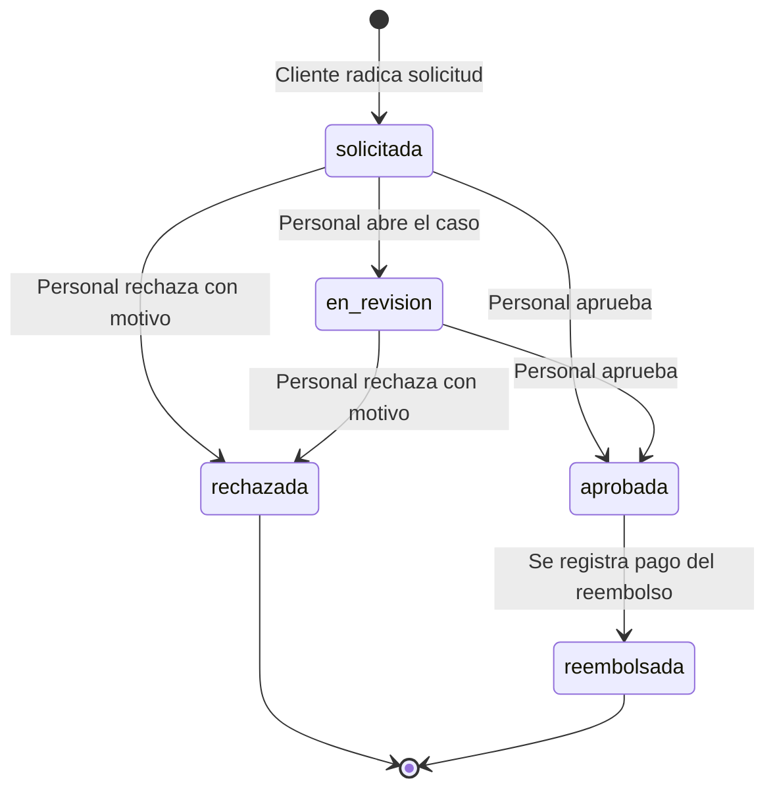

# M11. Postventa (Devoluciones, Reembolsos y Cancelaciones)

**Dominio:** Operación Comercial / Logística de Reversa / Atención Postventa  
**Prefijo de Historias:** POS  
**Fuente de los requisitos:** Directivas del negocio Pintu Clic, Estatuto del Consumidor en Colombia (Ley 1480 de 2011), especificaciones de M08 (Órdenes) y M13 (Inventario).

---

## 1. Propósito y Alcance

El módulo **M11 Postventa** gestiona el ciclo integral posterior a la confirmación y entrega de pedidos en Pintu Clic:
1. Las **cancelaciones de órdenes** que aún no han sido despachadas.
2. Las **devoluciones por derecho de retracto** de productos entregados.
3. Las **reclamaciones por garantía o avería** de productos entregados.
4. El **registro y seguimiento de los reembolsos** económicos asociados.
5. El **reintegro al inventario referencial (M13)** de productos devueltos aptos para reventa.

### Lo que NO hace M11:
- No ejecuta transferencias bancarias de dinero de forma automática y desatendida hacia cuentas de clientes (el sistema registra la obligación, el método, el valor, el responsable y el comprobante del desembolso, pero el movimiento de dinero es gestión directa del negocio con el cliente o conciliación bancaria).
- No anula facturas electrónicas de la DIAN directamente (eso corresponde a M12 Facturación mediante Notas Crédito cuando M12 se implemente).
- No gestiona el transporte físico de recogida del producto devuelto (la logística física se coordina en tienda o con el operador de transporte de la tienda).

---

## 2. Dependencias y Relaciones

- **Depende de:**
  - **M08 Órdenes de Venta:** M11 opera sobre órdenes confirmadas (`PC-AAAA-NNNNN`). Actualiza los estados terminales de la orden (`cancelado` y `devuelto`) mediante el servicio de órdenes.
  - **M04 Cuentas, Autenticación y Perfil:** Identifica al cliente titular que solicita la postventa y valida su sesión en servidor.
  - **M17 Administración, Empleados y Permisos:** Requiere `ventas.ver` para consultar solicitudes y `ventas.gestionar` para resolverlas, cambiarlas de estado y registrar reembolsos.
  - **M20 Seguridad y Auditoría:** Toda acción de resolución, aprobación, rechazo o reembolso queda registrada en bitácora inmutable con autor, IP, momento y motivo.
- **Habilita y se comunica con:**
  - **M13 Inventario:** Emite ajustes de inventario con motivo `devolucion` para productos estándar aptos.
  - **M18 Notificaciones:** Envía correos transaccionales al cliente cuando se radica su solicitud, cuando se aprueba/rechaza y cuando se confirma el pago del reembolso.
  - **M12 Facturación:** Cuando se implemente M12, las devoluciones aprobadas notificarán para la emisión de la Nota Crédito correspondiente.

---

## 3. Reglas de Negocio Clave (RN)

### RN-POS-01: Ventana y Condiciones de Cancelación de Pedidos
- El cliente puede solicitar la cancelación de su pedido mientras este se encuentre en los estados:
  - `orden_confirmada`
  - `revision_disponibilidad`
  - `en_preparacion`
- Una vez la orden pasa a `preparada` o `despachado`, **ya no se puede cancelar**: el cliente debe recibir el producto y solicitar una devolución por retracto una vez entregado.
- La cancelación cancela la **totalidad de la orden** y deja constancia del importe pagado a reembolsar.

### RN-POS-02: Ventana Legal de Retracto (Ley 1480 de 2011)
- Conforme al Estatuto del Consumidor de Colombia (Art. 47 Ley 1480 de 2011), el cliente dispone de **5 días hábiles** a partir de la fecha de entrega del pedido para solicitar la devolución por retracto comercial.
- Las solicitudes radicadas después de 5 días hábiles por concepto de retracto son rechazadas automáticamente por el sistema indicando vencimiento del plazo legal.

### RN-POS-03: Ventana de Garantía por Defectos de Calidad o Avería
- Para productos que presenten defectos de fabricación, inconsistencia de calidad o daños atribuibles al embalaje original, el plazo para radicar reclamación de garantía es de **30 días calendario** a partir de la entrega.
- Exige adjuntar descripción detallada de la falla y evidencia fotográfica o documental.

### RN-POS-04: Exclusión Estricta de Productos Entonados a Medida (RF-POS-04-04)
- Toda línea de orden donde `es_entonado = true` (preparación y dosificación computarizada de color de carta sobre bases tintométricas) **no admite devolución por retracto** (excepción expresa del Art. 47 numeral 3 de la Ley 1480: bienes confeccionados conforme a las especificaciones del consumidor o claramente personalizados).
- Solo se admitirán devoluciones de productos entonados si existe un fallo de calidad comprobado imputable a la empresa (garantía técnica), validado por el personal de back-office.

### RN-POS-05: Devolución Parcial o Total por Líneas
- Una solicitud de devolución puede ser **parcial** (una o varias unidades de líneas específicas) o **total** (todas las unidades de todas las líneas de la orden).
- Para cada línea seleccionada, el cliente especifica la cantidad que devuelve (menor o igual a la cantidad comprada) y el motivo puntual.
- Las líneas entonadas aparecen deshabilitadas para selección por retracto con la leyenda: *"Producto entonado a medida no admite devolución por retracto"*.

### RN-POS-06: Control Administrativo y Aprobación
- Ninguna devolución ni cancelación se aplica de forma automática e inmediata a la orden.
- El cliente **radica la solicitud** (estado `solicitada`).
- Un colaborador autorizado con permiso `ventas.gestionar` revisa la solicitud, la evidencia física y la viabilidad, decidiendo si es **aprobada** o **rechazada** con su respectivo motivo.

### RN-POS-07: Logística de Devolución y Fletes
- En devoluciones por retracto voluntario, el cliente asume el retorno físico del producto hacia la tienda o almacén principal.
- En devoluciones por avería de transporte, defecto de fábrica o despacho erróneo atribuible a Pintu Clic, la empresa asume el costo logístico de recolección.

### RN-POS-08: Gestión de Reembolsos (RF-POS-04-05)
- Tras la aprobación de la solicitud, el caso entra a fase de reembolso (`en_reembolso`).
- Los métodos soportados para la restitución del dinero son:
  1. `transferencia_bancaria`: Cuenta de ahorros o corriente a nombre del titular de la compra.
  2. `reverso_pasarela`: Reversión de la transacción a través de la pasarela Wompi (si aplica en los tiempos de la pasarela).
  3. `saldo_tienda`: Saldo a favor o cupón para compras en la tienda Pintu Clic.
  4. `efectivo`: Devolución en caja presencial en sede física.
- El personal debe registrar obligatoriamente: fecha del reembolso, método utilizado, referencia/número de transacción y comprobante opcional. Al registrarlo, la solicitud pasa a estado `reembolsada`.

### RN-POS-09: Reintegro de Inventario a M13
- Al aprobarse una devolución y recibirse los productos físicos conformes en bodega, el sistema o el personal registra el reintegro de stock hacia M13 con motivo `devolucion`.
- Si el producto devuelto está averiado o abierto, no se reintegra a existencias comerciales.

---

## 4. Tabla Resumen de Historias de Usuario

| ID | Historia de Usuario | Actores | Prioridad | Estado |
| :--- | :--- | :--- | :---: | :--- |
| **HU-POS-01** | Solicitud de cancelación de orden por el cliente | Cliente | Alta | Por implementar |
| **HU-POS-02** | Solicitud de devolución o garantía por el cliente | Cliente | Alta | Por implementar |
| **HU-POS-03** | Seguimiento de solicitudes de postventa por el cliente | Cliente | Media | Por implementar |
| **HU-POS-04** | Bandeja de gestión de solicitudes de postventa | Empleado (`ventas.ver`) | Alta | Por implementar |
| **HU-POS-05** | Resolución y cambio de estado de solicitudes | Empleado (`ventas.gestionar`) | Alta | Por implementar |
| **HU-POS-06** | Registro y liquidación de reembolsos | Empleado (`ventas.gestionar`) | Alta | Por implementar |
| **HU-POS-07** | Reintegro de inventario a existencias (M13) | Empleado / Sistema | Media | Por implementar |

---

## 5. Especificación Detallada por Historia de Usuario

### HU-POS-01: Solicitud de cancelación de orden por el cliente

> **Como** cliente titular de una orden de compra en curso  
> **Quiero** solicitar la cancelación de mi pedido antes de su despacho  
> **Para** corregir una compra errónea y obtener el reintegro de mi dinero  

#### Requisitos Funcionales
| ID | Tipo | Categoría | Requisito | Origen | Prioridad |
| :--- | :--- | :--- | :--- | :--- | :--- |
| **RF-POS-01-01** | RF | Validación | El sistema debe verificar que la orden pertenezca al cliente autenticado. | M20 | Alta |
| **RF-POS-01-02** | RF | Estado | El sistema debe permitir radicar cancelación únicamente si el estado de la orden es `orden_confirmada`, `revision_disponibilidad` o `en_preparacion`. | RN-POS-01 | Alta |
| **RF-POS-01-03** | RF | Datos | El cliente debe ingresar un motivo obligatorio (mínimo 10 caracteres, máximo 500). | Definido | Alta |
| **RF-POS-01-04** | RF | Unicidad | El sistema debe rechazar una nueva solicitud de cancelación si ya existe una solicitud en trámite para la misma orden. | Regla | Alta |

#### Criterios de Aceptación (Gherkin)
- **CA-POS-01-01: Radicación exitosa de cancelación**
  - **Dado que** tengo un pedido en estado `orden_confirmada` o `revision_disponibilidad`
  - **Cuando** selecciono "Solicitar cancelación" e ingreso un motivo válido
  - **Entonces** se crea una solicitud de postventa con código `DEV-AAAA-NNNNN`, estado `solicitada`, tipo `cancelacion`, y recibo confirmación en pantalla.
- **CA-POS-01-02: Rechazo por orden ya preparada o despachada**
  - **Dado que** mi pedido ya está en estado `preparada` o `despachado`
  - **Cuando** intento solicitar la cancelación
  - **Entonces** el sistema no lo permite y me informa que el pedido ya está en proceso de entrega y podré gestionar devolución tras recibirlo.

---

### HU-POS-02: Solicitud de devolución o garantía por el cliente

> **Como** cliente que ha recibido un pedido  
> **Quiero** solicitar la devolución parcial o total de los productos entregados  
> **Para** ejercer mi derecho de retracto legal o hacer valer la garantía por defectos  

#### Requisitos Funcionales
| ID | Tipo | Categoría | Requisito | Origen | Prioridad |
| :--- | :--- | :--- | :--- | :--- | :--- |
| **RF-POS-02-01** | RF | Estado | La orden debe encontrarse en estado `entregado` (o `despachado` si fue cierre por transporte). | M08 | Alta |
| **RF-POS-02-02** | RF | Plazo | Si el tipo es `retracto`, no deben haber transcurrido más de 5 días hábiles desde la entrega (RN-POS-02). Si es `garantia`, hasta 30 días calendario (RN-POS-03). | Legal | Alta |
| **RF-POS-02-03** | RF | Selección | El cliente puede seleccionar una o varias líneas elegibles y la cantidad a devolver por línea. | RN-POS-05 | Alta |
| **RF-POS-02-04** | RF | Restricción | Las líneas con `es_entonado = true` están bloqueadas para retracto (RF-POS-04-04). | RN-POS-04 | Alta |
| **RF-POS-02-05** | RF | Liquidación | El sistema calcula automáticamente el subtotal a reembolsar sumando `precioAplicado * cantidadDevuelta`. | Cálculo | Alta |

#### Criterios de Aceptación (Gherkin)
- **CA-POS-02-01: Devolución por retracto dentro de término legal**
  - **Dado que** recibí mi pedido hace 3 días hábiles y contiene 2 galones de pintura estándar
  - **Cuando** radico la devolución de 1 galón seleccionando tipo "retracto"
  - **Entonces** el sistema registra la solicitud con el valor proporcional de la línea seleccionada.
- **CA-POS-02-02: Intento de devolución de producto entonado a medida**
  - **Dado que** mi orden incluye una línea de pintura entonada en máquina
  - **Cuando** visualizo las líneas para devolver por retracto
  - **Entonces** dicha línea aparece inhabilitada y el sistema indica que los colores personalizados no tienen retracto.

---

### HU-POS-03: Seguimiento de solicitudes de postventa por el cliente

> **Como** cliente autenticado  
> **Quiero** consultar la lista y el detalle de mis solicitudes de postventa  
> **Para** conocer si han sido aprobadas, en qué fase van y los detalles del reembolso  

#### Requisitos Funcionales
| ID | Tipo | Categoría | Requisito | Origen | Prioridad |
| :--- | :--- | :--- | :--- | :--- | :--- |
| **RF-POS-03-01** | RF | Consulta | El cliente solo puede consultar solicitudes originadas en sus propias compras. | M20 | Alta |
| **RF-POS-03-02** | RF | Detalle | La consulta muestra: código de solicitud, orden asociada, tipo, fecha, estado actual, líneas afectadas, motivo del cliente y respuesta del equipo. | UI | Media |

---

### HU-POS-04: Bandeja de gestión de solicitudes de postventa (Back-office)

> **Como** empleado del área de operaciones y ventas  
> **Quiero** consultar una bandeja centralizada de solicitudes de postventa  
> **Para** priorizar y atender las solicitudes de cancelación y devolución  

#### Requisitos Funcionales
| ID | Tipo | Categoría | Requisito | Origen | Prioridad |
| :--- | :--- | :--- | :--- | :--- | :--- |
| **RF-POS-04-01** | RF | Permisos | Exige permiso `ventas.ver` para acceder a la bandeja y detalle. | M17 | Alta |
| **RF-POS-04-02** | RF | Filtros | Permite filtrar por estado (`solicitada`, `en_revision`, `aprobada`, `rechazada`, `reembolsada`), tipo (`cancelacion`, `devolucion`, `garantia`) y código de orden. | UI | Media |

---

### HU-POS-05: Resolución y cambio de estado de solicitudes

> **Como** colaborador autorizado  
> **Quiero** aprobar o rechazar una solicitud de cancelación o devolución  
> **Para** formalizar la decisión técnica/comercial y desencadenar las transiciones de la orden  

#### Requisitos Funcionales
| ID | Tipo | Categoría | Requisito | Origen | Prioridad |
| :--- | :--- | :--- | :--- | :--- | :--- |
| **RF-POS-05-01** | RF | Permisos | Exige permiso `ventas.gestionar`. | M17 | Alta |
| **RF-POS-05-02** | RF | Rechazo | Si se rechaza, es obligatorio registrar el motivo técnico/legal del rechazo (mínimo 10 caracteres). | Auditoría | Alta |
| **RF-POS-05-03** | RF | Transición Cancelación | Al aprobarse una solicitud de tipo `cancelacion`, la orden en M08 pasa automáticamente a estado `cancelado` (con autor y motivo). | M08 | Alta |
| **RF-POS-05-04** | RF | Transición Devolución Total | Al aprobarse una devolución total de todos los ítems de la orden, la orden en M08 pasa a estado `devuelto`. | M08 | Alta |
| **RF-POS-05-05** | RF | Siguiente paso | La solicitud pasa a estado `aprobada` y habilita la fase de liquidación del reembolso. | Flujo | Alta |

---

### HU-POS-06: Registro y liquidación de reembolsos

> **Como** empleado responsable de administración o tesorería  
> **Quiero** registrar los datos y el soporte del reembolso efectuado al cliente  
> **Para** cerrar formalmente la obligación financiera y mantener trazabilidad contable  

#### Requisitos Funcionales
| ID | Tipo | Categoría | Requisito | Origen | Prioridad |
| :--- | :--- | :--- | :--- | :--- | :--- |
| **RF-POS-06-01** | RF | Permisos | Exige permiso `ventas.gestionar`. | M17 | Alta |
| **RF-POS-06-02** | RF | Validación | Solo solicitudes en estado `aprobada` pueden pasar a `reembolsada`. | Estado | Alta |
| **RF-POS-06-03** | RF | Datos Obligatorios | Exige: método de reembolso (`transferencia_bancaria`, `reverso_pasarela`, `saldo_tienda`, `efectivo`), monto confirmado, fecha y número/referencia de transacción bancaria. | Trazabilidad | Alta |
| **RF-POS-06-04** | RF | Cierre | Al registrar el reembolso, la solicitud queda en estado final `reembolsada` y no admite modificaciones posteriores. | Inmutabilidad | Alta |

---

### HU-POS-07: Reintegro de inventario a existencias (M13)

> **Como** personal de almacén  
> **Quiero** confirmar el ingreso físico conforme de los productos devueltos  
> **Para** que el inventario referencial de M13 sume las existencias disponibles  

#### Requisitos Funcionales
| ID | Tipo | Categoría | Requisito | Origen | Prioridad |
| :--- | :--- | :--- | :--- | :--- | :--- |
| **RF-POS-07-01** | RF | Verificación | Solo líneas no entonadas (`es_entonado = false`) con producto intacto pueden reintegrarse a inventario. | M13 | Alta |
| **RF-POS-07-02** | RF | Registro | Se crea un `AjusteInventario` con motivo `devolucion`, origen `manual`, referencia `DEV-AAAA-NNNNN` y la cantidad devuelta. | M13 | Alta |

---

## 6. Ciclo de Vida y Máquina de Estados de Postventa

### Estados de la Solicitud (`enum_estado_postventa`):

### Efecto sobre el Estado de la Orden (M08):
- **Cancelación aprobada:** La orden pasa a `cancelado`.
- **Devolución total aprobada:** La orden pasa a `devuelto`.
- **Devolución parcial aprobada:** La orden conserva su estado `entregado`, pero queda vinculada a la solicitud aprobada y liquidada.

---

## 7. Identificador y Modelo de Datos

- **Identificador de Solicitud:** `DEV-AAAA-NNNNN`
  - Consecutivo independiente, corrido, sin huecos (usando tabla `consecutivo` con nombre `'postventa'`).
- **Tablas Principales:**
  - `solicitud_postventa`: Cabecera del trámite, orden vinculada, cliente, tipo, estado, montos y datos del reembolso.
  - `linea_solicitud_postventa`: Desglose de variantes, cantidades devueltas y precio liquidado.
  - `historial_estado_postventa`: Registro inmutable de transiciones con autor, motivo y timestamp.
